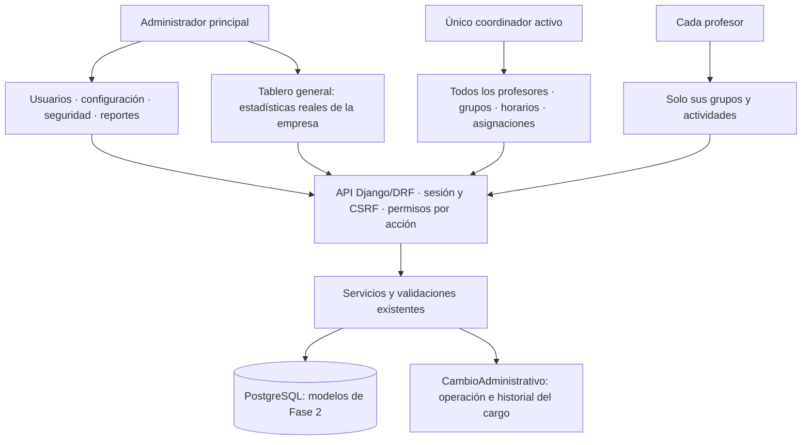
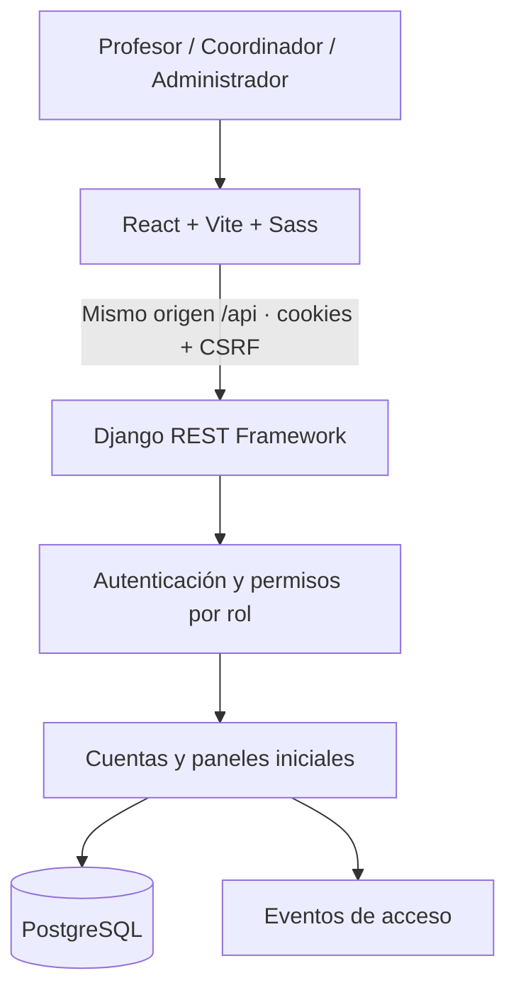
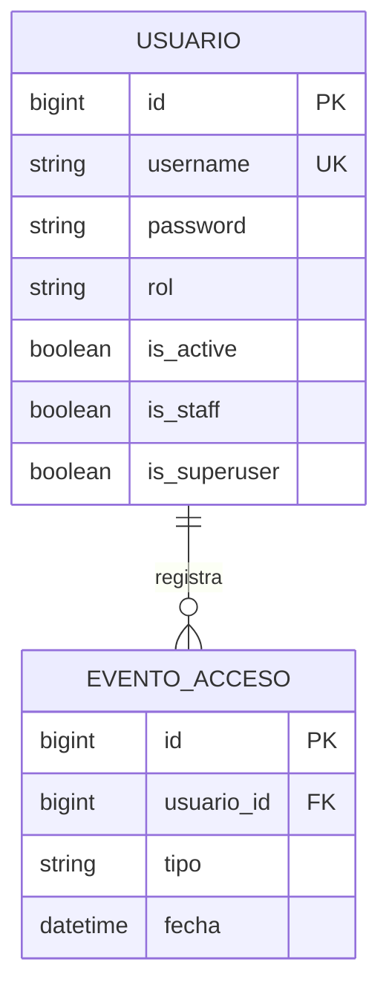

> Estado vigente, 28 de octubre de 2026: cuentas.0004_usuario_un_coordinador_activo fue autorizada y aplicada exclusivamente en zona_bloque, con respaldo integral verificado. Índice válido, sin migraciones pendientes, 21 comprobaciones PostgreSQL y dos rechazos concurrentes aprobados; datos existentes intactos. [Informe de aplicación](APLICACION_COORDINADOR_UNICO.md). Las referencias a migración pendiente o integración aún no ejecutada del documento siguiente describen el estado anterior a esta aplicación.

> Actualización del 28 de octubre de 2026: las cuatro migraciones de Fase 2 ya están aprobadas y aplicadas en zona_bloque, con respaldo previo y 88 comprobaciones de integración. [Informe de aplicación](APLICACION_MIGRACIONES_FASE_2.md). Las menciones posteriores a aprobación pendiente corresponden al estado histórico.

# Arquitectura — estado actual y evolución de coordinación

> En esta copia de integración, Etapa 2 añade Persona/EnlaceIdentidad, PertenenciaRol/EventoRol y autorización por pertenencias vigentes; conserva Usuario y todas las entidades operativas. [Implementación y migraciones aisladas](IMPLEMENTACION_ETAPA_2_NUCLEO.md). Las descripciones anteriores de rol exclusivo siguen documentando la versión de origen, que no fue sobrescrita.

> Estado vigente de noviembre: conservar este documento como historia de decisiones. La arquitectura actual y diferencias están en [Fase 0](AUDITORIA_INTEGRAL_FASE_0_2026_11_02.md); las propuestas transversales en [contratos futuros](CONTRATOS_COMPARTIDOS_FUTUROS.md). No son modelos ni endpoints implementados. Las referencias a pendientes se reconcilian en [estado vigente](RECONCILIACION_VIGENTE_2026_11.md).

## Decisión definitiva y arquitectura objetivo simplificada

Zona de Bloque es una empresa pequeña: administrador principal, un único coordinador activo y varios profesores. El coordinador gestiona la operación y supervisión pedagógica de toda la plantilla; administración conserva usuarios, configuración, seguridad y reportes; el profesor mantiene solo sus grupos y actividades propias.

La [matriz de permisos](MATRIZ_PERMISOS.md), la [propuesta simplificada](AMPLIACION_COORDINACION.md) y el [plan de tableros](PLAN_TABLEROS.md) sustituyen el diseño anterior de supervisiones individuales y coordinadores simultáneos.

Estado ejecutable: ampliación autorizada implementada, con permisos operativos específicos y tableros reales. La validación transaccional de coordinador único está en código; su índice PostgreSQL permanece pendiente. [Verificación actual](VERIFICACION_COORDINACION_TABLERO.md).

Reutilización propuesta:
- Usuario.rol e is_active identifican al titular coordinador; no hay tabla de supervisión por profesor.
- Grupo, Horario, Periodo y Asignacion sostienen la operación y los conteos reales.
- CambioAdministrativo conserva inicio/fin del cargo mediante acciones explícitas, con actor, usuario afectado y fecha.
- Formularios y páginas existentes se reutilizan en coordinación, con permisos específicos en servidor.
- Las asignaciones antiguas de tipo coordinador se conservan como historial, sin usarlas para limitar el nuevo alcance institucional.
- La unicidad condicional está en la migración cuentas.0004_usuario_un_coordinador_activo, generada y pendiente de aprobación para PostgreSQL. No crea tablas o columnas ni altera datos existentes.
- El relevo es transaccional, no elimina cuentas ni cambia la autoría de evidencias anteriores.
- Los resúmenes iniciales usan agregaciones ORM sobre profesores, grupos, coordinador, periodos y asignaciones; no requieren tablas de indicadores.

No se amplía indiscriminadamente el permiso compartido de escritura: cuentas y catálogos siguen administrativos. Los servicios operativos revalidarán al coordinador activo, sin habilitar cambios de privilegios.

Las sesiones, asistencias, cumplimiento y valoraciones se incorporarán después, junto con sus reglas e indicadores. No se simulan cifras ni se añade infraestructura de jerarquías.

Se mantiene el monolito Django/DRF, PostgreSQL y React/Vite/Sass. Se añadieron los módulos organizacion y auditoria y la recuperación segura en cuentas. El modelo relacional actualizado, endpoints, límites de permisos y transacciones están en [FASE_2.md](FASE_2.md). Las cuatro migraciones de Fase 2 ya están aplicadas y verificadas en zona_bloque. La ampliación de coordinación está implementada; el plan de índice pendiente se documenta en [MIGRACION_COORDINADOR_UNICO.md](MIGRACION_COORDINADOR_UNICO.md).

El diseño de Fase 1 que sigue se conserva como referencia histórica. La gestión de usuarios ahora se realiza en React/API y la consola Django es de consulta; los módulos organizativos ya están implementados y sustituyen los apartados antes indicados como futuros. El login y las sesiones se mantienen.

# Arquitectura — Fase 1

## Decisión

Monolito modular Django/DRF y frontend React separado. PostgreSQL es la única base de aplicación. La arquitectura general de Fase 0 fue aprobada por el propietario; solo se implementa Fase 1.

## Módulos actuales

- configuracion: settings por entorno, PostgreSQL, urls, WSGI/ASGI.
- cuentas: Usuario, roles, sesiones, administración y EventoAcceso.
- paneles: endpoints sin datos operativos, limitados al rol correspondiente.
- comun: formato de errores y Cache-Control no-store.
- frontend: autenticación, API, rutas privadas, componentes y estilos separados.

No hay todavía grupos, estudiantes, asistencia, instrumentos, uploads, informes ni notificaciones. Se incorporarán por módulos en fases posteriores.

## Autenticación

1. GET /api/autenticacion/csrf/ emite cookie CSRF HttpOnly y devuelve un token en JSON.
2. POST /api/autenticacion/ingresar/ exige cabecera X-CSRFToken y origen permitido, incluso sin sesión previa.
3. Django valida usuario, contraseña y estado activo. Devuelve un mensaje común si las credenciales no son válidas.
4. La sesión se almacena en la base; el navegador recibe solo su identificador HttpOnly.
5. Se rota el identificador y el token CSRF al ingresar. El cliente mantiene el token CSRF en memoria.
6. GET /api/autenticacion/sesion/ restaura la identidad al recargar.
7. POST /api/autenticacion/salir/ requiere sesión y CSRF e invalida la sesión en servidor.

Django valida CSRF mediante el decorador explícito del login y SessionAuthentication de DRF para solicitudes autenticadas. Referencias: [Django CSRF](https://docs.djangoproject.com/en/5.2/howto/csrf/) y [DRF SessionAuthentication](https://www.django-rest-framework.org/api-guide/authentication/#sessionauthentication).

## Permisos

Denegación por defecto: IsAuthenticated y autenticación por sesión como configuración global. Cada panel añade TieneRolDelPanel. No se aceptan roles desde cabeceras o parámetros.

Los paneles son específicos de rol: el administrador no obtiene automáticamente un panel de profesor. Los futuros permisos de negocio se definirán por rol, objeto y asignación vigente.

El admin Django exige cuenta activa, is_staff y rol administrador. Sus permisos de modelos siguen las convenciones Django; createsuperuser configura la cuenta inicial. La eliminación de usuarios y la modificación de eventos de acceso están deshabilitadas en esa interfaz.

## Persistencia

Usuario hereda AbstractUser. La restricción usuario_rol_valido solo admite los tres roles. EventoAcceso admite usuario nulo para intentos fallidos y conserva fecha y tipo; no guarda credenciales, IP ni nombres introducidos.

Las migraciones iniciales se incluyen en el proyecto, pero no pudieron verificarse mediante Django por falta de dependencias. Deben pasar makemigrations --check antes de considerarlas validadas.

## Configuración y límites

- Variables en .env de raíz, sin sobrescribir variables del proceso.
- SECRET_KEY obligatoria de al menos 50 caracteres.
- Cookies HttpOnly, SameSite Lax, duración máxima de ocho horas y cierre de navegador.
- Secure configurable para HTTP local; HTTPS y revisión de seguridad requeridos antes de despliegue.
- Sin CORS abierto ni autenticación básica/token por defecto.
- Respuestas API privadas con no-store; sin logs de contraseñas.
- Límite de diez solicitudes de login por minuto por IP, en caché local. Es una protección básica para localhost, no un límite distribuido ni defensa completa frente a ataques.
- Vite conserva Host/Origin en el proxy y autoriza solo los orígenes configurados.
- CSS/Sass con foco visible, etiquetas, menú accesible y estados textuales.
- El bloque ZB reserva espacio de marca y no representa el logo oficial.

## Trabajo posterior

Permisos por grupo, auditoría de negocio, almacenamiento privado, reportes, tareas, respaldo/restauración y endurecimiento se desarrollarán cuando corresponda. La existencia de PostgreSQL activo no acredita conexión de la aplicación ni migraciones aplicadas.
