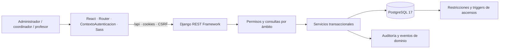
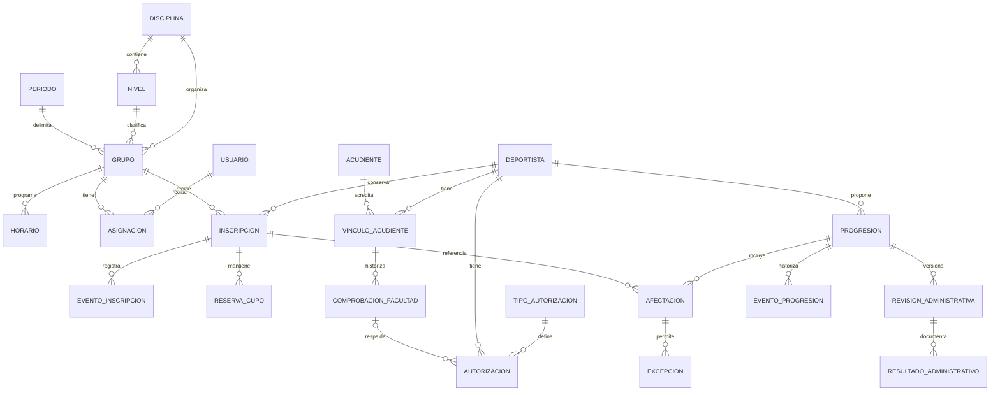

# Auditoría integral de Zona de Bloque — Fase 0

Fecha: 2 de noviembre de 2026, America/Bogota. Documento de continuidad y propuesta técnica; no autoriza implementación, migraciones operativas ni aprobación metodológica.

## 1. Alcance, evidencia y límites

Se inspeccionó el árbol de backend, frontend, scripts y documentación: 135 archivos Python del backend, 51 fuentes de frontend/src, 17 scripts y 56 documentos Markdown existentes. Se inventariaron modelos, migraciones, servicios, serializers, vistas, permisos, rutas, pruebas, configuración, estilos y referencias. Los entornos, node_modules, cachés, compilados y respaldos se trataron como dependencias o evidencia privada, sin copiar datos personales al informe. No se encontraron AGENTS.md dentro del proyecto.

Se consultó la base operativa exclusivamente dentro de una transacción `REPEATABLE READ, READ ONLY`, sin login, escrituras, fixtures ni migraciones. La comprobación del grafo de migraciones no equivale a una comparación exhaustiva de todos los triggers y columnas de la instalación real. Las pruebas de integración se ejecutan sobre un clúster temporal independiente.

No se modificaron fuentes de aplicación, dependencias, Excel ni migraciones históricas. La ejecución de pruebas/build genera artefactos locales de comprobación; este informe es documentación nueva de la auditoría. No se inicializó Git, no se hicieron commits, push ni despliegues.

Fuentes principales: código local; README; DECISIONES; ARQUITECTURA; MATRIZ_PERMISOS; IMPLEMENTACION_FASE_3; documentación de identificación y facultades; incrementos B1/B2/B3 de ascensos; VERIFICACION_FUNCIONAL_ASCENSOS_B3_D; IMPORTACION_EXCEL; prompt histórico; paquete maestro deportivo F03/F04/F05 y sus inventarios. El prompt integral recibido en esta sesión es la especificación objetivo de noviembre. La evidencia histórica no se presenta como prueba ejecutada hoy.

## 2. Arquitectura y versiones reales

| Componente | Comprobado localmente | Observación |
|---|---|---|
| Python usado en auditoría | 3.12.14 | Runtime disponible; lanzador .venv-local apunta a Python313 inaccesible |
| Django / DRF | 5.2.18 / 3.18.3 | Paquetes existentes de .venv-local; sin reinstalación |
| PostgreSQL / psycopg | 17.11 / 3.2.13 | Servidor operativo consultado en lectura; libpq local |
| python-dotenv | 1.2.4 | Configuración por entorno |
| Node | 24.20.0 | Supera requisito declarado >=22.12 |
| React / React Router | 19.3.1 / 7.18.5 | Versiones instaladas; package.json declara rangos |
| Vite / Vitest / Sass | 7.3.7 / 5.0.5 / 1.106.1 | package-lock.json presente |

Monolito modular Django/DRF con PostgreSQL. Apps propias: cuentas, organizacion, deportistas, inscripciones, auditoria y paneles. configuracion centraliza entorno/rutas; comun maneja errores y no-store. Flujo habitual: vista y serializer → servicio transaccional → modelo/restricciones PostgreSQL → auditoría. Hay SQL y triggers propios de PostgreSQL en ascensos; SQLite ya no reproduce la instalación completa.

React es JavaScript/JSX, con BrowserRouter, ContextoAutenticacion, páginas por rol, componentes de gestión reutilizables y Sass. No hay TypeScript ni gestor de estado externo que justifique una sustitución. El cliente usa fetch, cookies del mismo origen y CSRF; Vite reenvía /api a Django. No hay JWT ni CORS abierto. `Aplicacion.jsx` y `Estructura.jsx` dependen de un único `usuario.rol`.



### Git, entorno y migraciones

- La raíz no es un repositorio Git. `git status --short` falla con “not a git repository”. No se puede determinar diff contra HEAD, modificaciones pendientes o relación actual con el remoto. REPOSITORIO_REMOTO.md describe una inspección histórica de otro árbol; no se ha verificado de nuevo el remoto.
- .gitignore excluye .env, referencias privadas, medios, respaldos, entornos y compilados. Esta exclusión no sustituye permisos de sistema ni cifrado de respaldos.
- Base real: 38 tablas; 14 migraciones propias aplicadas; ninguna pendiente en el grafo local. cuentas 0001–0004, organizacion 0001–0002, deportistas 0001–0003, inscripciones 0001–0004 y auditoria 0001.
- Se preservan todas las migraciones. No se ejecutó `migrate` en la base operativa.

## 3. Inventario y mapa de entidades existentes

Hay 29 modelos concretos propios registrados; Registro, Validado y EvidenciaInmutable son bases reutilizables, no catálogos adicionales.

| Dominio | Modelos y relaciones | Funcionamiento existente |
|---|---|---|
| Identidad | Usuario(AbstractUser), EventoAcceso → Usuario, SolicitudRestablecimiento → usuario/solicitante | Tres roles exclusivos, cuentas activas, acceso por sesión, relevo de coordinador único, recuperación por token hash de un uso y 30 minutos |
| Organización | Disciplina → Nivel; Grupo → Disciplina/Nivel/Periodo; Horario → Grupo; Asignacion → Grupo/Usuario con fechas/tipo | Catálogos, grupos, cupos, horarios, cruces docentes, asignaciones e historial; calendario organizativo |
| Deportistas | Deportista; TipoDocumento; CambioDocumentoDeportista → Deportista/actor | UUID público, código interno, documento normalizado único cuando existe, registro pendiente admitido, máscara docente e historial documental |
| Acudientes | Acudiente; VinculoAcudiente → Deportista/Acudiente; ComprobacionFacultad → vínculo/tipo/responsable | Contactos, vínculo temporal, comprobación por alcance y versión, evidencia referenciada mediante UUID; revocación e historial |
| Autorizaciones | TipoAutorizacion versionado; Autorizacion → Deportista/tipo/vínculo/comprobación; PoliticaDatos | Finalidad, vigencias, decisiones y revocación; política configurable, sin automatizar fundamento ni consentimiento |
| Matrícula | Inscripcion → Deportista/Grupo y anterior(1:1); EventoInscripcion → inscripción/actor; ReservaCupo → inscripción; Propuesta → persona/origen/destino/resultado | Inscripciones múltiples, suspensión/reanudación/retiro, reservas, cupos por intervalo, traslados y propuestas; persona preservada |
| Progresión | ProgresionInstitucional → Deportista/Disciplina/niveles/Periodo/inscripción; AfectacionInscripcion → progresión/inscripción; ExcepcionPedagogica → afectación; EventoProgresion → progresión/actor | Propuesta docente, revisión coordinadora, disposiciones por inscripción, excepciones con vigencia y evidencia histórica |
| Formalización | RevisionAdministrativa → progresión/actor; ResultadoAdministrativo → revisión/afectación/origen/destino | Versiones inmutables, ejecución individual, UUID idempotente, integridad por triggers y evidencia de origen/destino |
| Auditoría | CambioAdministrativo → actor, entidad/id/acción/campos/fecha | Registra cambios sin copiar valores personales; no constituye aún un registro completo de lecturas sensibles |



El diagrama resume las relaciones principales; las claves de autor, nivel y período adicionales están en la tabla. No hay entidad Persona compartida ni relaciones de cuenta hacia Deportista/Acudiente. Una misma persona puede estar registrada por separado en esos dominios: la unicidad documental de deportistas no resuelve identidad global. No se debe fusionar por nombre/correo ni crear cuentas automáticamente.

La muestra operativa es pequeña: tres cuentas, una disciplina, cinco niveles, un grupo, un deportista y una inscripción. No permite inferir rendimiento a escala institucional. No hay comprobaciones de facultad, tipos de autorización, autorizaciones ni políticas registradas en la consulta actual; la existencia de formularios no acredita configuración institucional aprobada. No se publican identificaciones ni nombres personales en esta auditoría.

## 4. API, permisos y pantallas reutilizables

| API actual | Pantalla/cliente | Permiso y reutilización |
|---|---|---|
| /api/autenticacion/{csrf,ingresar,sesion,salir}/ | Ingreso, ContextoAutenticacion, cliente.js | Sesión Django, CSRF explícito también para login, cuenta activa, throttling de ingreso |
| /api/usuarios/; /api/recuperacion/confirmar/ | Usuarios, RestablecerAcceso | Administración; reautenticación al emitir enlace; contraseña validada |
| /api/organizacion/{disciplinas,niveles,periodos,grupos,asignaciones,profesores,calendario,coordinacion}/ | Catalogos, Grupos, Asignaciones, Profesores, Calendario, Coordinacion | Administración configura; coordinador único gestiona operación; profesor consulta sus asignaciones vigentes |
| /api/{deportistas,tipos-documento}/; acciones trayectoria/documento | Deportistas, ficha, DocumentoDeportista, BusquedaDocumento | Consulta docente filtrada y enmascarada; escritura institucional; control de versión |
| /api/{acudientes,vinculos-acudientes,tipos-autorizacion,autorizaciones,politicas-datos}/ | AcudientesAutorizaciones, ComprobacionFacultad | Gestores; configuración de tipos/políticas administrativa; vínculo no habilita portal |
| /api/inscripciones/; cupos, historial y acciones de estado | Inscripciones, selectores de cupos | Servicios revalidan rol, ámbito, fechas, capacidad y cruces bajo bloqueos |
| /api/propuestas/; destinos/aprobar/rechazar/cancelar | Propuestas, FormularioPropuesta | Docente propone desde referencia propia; resolución institucional según acción |
| /api/ascensos/; contexto/niveles/afectaciones/disponer/aprobar/rechazar/ejecucion/revisiones/resultados/ejecutar | ListadoAscensos, FormularioAscenso, RevisionAscenso, EjecucionAscenso integrados en Propuestas | Docente propone; coordinador decide; hoy coordinador y administrador ejecutan: diferencia con nuevo maestro |
| /api/paneles/ | Panel, ResumenInstitucional | Paneles por rol y resúmenes organizativos reales; no analítica deportiva aún |

Reutilizar además Estricto/EntradaEstricta, errores por campo, Conflicto por versión, Registro, `grupos_permitidos`, `inscripciones_visibles`, `deportistas_visibles`, `usuario_actual`, servicios de ocupación/cupos, historial de matrícula, auditoria.registrar, formularios/listados/estados y tokens Sass. Los permisos dependen de rol único en múltiples capas: no basta añadir tres opciones al selector.

## 5. Matriz de requisitos y trazabilidad inicial

Estados: **EV** = Existente y verificado dentro de las pruebas y límites de esta auditoría; **P** = Parcial; **NI** = No implementado; **VM** = Pendiente de validación metodológica; **BD** = Bloqueado por dependencia; **FE** = Fuera del alcance de esta etapa. Un estado técnico no expresa aprobación científica. Los nombres entre paréntesis son entidades candidatas, no modelos existentes. “Propuesta” en evento o prueba indica trabajo futuro.

| ID / requisito | Entidad | API | Pantalla | Permiso | Evento | Prueba / aceptación | Estado y brecha |
|---|---|---|---|---|---|---|---|
| M01 identidad/roles | Usuario/Asignacion | autenticacion, usuarios | tres espacios | rol+asignación | EventoAcceso/CambioAdministrativo | test_acceso, test_usuarios, test_operacion_coordinador | P: tres roles operativos; faltan roles múltiples y tres roles nuevos |
| M02 persona/matrícula | Deportista/Acudiente/Inscripcion | deportistas, vínculos, inscripciones | fichas y matrículas | ámbito vigente | documental/matrícula/facultad | suites deportistas e inscripciones | P: reutilizable; falta identidad transversal y enlace de cuentas |
| M03 currículo | Nivel; (MallaVersion/Competencia) | no existe curricular | no existe | propuesta: edición/revisión/publicación | propuesta: aprobación de versión | propuesta: importación idempotente, celdas fuente y fases | NI/VM: cuatro hojas originales, sin importador |
| M04 biblioteca/materiales | (EjercicioVersion/MaterialVersion) | no existe | no existe | propuesta: autor/revisor/lector | propuesta: revisión/publicación | propuesta: búsqueda, versiones y descarga autorizada | NI/VM: 224 candidatos, ninguno se habilita por defecto |
| M05 sesión/asistencia | Grupo/Horario; (Sesion/Asistencia) | calendario actual no registra sesión | calendario organizativo | propuesta: docente propio y corrección autorizada | propuesta: confirmar/corregir/cerrar | propuesta: dos sesiones, concurrencia, estados y cierre | NI: no hay sesión ni asistencia |
| M06 evaluación | (ProtocoloVersion/Aplicacion/Resultado) | no existe | no existe | propuesta: aplicador/revisor/publicación | propuesta: aplicar/revisar/publicar | propuesta: ausente≠cero, ordinal, piloto | NI/VM: códigos candidatos no son protocolos aprobados |
| M07 progresión | Progresion/Afectacion/Revision/Resultado | ascensos | Propuestas/ascensos | docente→coordinador; ejecución hoy compartida | EventoProgresion | test_integracion_b3_d y suites B1/B2/B3 | P: flujo técnico amplio; faltan evidencias evaluativas y formalización exclusiva administrativa |
| M08 route setting | (Muro/MapaVersion/Presa/Montaje/Bloque/RIC) | no existe | no existe | propuesta: autor/revisor; admin publica | propuesta: publicar/desmontar | propuesta: presa única, funciones por bloque, voto por persona | NI/VM: RIC aún candidato |
| M09 banco evaluativo | (Estacion→MontajeVersion) | no existe | no existe | propuesta: uso oficial vigente | propuesta: equivalencia aprobada | propuesta: bloquear montaje retirado futuro; conservar pasado | BD: M06+M08; un solo catálogo |
| M10 planificación | (Temporada/Ciclos/PlanVersion)→Sesion | no existe | no existe | propuesta: entrenador propio sin aprobación ordinaria | propuesta: ajustar/confirmar versión | propuesta: tradicional/ondulantes/ATR/flexible, dos sesiones, restricciones | NI/VM: modelos y plantillas por documentar |
| M11 carga | (Exposicion/Ejecucion/RPEProtocolo) | no existe | no existe | propuesta: entrenador y autorreporte habilitado | propuesta: registrar/revisar | propuesta: 75×6=450 UA; ausencia, unidades, no duplicación | NI/VM: escala/población/momento pendientes |
| M12 RSD | (Incidencia/AutorizacionFuncional/Adaptacion) | no existe | no existe | propuesta: información clínica segregada | propuesta: restringir/revocar/adaptar | propuesta: incompatibilidad bloqueada incluso al ejecutar | NI: ExcepcionPedagogica no es autorización sanitaria |
| M13 competición | (Evento/ReglamentoVersion/ResultadoCompetitivo) | no existe | no existe | propuesta: gestión/registro/publicación | propuesta: confirmar resultado | propuesta: 25/10, penalización previa, zona no sumada al top | NI: regla depende de evento; no se validó reglamento externo hoy |
| M14 portales | vínculo existente; (AccesoPortal) | no existe portal | no existe | propuesta: persona/vínculo/finalidad vigente | propuesta: revocar/publicar | propuesta: IDOR, revocación inmediata y resultado publicado | BD: M01/M02 y política de publicación |
| M15 analítica | resúmenes actuales; (IndicadorVersion) | paneles parcial | ResumenInstitucional | agregados por ámbito | propuesta: exportación auditada | test_resumen; propuesta: faltantes/unidades/ordinales | P: conteos organizativos; faltan informes deportivos PDF/Excel |
| M16 captura | (ArchivoPrivado/Intento/AnotacionVersion) | no existe multipart/captura | no existe | propuesta: finalidad y acceso por objeto | propuesta: subir/anotar/revisar | propuesta: teléfono único, integridad, acceso, timeline | NI: custodia por UUID actual no es repositorio de archivos |
| M17 IA | notebooks externos únicamente | no existe integración | no existe | sin uso operativo | sin inferencias | no entrenar/descargar/integrar en estas etapas | FE: preparación de contratos; IA automática pausada |
| M18 comunicación | auditoría/eventos actuales; (Notificacion/Outbox) | no existe buzón | no existe | propuesta: destinatarios autorizados | propuesta: evento→entrega/reintento | propuesta: idempotencia y fallo sin revertir registro válido | P en eventos de negocio; NI en notificaciones y automatización |
| M19 UX | Aplicacion/Estructura/componentes | cliente compartido | tres espacios adaptables | RutaPrivada + backend | acciones actuales | 150 pruebas frontend; revisión visual pendiente | P: conservar identidad; faltan espacios y flujos deportivos |
| M20 seguridad | permisos/auditoría/autorizaciones | aplicada al núcleo | gestión actual | objeto+acción en núcleo | cambios sí; lecturas sensibles incompletas | suite actual + propuesta: medios/portales/RSD | P: faltan medios privados operativos y endurecimiento de despliegue |
| M21 aceptación | suites existentes | contratos actuales | tests React/API | aislamiento y concurrencia | evidencia de pruebas | ver apartado 10 | P: no acredita módulos futuros ni visual móvil real |
| M22 etapas | esta propuesta | por etapa | por etapa | contrato antes de implementación | registro de decisión | puertas de aceptación por etapa | P: plan propuesto, no ejecutado |
| M23 continuidad | documentación histórica + este informe | documentación por contrato | instrucciones reproducibles | no expone datos privados | bitácora por entrega | matriz actualizable y evidencia fechada | P: trazabilidad inicial; desglosar criterios por incremento |

La matriz es cobertura por módulo. Cada implementación debe añadir filas por requisito atómico con endpoint, permiso y prueba concretos; no se marcará un módulo completo por disponer de una tabla o formulario.

## 6. Reconciliación documental y metodológica

| Diferencia | Evidencia actual | Resolución compatible propuesta |
|---|---|---|
| Tres roles y sin portales en prompt antiguo | Usuario.rol, rutas y restricciones admiten profesor/coordinador/admin | Nuevo maestro amplía alcance. Migración aditiva de pertenencias múltiples y enlaces de identidad, con compatibilidad temporal; no recrear Usuario |
| Varios coordinadores por competencia vs decisión posterior | Coordinador único activo institucional, índice aplicado | Conservar coordinador único. Los ámbitos futuros no implican varios cargos; revisar solo si se aprueba expresamente otra organización |
| Formalización administrativa exclusiva | AccesoAscensos y servicios permiten ejecutar al coordinador y administrador | Separar revisión pedagógica de ejecución; restringir nuevas formalizaciones a admin en todas las capas, incluidos triggers donde apliquen; preservar autores históricos |
| Documentos dicen migraciones pendientes | Lectura actual: ninguna pendiente, inscripciones.0004 aplicada | Añadir estado vigente y referencias sin borrar historia; no repetir ni falsear migraciones |
| README cita 271 backend/88 frontend | Suite descubre 505 backend y aprueba 150 frontend | Actualizar cifras solo con resultados actuales; no confundir número descubierto con aprobado |
| Python local recomendado no inicia | Lanzador apunta a Python313 inaccesible | Documentar runtime funcional ya utilizado; no reinstalar dependencias ni alterar el Python del sistema |
| Pruebas SQLite recomendadas | Preparación falla con SQL `SET` de migraciones PostgreSQL | Declarar PostgreSQL aislado como verificación integral; no modificar migraciones históricas para SQLite |
| Dos sesiones diarias y duraciones por programa | No existe Sesion ni control diario; Horario solo valida horas y cruces | Implementar regla transaccional diaria por profesor en Sesion; conservar horarios. Babys 40–45, Lúdico ~60 y resto según programa, sin imponer 120 universal |
| F03 exige motivo curricular y F05 motivo de cambio | No hay implementación docente | Versionado automático y motivo breve solo donde sea pertinente; sin aprobación previa ordinaria ni justificación extensa obligatoria |
| F05 permite minutos activos o de sesión para carga | Ejemplo histórico usa activos | sRPE del maestro = duración de sesión × RPE; tiempo activo se guarda separado. Cualquier indicador distinto requiere otra definición/protocolo, no mismo nombre |
| Manual “piloto de 16” | Manual técnico contiene 12 fichas ZB-J; revisión y CSV contienen 16 títulos | Son artefactos distintos; no inferir correspondencia ni publicación. Cotejar páginas originales y seguridad presencial |
| Archivo de ampliación dice “25 entradas” | CSV contiene 31 registros; 193+31=224 | Conservar nombre original y documentar recuento real; no tratar filas como ejercicios validados únicos |
| Taxonomías F04 amplias y nuevos estilos institucionales | Ninguna taxonomía en modelos actuales | Crear catálogo controlado con etiquetas multivalor y correspondencias explícitas; conservar términos de origen |
| Semáforo/tercer día/límite de copias antiguos | Reglas históricas pendientes y sin código de asistencia | No introducir sanciones o límites de copia supuestos; separar decisión posterior de los requisitos ya claros de bloqueo de asistencia |
| Nivel vigente frente a varios grupos | Nivel hoy se obtiene por grupo/inscripción y progresión | Diseñar proyección/historial por persona y disciplina, coherente con inscripciones, sin segundo campo editable contradictorio |

### Excel curriculares

Se leyeron las cuatro hojas originales por XML del archivo, sin recálculo ni escritura. Todas tienen 40 semanas y 80 clases numéricas. LUDICO: 10/10/20; NIVEL 1, NIVEL 2 y ESPECIALIZACION SEMICOMPETITIVA: 14/14/12. Combinaciones: 230, 230, 238 y 230 respectivamente. Estas celdas no son competencias separadas. No hay malla comprobada de Babys ni Alto Rendimiento. Babys tampoco está en los cinco niveles sembrados actuales.

NIVEL 1!G5 conserva una instrucción para “Escribir un objetivo general”, no un objetivo terminado. Especialización presenta contenidos generales que requieren cotejo metodológico. Conservar texto original, localizador, hash y versión; propuestas corregidas separadas de originales y aprobadas. No importar nombres/anotaciones accesorias como currículo.

Hash SHA-256 del archivo curricular: `3dd3f805d072ef726193ea5966d82836d48949a9171b66cfa31273ce0318efb2`.

### Excel de valoraciones

Se inventariaron las 42 hojas y 1.548 nodos de fórmula, incluidas fórmulas compartidas. Los siguientes localizadores usan ordinal de hoja para evitar publicar nombres personales. No se recalculó Excel ni se certificaron baremos, población, instrumentos o diagnósticos.

- Hoja 3, B9: ascenso sugerido si B27>=80; hoja 4, C9 y hoja 29, C9 repiten umbral. No trasladar esas fórmulas al sistema.
- Hoja 3, C15 mezcla B15 y B16; C16 mezcla B16 y B17; el patrón desplazado continúa en otras filas. Es evidencia concreta de referencias inconsistentes.
- Hoja 4, C25 divide por M27 de indicadores; la tabla de indicadores distingue otra sección con denominador P49. Requiere reconciliar criterios y denominador antes de cualquier cálculo, sin corregir silenciosamente el original.
- Hoja 29, C23 fija denominador 40; C22 suma C11:C21. Se debe reconstruir qué filas son evaluables antes de aceptar ese total.
- Hoja 29, E19 utiliza “No presento” como alternativa; C19 lo convierte en 0. En C21, alternativas no reconocidas terminan en 1. Hoja 3, C13 y siguientes utilizan el descriptor mínimo como caso por defecto. Faltante, ausencia y bajo desempeño no quedan separados.
- Las escalas físicas, unidades y pruebas por edad no pueden acreditarse mediante fórmulas Excel. Se requieren ficha de protocolo, instrumento, condiciones y aprobación específica. Los formatos de fecha mencionados en IMPORTACION_EXCEL siguen siendo advertencias de revisión; no son una unidad física validada.

Hash SHA-256 del archivo de valoraciones: `d7b015b1bf938c8cbf4ce0fbd5d6c6490e6854674e0f02cad9cf83bc7f055a67`.

No se automatizaron resultados, porcentajes de competencia ni ascensos. LUD-RB01, ZB-N1-MB01, ZB-021, ZB-N2-MB01, ZB-ESP-MB01/02 y AR01–AR06 son requisitos candidatos del nuevo maestro, no protocolos encontrados como modelos operativos aprobados.

### Biblioteca e IA

CSV comprobados: 193 candidatos, 31 de ampliación, catálogo unificado 224, piloto depurado 16 y matriz bibliográfica 16. Sus títulos y estados no acreditan validación científica ni seguridad. Los PDF originales no están en el árbol documental inspeccionado; no se pudo repetir el cotejo visual de las páginas de las obras, por lo que la validación presencial/editorial sigue pendiente.

La carpeta hermana ClimbVision-AI existe y contiene tres notebooks, README y requirements. En las celdas de código de los tres aparecen YOLO, pose y ByteTrack, además de dependencias de Colab. No se ejecutaron, no se descargaron pesos ni se integraron dependencias. Esa inspección acredita existencia de experimentos, no precisión de contactos, validación científica o aptitud para decisiones deportivas.

## 7. Seguridad y privacidad

| Prioridad | Hallazgo | Medida propuesta y verificación |
|---|---|---|
| Alta antes de formalizar bajo el nuevo maestro | Coordinador conserva autoridad administrativa de ejecución | Cambiar API, servicios, UI y garantías SQL afectadas de forma coordinada; probar rechazo directo por rol y concurrencia; mantener histórico |
| Alta antes de abrir medios/portales | No hay almacenamiento privado ni modelo de archivo, streaming o autorización audiovisual operativa | Servicio común de archivos privados, acceso verificado al descargar y al servir rangos, tamaño/tipo/firma, nombres opacos, cuota, hash, conservación y revocación; no MEDIA_URL pública |
| Alta antes de datos sensibles | PoliticaDatos/TipoAutorizacion/Autorizacion existen pero están vacíos en la consulta actual | Formalizar finalidades, conservación y permisos institucionales. No convertir vínculo o UUID de evidencia en permiso de grabación/IA |
| Alta antes de exposición pública | Configuración local: DEBUG=True, cookies Secure=False; SSL redirect desactivado y HSTS=0 | `check --deploy` produce W004/W008/W012/W016/W018. Es entorno local; preparar perfil de despliegue y HTTPS, sin habilitar HSTS a ciegas ni desplegar ahora |
| Alta para nuevos roles | No hay identidad común ni autorización de portales | Vinculación comprobada y reversible; nunca enlazar por coincidencia de nombre; revocación efectiva por objeto en cada consulta |
| Media | Auditoría de cambios existe; lectura sensible no se registra sistemáticamente | Catálogo de operaciones sensibles y eventos mínimos sin datos clínicos/documentos; permisos de lectura y política de retención del log |
| Media | Inmutabilidad variable: algunos save/delete protegidos, otros eventos/auditoría sin protección equivalente | Revisar escritura ORM directa y privilegios SQL por entidad. Los triggers de ascensos no garantizan toda la auditoría del sistema |
| Media | Bloqueos globales de todas las cuentas en numerosos servicios | Conservar orden actual para integridad; medir y reducir alcance de bloqueos después de probar equivalencia, antes de escalar |
| Media | Throttling con LocMemCache | Protección básica por proceso, sin garantía distribuida. Configurar alcance compartido al definir despliegue |
| Media | Referencias de evidencia son claves, no documentos custodiados por la aplicación | Mantener el contrato actual; añadir vínculo verificable al futuro repositorio sin presumir que el UUID acredita archivo existente |
| Media / mantenibilidad | AutorizacionVista declara dos veces get_queryset; la segunda definición sustituye la primera y omite su llamada explícita a exigir_esquema | Consolidar en Etapa 1 y probar instalación incompleta y filtrado. get_serializer_class aún verifica esquema; no se afirma una filtración demostrada por esta duplicación |
| Media | Sin Git local y con respaldos/entornos privados locales | Reconciliar copia local/remoto antes de sincronizar; no inicializar/push automático. Revisar acceso y retención de respaldos sin eliminarlos |

El código actual incluye denegación autenticada por defecto, filtrado de ámbito, máscaras para docentes, versionado optimista, bloqueos, transacciones y pruebas de aislamiento. No se encontró un endpoint público de medios que exponga archivos existentes; el riesgo es la infraestructura aún ausente. No se certifica ausencia de vulnerabilidades: no se completó auditoría de dependencias contra registros ni pentest. Tampoco se emitió asesoría jurídica o validación clínica a partir de documentación histórica.

## 8. Nuevos componentes y límites propuestos

Conservar el monolito, Usuario y todos los identificadores. Diseñar migraciones aditivas por etapa. Las siguientes son fronteras de dominio propuestas, no orden de crear una app Django por módulo:

1. Identidad: pertenencias de rol versionadas/vigentes, capacidad por acción y enlace comprobado a perfiles existentes. Mantener temporalmente `rol` para compatibilidad; resolver cargo único sin depender solo del rol principal. Backfill 1:1 del rol actual, sin elevar privilegios.
2. Currículo/biblioteca: fuentes y versiones, objetivos/competencias y fases; importador con vista previa e idempotencia por fuente/celda/versión. Ejercicios y materiales con aprobación independiente de la sesión que los usa.
3. Operación: una Sesion canónica con plan, ejecución y versiones; tareas vinculadas a versiones exactas; asistencia única por sesión/inscripción, confirmación y corrección extraordinaria auditada. El límite diario debe cubrir concurrencia, cancelación y reprogramación mediante reglas explícitas.
4. Route Setting: presa física separada de su posición en mapa/montaje y de su función por bloque; montaje versionado, voto RIC por persona y versión, seguridad física separada y publicación administrativa. Banco de evaluación solo designa esos mismos bloques.
5. Medios: ArchivoPrivado común para fotos/vídeos/materiales, autorizaciones por finalidad, Attempt/Intento con montaje exacto, anotación humana versionada con visibilidad e incertidumbre. Captura web móvil con un teléfono; comprobar formatos reales Android/iPhone antes de prometer compatibilidad completa.
6. Evaluación: protocolo/instrumento/estación versionados, aplicación, observación y resultado con estados explícitos; publicación separada de revisión y de decisión de progresión. Reutilizar ProgresionInstitucional.
7. Planificación: temporada/ciclos/modelo/objetivos y eventos ligados a la misma Sesion. Especialización añade vínculos curriculares y deportivos sin segunda sesión. Plantillas revisables, alternativas propuestas y confirmación del entrenador.
8. Seguridad funcional y carga: autorización funcional segregada, reglas estructuradas de incompatibilidad, adaptación por persona y versión, comprobación al planificar y justo antes de ejecutar. Dato de Exposicion único para no sumar sesión, intento y reporte como tres cargas. RPE y duración con protocolo/unidad/procedencia y faltantes explícitos.
9. Resultados competitivos: reglamento inmutable por evento, resultado por bloque y logro, intentos separados, sin reutilizar calificación curricular. Puede implementarse como incremento dependiente del banco de bloques antes de cerrar analítica.
10. Servicios transversales: eventos de dominio y outbox transaccional, notificaciones internas con idempotencia/reintentos, indicadores versionados, exportaciones autorizadas y auditoría sensible. Empezar con ejecución local, sin servicio externo pago obligatorio.

RSD debe tener un contrato mínimo de restricciones antes del motor de planificación. El flujo de ejecución no puede habilitar tareas incompatibles mientras se completa el módulo avanzado de cargas. El plan de grupo se preserva; la adaptación individual no lo reemplaza. Ausencia de alerta no se presentará como garantía clínica.

## 9. Riesgos de migración y controles

- **Roles y triggers:** la autoridad está codificada en permisos, consultas, servicios, React y SQL histórico. Inventariar cada comprobación `rol` y comparar privilegios antes/después. No cambiar AUTH_USER_MODEL ni eliminar columnas durante transición.
- **Persona única:** realizar reconciliación supervisada y enlaces, sin fusiones masivas. Documentos pendientes y Acudiente sin identidad documental única impiden deduplicación automática segura.
- **Coordinador único:** conservar el índice y su semántica durante transición a múltiples roles; cualquier sustitución requiere migración nueva y prueba de dos nombramientos concurrentes.
- **Nivel:** no sembrar de nuevo los cinco existentes. Babys se añade con procedencia/estado institucional; no inventar currículo. Mantener disciplina y no asumir nivel global único para todas las disciplinas.
- **Históricos:** no reasignar autores, cambiar retrospectivamente sesiones ejecutadas ni apuntar resultados pasados al montaje actual. Usar FK a la versión exacta y baja lógica según entidad.
- **SQL PostgreSQL:** conservar secuencia y search_path; migraciones 0003/0004 de inscripciones tienen triggers y referencias históricas. Añadir cambios reversibles, revisar SQL y probar migración desde instalación previa y restauración aislada.
- **Concurrencia:** cupos, ejecución de ascensos, roles y cierre de asistencia requieren revalidación bajo bloqueo; una validación serializer previa no basta.
- **Importaciones:** tabla de staging/vista previa; hash de fuente, hoja/celda, informe de descartes y transacción idempotente. Datos personales y catálogos se importan por procesos separados.
- **Medios:** despliegue de almacenamiento privado y política primero; metadatos después. No mover archivos ni publicar enlaces sin inventario y verificación de acceso.
- **Operación real:** antes de aplicar una migración estructural, presentar plan/SQL, respaldo comprobable, ensayo de restauración y conteos/huellas de conservación. La aprobación de la siguiente etapa no autoriza cambios destructivos ni despliegue.

## 10. Verificaciones de esta sesión

| Comprobación | Resultado |
|---|---|
| git status | No disponible: carpeta sin Git |
| Lanzador .venv-local/Scripts/python.exe | No ejecuta: Python313 de base inaccesible |
| Backend con settings_pruebas SQLite | Descubre 505 pruebas; falla al preparar migraciones con `OperationalError: near SET`; no hay pruebas superadas por esa ejecución |
| Backend PostgreSQL temporal | 505 pruebas aprobadas en 207,648 s; system check sin incidencias; base de pruebas destruida y clúster detenido |
| Modelos frente a migraciones | makemigrations --check --dry-run en PostgreSQL aislado: No changes detected |
| Vitest | 12 archivos, 150 pruebas aprobadas |
| Cliente HTTP node:test | 6 pruebas aprobadas |
| Build Vite | Aprobado; 74 módulos transformados |
| Django check --deploy local | 5 advertencias W004/W008/W012/W016/W018; no corregidas en auditoría |
| Lectura de instalación real | PostgreSQL 17.11, 38 tablas, ninguna migración pendiente; sin escrituras |
| Excel | Cuatro hojas curriculares y 42 de valoraciones inventariadas, fórmulas inspeccionadas; sin recalcular ni importar |
| Navegador/móvil real | No ejecutado en esta auditoría; jsdom no acredita CSS, cámara, reproducción, accesibilidad completa o proxy real |
| Auditoría de dependencias/pentest | No completados; no afirmar ausencia de vulnerabilidades |

Comandos reproducibles desde raíz, sin usar fixtures contra la base operativa:

```powershell
$env:PYTHONDONTWRITEBYTECODE='1'
Remove-Item Env:ZDB_GENERAR_ASCENSOS -ErrorAction SilentlyContinue
& 'C:/Users/57310/.cache/codex-runtimes/codex-primary-runtime/dependencies/python/python.exe' scripts/pruebas_postgresql_aisladas.py --failfast
```

Desde frontend:

```powershell
npm.cmd test -- --reporter=dot
npm.cmd run test:api
npm.cmd run build
```

El script PostgreSQL comprueba el directorio y PID del clúster hijo, usa un puerto temporal y genera evidencia en respaldos. No activar ZDB_GENERAR_ASCENSOS en una auditoría: esa opción genera migraciones.

Evidencia privada de la ejecución actual: `respaldos/pruebas_fase3_qij51laz/`. Resultado del proceso: código 0, 505 pruebas OK y comprobación de migraciones sin cambios. No se reejecutaron los recorridos históricos de navegador. Las 505 pruebas no validan funciones que aún no existen ni sustituyen pruebas de volumen o validación metodológica.

## 11. Plan incremental y puertas de aceptación

| Etapa | Trabajo propuesto, reutilización y dependencias | Pruebas y salida verificable |
|---|---|---|
| 1. Estabilización | Reconciliar documentación; ruta Python; baseline PostgreSQL; mapa de autoridades; plan de Git sin sincronización automática. Corregir autoridad de formalización según maestro | Regresión actual; coordinador revisa pero no formaliza; admin no adquiere decisión pedagógica; migraciones nuevas ensayadas si se requieren |
| 2. Núcleo institucional | Usuario/Deportista/Acudiente/Asignacion existentes; roles múltiples, enlaces y permisos por acción; auditoría de acceso sensible y política de autorización | Roles combinados sin duplicación, aislamiento horizontal, revocación, coordinador único concurrente y preservación de autores |
| 3. Currículo y biblioteca | Nivel existente, fuentes y staging; cuatro mallas, ejercicios/materiales versionados; candidatos permanecen pendientes | 40/80 y fases correctas, combinadas preservadas como procedencia, reimportación idempotente, original/propuesta/aprobado, descarga autorizada |
| 4. Operación docente | Grupo/Horario/Inscripcion, Sesion canónica, jornada, fases, tareas, duración, asistencia y corrección | Dos sesiones por profesor/día concurrentes, ámbito vigente, confirmación inmutable, corrección auditada, cierre coherente, planes y ejecución separados |
| 5. Route Setting | Catálogos nuevos vinculados a identidad/autor; mapa, presa, montaje, bloque, RIC y revisión física | Presa compartida sin duplicación, funciones por bloque, V exacto independiente de color, voto único por persona, publicación admin y desmontaje histórico |
| 6. Captura audiovisual | ArchivoPrivado común, foto/mapa/contorno e intento; después reproductor/timeline y anotación manual | Android/iPhone con teléfono único, tamaño/tipo/integridad, acceso y revocación, montaje exacto, anotación humana revisable sin inferencias |
| 7. Evaluación/progresiones | Protocolos piloto versionados, estaciones sobre catálogo oficial, resultados y publicación; integrar ascensos existentes | Ausencia/NA/interrupción separados; sin 80%; montaje desmontado no programable; evidencia y cadena docente→coordinador→admin |
| 8. Planificación | Antes: contrato mínimo de restricciones funcionales y decisión ante incertidumbre. Después temporadas/ciclos/modelos y eventos A/B/C sobre Sesion existente | Modalidades diferenciadas, dos sesiones semanales cuando corresponda, Especialización sin duplicación, ATR sin compresión automática, ajuste confirmado, pasado inmutable |
| 9. Carga/adaptación | Completar RSD longitudinal y ejecución individual; Exposicion/RPE versionados; profesional clínico aporta autorización | Restricción vigente prevalece incluso por POST directo y cambio concurrente; grupo intacto; 75×6=450 UA; faltantes y no doble conteo |
| 10. Portales | Enlaces institucionales ya comprobados, calendarios/resultados publicados, comunicación y autorreporte por habilitación | Cambio de identificador no filtra terceros, revocación inmediata, menores vinculados, sin edición de evaluación oficial |
| 11. Analítica/comunicación/competición | Incremento explícito de competición y reglamentos antes de informes competitivos; indicadores, PDF/Excel, buzón y outbox sobre eventos existentes | 25/10 sin suma top+zona, intentos previos correctos según versión; leyendas/unidades/faltantes; exportación por ámbito; reintento idempotente |
| 12. Validación integral | Regresiones cruzadas, seguridad, restauración, navegación visual, accesibilidad y ensayo de despliegue | Criterios M21 completos, límites documentados, cero declaraciones de pruebas no ejecutadas. Despliegue solo con autorización posterior |
| Futura independiente | Climbing Vision AI automático continúa pausado | Datos autorizados y contratos separados; medición/validación propia antes de uso, sin descargar ni entrenar en etapas previas |

Las etapas 8/9 ajustan el orden para que las restricciones precedan a cualquier habilitación del planificador. Los eventos esenciales y el almacenamiento privado se introducen cuando los primeros módulos los necesitan; la etapa 11 amplía sus interfaces e informes. No es necesario esperar al módulo final de comunicaciones para auditar operaciones anteriores.

Cada entrega debe incluir requisitos concretos, reutilización, diff revisable, modelos/endpoints, prueba ejecutada y resultado, prueba manual con datos ficticios, migraciones y conservación, limitaciones y matriz actualizada. Sesiones o ejercicios ordinarios no requieren aprobación coordinadora previa; contenido institucional, permisos sanitarios y formalizaciones conservan su autoridad específica.

## 12. Bitácora de decisiones y siguiente paso

Decisiones tomadas en auditoría: conservar arquitectura y todos los IDs; no tocar migraciones; no activar IA; no importar catálogos candidatos; usar PostgreSQL aislado para validación completa; documentar contradicciones antes de cambios. Estas decisiones no aprueban metodologías deportivas.

Pendientes institucionales antes de sus etapas: identificación transversal de personas; finalidades/retención y publicación para menores/medios/portales; currículo Babys y correcciones de mallas; validación de juegos y protocolos; escalas RPE por edad; límites de tareas ante restricciones funcionales; configuración de reglamentos; reglas aún ambiguas de asistencia y copias históricas. No bloquean la auditoría ni justifican pedir aprobación previa de cada sesión ordinaria.

**Punto de parada:** auditoría y propuesta presentadas. Se requiere aprobación del usuario para iniciar la Etapa 1 y los cambios estructurales descritos, conforme a la instrucción expresa de Fase 0. No aplicar migraciones a la base real ni desplegar por inferencia a partir de esa aprobación; presentar primero su alcance concreto cuando corresponda.
