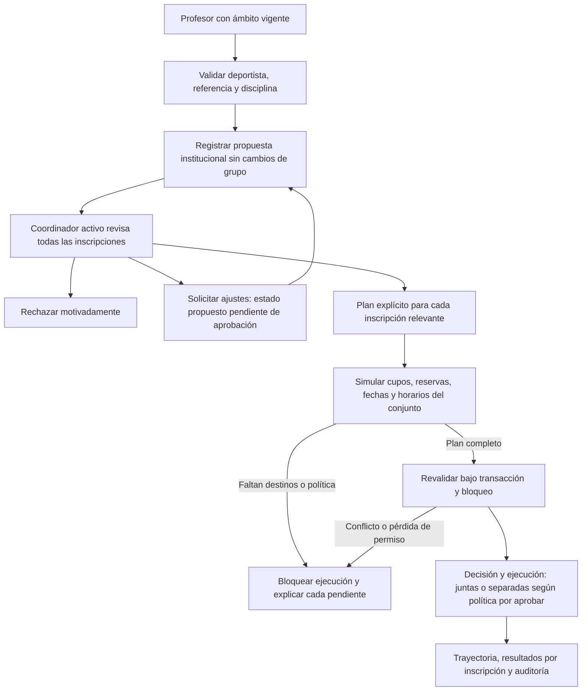
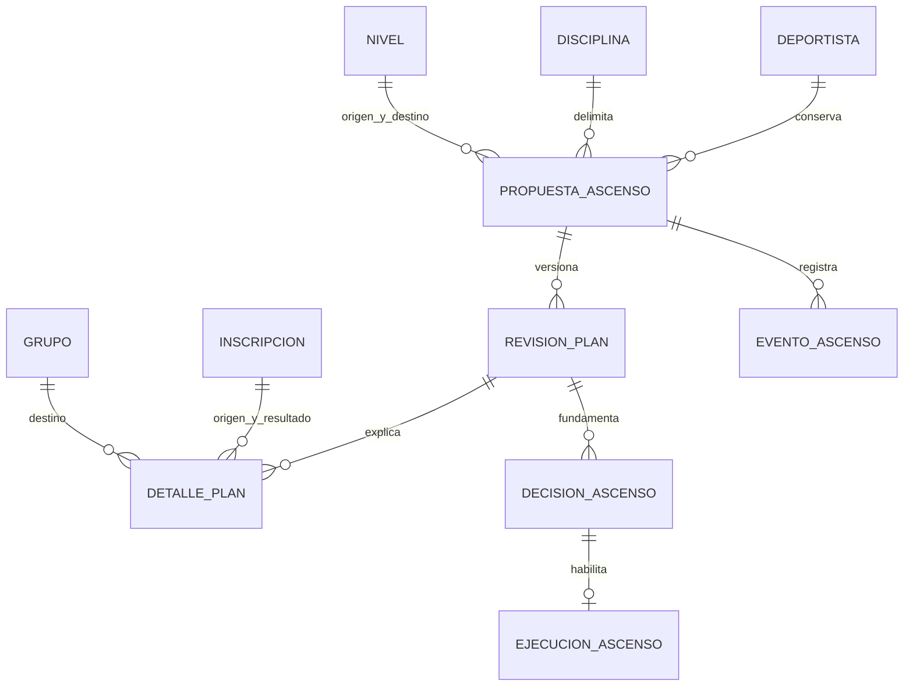

# Ascensos deportivos institucionales — Incremento 2, etapa A

Fecha: 29 de octubre de 2026. Estado: diagnóstico y diseño para aprobación; no autoriza implementación ni migraciones.

## 1. Resumen ejecutivo

El flujo actual resuelve un cambio de nivel mediante el cierre de una inscripción y la creación de una continuación. No representa todavía una decisión institucional por deportista y disciplina. El Incremento 1 bloquea conservadoramente la operación cuando existen otras inscripciones relevantes, evitando ascensos parciales inadvertidos.

Se recomienda una decisión institucional independiente, con revisión integral y un plan explícito y versionado para las inscripciones afectadas (alternativa B). Separar conceptualmente decisión pedagógica y ejecución administrativa no obliga a separarlas temporalmente: esa elección sigue pendiente. Como propuesta conservadora para una primera implementación, evaluar decisión y ejecución atómicas cuando todas las inscripciones estén resueltas; no convertir esta recomendación en política sin aprobación.

No se propone ascender automáticamente por edad, antigüedad, color, grado de escalada, posición en el catálogo, calificación o inteligencia artificial. Tampoco asignar por defecto un destino por equivalencia de jornada.

## 2. Estado actual verificado del código

### Alcance y fuentes

Inspección estática de `backend/inscripciones/{models,servicios,serializers,views,compatibilidad_propuestas,cancelacion}.py`, `tests.py` y `test_propuestas_traslados.py`; modelos, alcance, permisos y servicios de organización; modelos y permisos de deportistas; `frontend/src/componentes/FormularioPropuesta.jsx` y páginas `Propuestas.jsx` e `Inscripciones.jsx`.

Referencias: [revisión organizativa](REVISION_ORGANIZACION_REAL_ESCUELA.md), [cierre del Incremento 1](AJUSTES_PROPUESTAS_TRASLADOS.md), [plan de Fase 3](PLAN_FASE_3_DEPORTISTAS.md), LEEME del paquete de investigación y referencias a F03. La revisión organizativa describe restricciones anteriores al Incremento 1: cuando discrepan, prevalecen el código actual y las decisiones institucionales posteriores. F03/F04/F05 e inventarios son preliminares; no acreditan currículo ni criterios de ascenso aprobados. Las mallas fuente requieren revisión institucional y Alto rendimiento no tiene malla propia aportada según F03. No se importaron materiales ni se inspeccionaron datos personales.

Este encargo no ejecutó suites, consultas de negocio ni consultas a PostgreSQL. Los últimos resultados documentados son 275 pruebas backend y 88 frontend aprobadas en el cierre anterior; no constituyen una nueva certificación de ejecución.

### A–J. Diagnóstico trazable

| Tema | Comportamiento comprobado | Consecuencia |
| --- | --- | --- |
| A. Nivel | `Deportista` no tiene nivel institucional. Se obtiene de `Inscripcion.grupo.nivel`; `Nivel` pertenece a `Disciplina` | No existe una fuente independiente del nivel reconocido del deportista |
| B. Varios grupos | Se admiten varias inscripciones compatibles en un nivel; no hay exclusividad deportista/nivel/periodo | El ascenso debe examinar el conjunto, no solo el origen |
| C. Propuesta y resolución | `Propuesta` tiene un origen, un destino y una inscripción resultante; tipos inscripción/traslado/nivel; estados pendiente/aplicada/rechazada/cancelada | No hay detalle múltiple, solicitud de ajustes ni aprobación pendiente de ejecución |
| D. Ámbito docente | `usuario_actual`, `deportistas_visibles`, `inscripciones_visibles`, `contexto_docente` y `docente_en_grupo` verifican cuenta, rol, origen activo, pertenencia y asignación vigente | Ver otro grupo del deportista no sustituye la asignación al origen. Se revalida al aprobar |
| E. Destinos | `PropuestaVista.destinos` y `validar_destino` admiten grupos de otros profesores/jornadas; exigen otra PK, misma disciplina y nivel distinto para tipo nivel | El profesor recibe metadatos mínimos; no recibe el padrón del destino |
| F. Operación | `validar_nueva`, `intervalo`, `ocupacion_maxima` y `cruzan` revisan estructura, cupo, intervalos y horarios; reservas vigentes ocupan | Hoy cupo por grupo/fechas y horario completo, no por sesión ni plan individual |
| G. Fechas | `contexto_docente` y `trasladar_bajo_bloqueo` exigen fecha operativa actual e ingreso anterior; `resolver` rechaza aprobación en otro día | No se pueden representar propuestas pedagógicas de revisión prolongada sin diseñar otra vigencia |
| H. Concurrencia | Transacciones, bloqueo de usuarios, propuesta, deportista, grupos e inscripción; `version` y `version_origen`; restricciones de pendientes | Base útil, pero el conjunto institucional requiere más versiones y protección contra nuevas inscripciones concurrentes |
| I. Niveles mezclados | Altas ordinarias rechazan solapamiento entre niveles de una disciplina; `reanudar` llama a `validar_nueva(... permitir_nivel=True)` | No existe una restricción SQL transversal que garantice un solo nivel. No asumir que nunca puede haber mezcla |
| J. Decisión/ejecución | `resolver(... aprobar=True)` decide y ejecuta en la misma transacción | No existe actualmente reconocimiento pedagógico separado de la ubicación administrativa |

Detalles importantes:

- `contexto_docente` bloquea tipo nivel si otra inscripción de la disciplina cumple `max(inicio, fecha) < fin`. Incluye inscripciones futuras, aunque estén en otro periodo no solapado con hoy. No se limita a otras del nivel de origen. El coordinador debe distinguir estos casos en el diseño futuro.
- Una suspendida ocupa hasta el vencimiento inclusivo de su reserva. `intervalo` usa fin exclusivo; una reserva vencida deja de contar sin necesidad de una escritura GET. La liberación persistente se realiza auditadamente en servicios de escritura; `contexto` puede procesar reservas vencidas, por lo que no es una función de lectura.
- Las inscripciones usan intervalos `[ingreso, salida)`, limitados por el periodo; asignaciones docentes tienen fin inclusivo. Horarios contiguos no se cruzan. No hay vigencias históricas por franja ni excepciones de calendario.
- `inscripcion_fechas_validas` exige salida estrictamente posterior al ingreso. El cierre del Incremento 1 conserva esta regla y distingue los mensajes de traslado y cambio de nivel. Reanudar no cambia el ingreso, pero sí incrementa la versión.
- El destino de tipo nivel solo exige un nivel diferente, no necesariamente superior o inmediato. `Nivel.orden` no es una política aprobada de transiciones, no es único ni contiene criterios pedagógicos. El nuevo concepto de ascenso necesita una política expresa de transiciones.
- La autorización vigente diferencia administración de promoción: administrador y coordinador gestionan operaciones administrativas, pero solo el coordinador activo decide tipo nivel, tanto para aprobar como para rechazar. El administrador no obtiene una excepción pedagógica por su acceso global.
- Las unicidades pendientes actuales son por origen y por deportista/destino. No equivalen a exclusividad por deportista/disciplina; no impiden conceptualmente dos expedientes institucionales iniciados desde orígenes diferentes.
- React fija fecha operativa al abrir el formulario; selecciona deportista propio, origen activo y un destino. La pantalla coordinadora confirma una resolución, sin una matriz completa de todas las inscripciones. No existe una pantalla de ascenso global.

## 3. Reglas institucionales confirmadas

1. Identidad permanente única; no cambiar UUID, PK, código interno ni relaciones históricas.
2. Grupos independientes entre semana y fin de semana, con profesores, horarios y cupos propios. Un profesor puede dirigir varios grupos/niveles compatibles.
3. Niveles pedagógicos: Lúdico, Nivel 1, Nivel 2, Especialización semicompetitiva y Alto rendimiento. No confundirlos con grados o colores de dificultad. Reutilizar el catálogo existente, sin duplicar la denominación larga de Especialización.
4. Una malla institucional compartida por nivel; no duplicarla por jornada, profesor o grupo. Su módulo aún no existe.
5. Varias inscripciones compatibles por deportista y disciplina/nivel. Toda progresión debe revisar todas las pertinentes.
6. Profesor vigente propone; coordinador activo decide. El profesor no ejecuta ni obtiene expedientes ajenos.
7. Sin traslados automáticos incompatibles ni cambios parciales inadvertidos. Historial y auditoría íntegros.
8. Planes individuales de días y cupos por sesión están confirmados como orientación institucional, pero su implementación e integración siguen fuera de esta etapa.

## 4. Brechas y riesgos

El modelo de un origen/un destino no describe varias jornadas. No existe nivel reconocido independiente, política de transición, revisión global versionada ni plan que explique cada inscripción. La fecha de propuesta está confundida con la de ejecución. Un conjunto de destinos individualmente válidos puede ser incompatible al evaluarse en conjunto.

Reutilizar secuencialmente `trasladar_bajo_bloqueo` para cada origen puede producir validaciones contra inscripciones todavía abiertas que el mismo plan cerrará, o excepciones indebidamente amplias mediante `permitir_nivel=True`. Hace falta una proyección integral y una transacción única; no desactivar validaciones para sortear los cruces.

Las reservas no se deben convertir automáticamente en altas activas ni perder su vencimiento. Las altas futuras necesitan resolución explícita, porque cerrar una inscripción antes de que empiece viola su semántica. La ausencia de destinos o una inscripción en otro nivel no justifican un retiro automático. Un resultado guardado en la pantalla no garantiza cupo al ejecutar.

## 5. Procedimiento y flujo propuestos

1. Profesor selecciona un deportista de su ámbito y una inscripción de referencia vigente; propone nivel de la misma disciplina y justifica pedagógicamente. No se le obliga a asignar todos los destinos ni se le muestran expedientes ajenos.
2. Sistema verifica permiso actual, disciplina, referencia y conflicto de expediente abierto; registra propuesta sin ocupar cupos ni cambiar nivel.
3. Coordinador consulta la revisión global: inscripciones activas, suspendidas, futuras y antecedentes; distingue relevantes a la fecha prevista de las históricas ya terminadas.
4. Para cada inscripción relevante, el coordinador define una disposición explícita y, cuando proceda, un destino. La pantalla identifica «sin destino compatible» y su motivo. No hay asignación automática.
5. Simulación integral de fechas, capacidad y horarios entre destinos, otras disciplinas y todas las inscripciones conservadas. Cada excepción requiere política aprobada; sin ella la ejecución queda bloqueada.
6. Coordinador rechaza motivadamente o solicita ajustes si se aprueba ese estado. Para aprobar/ejecutar se releen permisos, versiones y conjunto completo bajo bloqueo. Si algo cambia, no hay aplicación parcial.

Si se autoriza separar aprobación y ejecución, ambas serán acciones explícitas; la aprobación no reservará plazas por sí sola. Una eventual reserva previa requiere política propia, no reutilizar sin análisis una reserva por suspensión.

## 6. Comparación de arquitecturas

| Criterio | A. Ampliar Propuesta y detalle | B. Decisión institucional y plan |
| --- | --- | --- |
| Forma | `Propuesta` con varios orígenes/destinos para tipo nivel | Agregado propio por deportista/disciplina, con plan e historial |
| Ventaja | Reutiliza listado, autoría, resolución y parte del API | Expresa progresión distinta de traslado y reconoce múltiples inscripciones |
| Desventaja | Campos singulares quedarían ambiguos; mezcla alta administrativa y progresión | Más entidades, endpoints y pantallas; requiere transición explícita |
| Complejidad | Menor al inicio; aumenta con estados específicos y compatibilidad | Moderada, acotable con una cabecera, revisión y detalles |
| Modelos/API | Añadir detalles y estados; origen/destino singulares opcionales según tipo; adaptar serializers antiguos | Añadir modelos aditivos y `/ascensos/`; mantener propuestas antiguas legibles |
| Registros existentes | Riesgo de interpretar campos antiguos como resumen de un conjunto | No transformar decisiones anteriores automáticamente |
| Migración | Riesgo medio al relajar invariantes/constraints actuales | Riesgo inicial bajo si es aditiva; el reconocimiento inicial requiere revisión separada |
| Auditoría | Habría que distinguir eventos por tipo y resultados múltiples | Eventos del expediente, revisiones, decisión y ejecución claramente enlazados |
| Seguridad | Riesgo de exponer detalles globales por el serializer docente actual | Proyecciones separadas para profesor y coordinación |
| Mantenimiento | Menos rutas, más bifurcaciones y compatibilidad de contratos | Más claro para revisión prolongada y ejecución múltiple |
| Futuro currículo/evaluación | Posible con referencias añadidas, pero acoplado a traslados | Referencias futuras a versiones aprobadas sin imponer módulos inexistentes |

**Recomendación: B**, sin construir un motor genérico de procesos. Mantener traslado administrativo al mismo nivel e inscripción adicional en el modelo actual. Para tipo nivel antiguo, mantener consulta y resolución histórica; definir una transición que impida que ambos caminos ejecuten decisiones incompatibles. La interfaz puede ofrecer una bandeja unificada con APIs separadas. Esta recomendación no aprueba las decisiones de temporalidad, excepciones o reconocimiento institucional.

## 7. Modelo de datos y relaciones propuestos

Nombres conceptuales; no son modelos creados ni inventario definitivo de migración.

| Entidad propuesta | Campos y relaciones principales |
| --- | --- |
| PropuestaAscenso | ID, FK deportista y disciplina, nivel origen declarado y destino, inscripción de referencia, autor, fecha de propuesta, justificación, estado, versión; fecha límite de revisión solo cuando se apruebe su política |
| RevisionPlanAscenso | FK propuesta, número de revisión, coordinador responsable, fecha prevista de ejecución, estado de revisión, fecha de simulación; huella/versiones del conjunto revisado sin PII duplicada |
| DetallePlanAscenso | FK revisión e inscripción origen; versión observada, estado/reserva observados, disposición explícita, destino opcional, fechas previstas y explicación de impedimento; FK inscripción resultante al ejecutar |
| DecisionAscenso | FK propuesta y revisión decidida, coordinador, resultado, justificación, fecha; registro inalterable de decisión, sin sobrescribir resoluciones anteriores |
| EjecucionAscenso | FK decisión aprobada y revisión, actor, fecha efectiva/registro, estado y clave de idempotencia; resultados enlazados a eventos e inscripciones |
| EventoAscenso | FK expediente, actor, fecha, transición y motivo; referencias a revisión/decisión/ejecución, sin documentos personales completos |
| TrayectoriaNivelDisciplina — condicionada | Deportista, disciplina, nivel reconocido, inicio/fin de vigencia, decisión fuente y responsable; solo si se aprueba reconocimiento institucional independiente |

Usar `PROTECT` en relaciones históricas y reutilizar usuarios, niveles, periodos y grupos. No copiar nombres, documentos ni currículo en cada detalle. Las versiones observadas identifican cambios, no reemplazan la relectura de reservas/horarios. Los grupos no tienen actualmente campo de versión: comparar una huella canónica de estructura, periodo y horarios o proponer una versión adicional; decidir su alcance antes de migrar.

Restricciones propuestas: una propuesta abierta por deportista/disciplina, revisión única por expediente/número, detalle único por revisión/inscripción, ejecución única exitosa por decisión, idempotencia única, coherencia de campos según estado y fechas. Índices para deportista/disciplina/estado, bandeja estado/fecha y referencias de inscripción. Igualdad de disciplina entre nivel, grupo y expediente requiere validación transaccional de relaciones; un CHECK simple no valida otras tablas.

No fijar un número arbitrario de tablas: si decisión y ejecución se aprueban inseparables, se puede reducir el modelo, manteniendo eventos y resultados múltiples. Si se necesitan varias decisiones pedagógicas sucesivas, usar una secuencia única por expediente y eventos que documenten sustitución; no reemplazar una aprobación ejecutada.

El diagrama no representa módulos de sesiones o evaluaciones existentes. El reconocimiento institucional opcional sería una trayectoria por deportista/disciplina, nunca un campo global que mezcle disciplinas. No se inicializa desde el máximo `Nivel.orden`: una mezcla de inscripciones debe quedar «pendiente de revisión», no reconocida automáticamente. Las referencias curriculares futuras irán a una versión institucional de la malla del nivel; no almacenar otra copia por ascenso.

## 8. Validaciones y restricciones propuestas

- Separar fecha de propuesta, decisión y ejecución; preservar la regla actual de cierres con duración positiva. Proponer hoy no tendría que cerrar nada, pero habilitar propuestas pedagógicas del mismo día exige aprobar el nuevo contrato.
- Definir el conjunto a revisar por deportista/disciplina: vigentes, reservas, futuras y pendientes que puedan alterar ese conjunto. Históricas finalizadas aportan contexto, no se trasladan. Mostrar periodos no solapados sin asumir que deben cerrarse hoy.
- Referencia docente activa y propia al proponer. Revalidar autorización al decidir como protección inicial recomendada; si se desea conservar validez pedagógica tras relevo docente, aprobar un mecanismo de ratificación, no suplantar al autor.
- Verificar nivel de destino de la misma disciplina y transición institucional autorizada. Pendiente si solo se permite el siguiente nivel y si hay saltos o reconocimientos de experiencia previa. No inferirlo por diferencias numéricas de `orden`.
- Cada inscripción relevante debe tener una resolución expresa. «Sin destino» nunca significa retirar, mantener excepción ni ignorar automáticamente.
- Proyectar simultáneamente cierres y aperturas; comprobar capacidad máxima por intervalo de cada grupo y compatibilidad entre todos los resultados y las inscripciones restantes, también de otras disciplinas.
- Suspensión con reserva: no reactivar por ascenso. La transferencia de reserva, su vencimiento y continuidad requieren política expresa. Suspensión sin reserva vigente no ocupa cupo, pero debe seguir visible como antecedente/pendiente administrativo.
- Si varias inscripciones convergen en un destino, bloquear duplicados. Una eventual consolidación de dos orígenes en una inscripción requiere diseño de genealogía: la relación actual `inscripcion_anterior` es uno a uno y no representa fusiones.
- No aprobar/ejecutar revisiones incompletas, desactualizadas o vencidas, ni ejecutadas previamente. Fallar con mensaje de conflicto comprensible sin perder el trabajo de revisión.
- No cambiar estructura histórica del grupo ni fechas previas para facilitar la operación. Para ingresos futuros no cerrar antes de inicio; dejar el plan pendiente de política o requerir una operación futura expresamente aprobada.

## 9. Matriz de escenarios

Comportamientos recomendados para aprobación; donde falta política, se bloquea ejecución, no se inventa una solución. El bloqueo del código actual permanece hasta implementar un reemplazo autorizado.

| # | Escenario | Respuesta de diseño |
| --- | --- | --- |
| 1 | Una inscripción N1 y destino N2 válido | Plan de un detalle; decisión coordinadora y revalidación; ejecutar solo con fecha posterior al ingreso |
| 2 | N1 entre semana y domingo, dos destinos válidos | Plan completo con ambos orígenes; comprobar también compatibilidad mutua de destinos; aplicación integral |
| 3 | Solo un destino tiene cupo | Identificar detalle sin plaza; no aplicar solo el disponible. Espera, aprobación diferida o excepción pendientes de política |
| 4 | No existe equivalente en nivel superior | Mostrar ausencia de oferta, no seleccionar otra jornada automáticamente; decisión institucional pendiente |
| 5 | Activa y suspendida con reserva | Incluir ambas y vencimiento; no perder reserva ni reactivar. Bloquear ejecución hasta definir tratamiento explícito |
| 6 | Distintos niveles de misma disciplina | Señalar incoherencia/posible situación excepcional y revisar antes de fijar origen institucional. No escoger el mayor ni ascender solo una |
| 7 | Dos profesores proponen | Una única propuesta abierta por deportista/disciplina. Segundo envío recibe conflicto genérico sin detalles ajenos; coautoría o aportes posteriores requieren diseño autorizado |
| 8 | Cambia disponibilidad tras proponer | Simulación informativa; revalidación final rechaza ejecución sin cambios parciales; coordinador revisa plan |
| 9 | Pierde vigencia el profesor | Registrar historia sin borrarla; bloquear aprobación según protección recomendada. Ratificación/reemplazo quedan por aprobar |
| 10 | Se propone el día del ingreso | Flujo actual lo impide. En nuevo expediente se recomienda poder registrar intención sin ejecutar; cambio de regla requiere aprobación. Cierre del mismo día sigue prohibido |
| 11 | Coordinador aprueba vencida | Código actual rechaza fecha distinta de hoy. Diseño futuro separa vigencia pedagógica y operativa; si vence, impedir aprobar/ejecutar y exigir revisión motivada |
| 12 | Destino de otra disciplina | Rechazar antes de registrar propuesta válida y al decidir; no convertirlo en ascenso |
| 13 | Varios periodos | Históricos no cambian; actuales y futuros se clasifican y resuelven explícitamente. No cerrar altas futuras ni periodos distintos por defecto |
| 14 | Destino cruza otra actividad | Rechazar si cruza otra inscripción/reserva conocida, incluso de otra disciplina. Actividades externas no registradas no son detectables; no afirmar disponibilidad absoluta |

## 10. Diseño de permisos y API

| Acción | Profesor vigente | Coordinador activo | Administrador | Otros/inactivos |
| --- | --- | --- | --- | --- |
| Proponer | Solo deportista y referencia propios | No suplantar al docente | No suplantar al docente | Denegado |
| Consultar propuesta | Propia y con ámbito vigente; proyección mínima | Global operativo | Global institucional autorizado | Denegado |
| Ver todas las inscripciones y plan global | No; ni por IDs manipulados | Sí, para revisión | Consulta institucional autorizada | Denegado |
| Aprobar/rechazar ascenso | No | Exclusivo | No | Denegado |
| Solicitar ajustes | No | Propuesto, sujeto a aprobación del estado | Sin decisión pedagógica | Denegado |
| Ejecutar plan aprobado | No | Candidato | Candidato solo si se aprueba separación y permiso | Denegado |
| Autorizar excepción | No | Pendiente de política | Pendiente de política; no autoridad implícita | Denegado |

El profesor no necesita revisar la matriz global para justificar su propuesta. Mostrar solo resultados pedagógicos autorizados de su propuesta y un aviso genérico de revisión institucional; no devolver grupos ajenos de origen, nombres de terceros, datos de acudientes o documentos completos. Mantener enmascaramiento documental y autenticación por sesiones, CSRF y cookies actuales.

Endpoints propuestos, no implementados:

| Ruta bajo `/api/ascensos/` | Método | Finalidad/permiso |
| --- | --- | --- |
| `/` y `/{id}/` | GET | Listado/detalle según ámbito y serializer por rol |
| `/` | POST | Propuesta del profesor con ámbito vigente |
| `/{id}/revision/` | GET | Conjunto completo y bloqueos, solo coordinación/administración autorizada |
| `/{id}/planes/` | POST | Nueva revisión motivada del coordinador; sin ejecutar |
| `/{id}/simular/` | POST | Simulación sin escrituras de dominio, coordinador; no invocar `contexto` actual |
| `/{id}/aprobar/`, `rechazar/` | POST | Coordinador activo; versión/revisión y resolución obligatorias |
| `/{id}/solicitar-ajustes/` | POST | Solo si se aprueba ese estado |
| `/{id}/ejecutar/` | POST | Solo si se aprueba ejecución separada, actor y vigencia específicos |
| `/{id}/historial/` | GET | Historial con proyección según rol; referencias técnicas sin PII innecesaria |

Sin PUT/PATCH genérico de decisiones o historial ni DELETE de registros históricos. Errores 400 de validación, 409 de versión/cupo/duplicado y denegación 403/404 según el contrato de no exposición. Revisar que relaciones anidadas, filtros y búsquedas no amplíen ámbito.

Pantallas propuestas: formulario docente de intención pedagógica; bandeja coordinadora; ficha con matriz de inscripciones, periodos, reservas y destinos por fila; simulación con bloqueos identificables; confirmación motivada y cronología; consulta administrativa institucional. Reutilizar selectores buscables, tablas, errores y navegación actuales, sin renovación visual. Indicar expresamente «no reserva cupo» y no confundir «aprobado» con «ejecutado» si se autoriza separarlos.

## 11. Transacciones y concurrencia

1. Mantener inicialmente el orden de bloqueo vigente de usuarios para coordinar relevos/roles; revalidar actor desde base dentro de la transacción. No reemplazar solo un servicio por otro orden incompatible.
2. Bloquear agregado deportista/disciplina, propuesta y revisión; asegurar creación concurrente con unicidad SQL. El bloqueo del deportista debe coordinarse con altas, traslados, reservas y cambios de estado existentes, no solo con nuevos ascensos.
3. Cargar y bloquear todas las inscripciones/reservas afectadas y grupos origen/destino en orden determinista. Documentar y comprobar el mismo orden en servicios antiguos antes de implementar; el bloqueo de una lista previa no evita una nueva fila concurrente por sí solo.
4. Comparar versiones y recalcular el conjunto: una inscripción nueva o eliminada del ámbito cambia la revisión aunque ninguna versión anterior haya cambiado. Bloquear padre compartido evita ese caso si todos los escritores participan.
5. Releer estructura, horarios y periodos y coordinar sus escrituras con el mismo protocolo. No confiar en una huella de la simulación ni en datos precargados del navegador.
6. Proyectar toda la operación sin efectos; verificar también competencia por el último cupo con inscripciones ordinarias. Aplicar cierres, altas, reservas autorizadas, resultados, decisión y auditoría en una sola transacción cuando así se apruebe.
7. Cualquier fallo revierte todo; nada de commits por fila. Si hay aprobación separada, su registro no garantiza una ejecución posterior: cada ejecución vuelve a validar y conserva el motivo del bloqueo.
8. Idempotencia y versión de revisión impiden dobles clics y reintentos; no duplicar eventos ni inscripciones. Limitar la duración de bloqueos: nunca esperar interacción humana dentro de la transacción.

El bloqueo global de usuarios actual simplifica serialización en una empresa pequeña, pero reduce concurrencia. No optimizarlo aisladamente ni afirmar que sustituye restricciones SQL y cobertura de todos los escritores.

## 12. Impacto sobre datos existentes

Conservar deportistas, PK, UUID público, código interno, relaciones con acudientes, autorizaciones, inscripciones, reservas y propuestas. No corregir niveles mezclados ni fechas por migración automática. Mantener legibles decisiones antiguas y distinguir su alcance individual del nuevo alcance institucional.

Para propuestas nivel pendientes antiguas: proponer consulta y cancelación motivada antes de nueva propuesta institucional, o conversión explícita revisada por coordinación con referencia al registro original. No copiarlas como aprobaciones ni cancelarlas masivamente sin autorización. Impedir una carrera entre aprobación antigua y expediente nuevo mediante una comprobación común durante la transición.

No hay evidencia aquí sobre cuántos casos reales requieren revisión: no se consultó la base. Antes de un despliegue futuro, presentar un inventario agregado de impacto de solo lectura y resolver casos institucionales sin exponer PII.

## 13. Migraciones eventualmente necesarias

Solo propuesta: crear tablas del agregado elegido, detalles/revisiones, decisiones/ejecuciones según temporalidad aprobada, eventos, FKs protegidas, índices y restricciones del apartado 7. Reconocimiento institucional y posibles versiones de Grupo/horarios son dependencias opcionales que deben aprobarse separadamente. No alterar `inscripcion_fechas_validas` ni la semántica de los periodos.

No se crean nombres ni números de migración en esta etapa. Inventario exacto y SQL dependerán del modelo definitivo y de las dependencias reales al implementar. Estrategia: aditiva, tablas inicialmente vacías, sin reconocimiento automático ni recálculo histórico. Si una versión futura requiere enlazar propuestas antiguas, migración de datos independiente revisada, nunca inferencia de decisiones.

Antes de aplicar en `zona_bloque`: autorización expresa del inventario, conexión/esquema verificados, respaldo nuevo con SHA-256 y restauración funcional aislada, comparación de conteos/huellas preexistentes, plan de dependencias y comprobación posterior. Recuperación: deshabilitar nuevas escrituras del módulo y restaurar respaldo si corresponde con autorización; no revertir tablas con historia nueva de forma destructiva. Documentar preservación/exportación de operaciones posteriores al respaldo antes de cualquier recuperación.

## 14. Implementación y pruebas por incrementos futuros

1. **Acuerdo funcional:** resolver apartado 15; decidir temporalidad y nivel reconocido. Criterio: ningún estado con semántica ambigua ni excepción implícita.
2. **Base institucional:** agregado y permisos en entorno aislado, migraciones aditivas generadas únicamente tras autorización de desarrollo. Criterio: unicidad por deportista/disciplina y cero alteración de identidades previas.
3. **Revisión y simulación:** matriz integral y candidatos mínimos, sin cambios de inscripción. Criterio: los 14 escenarios tienen resultado explicable y el profesor no ve información ajena.
4. **Decisión/ejecución:** transacciones y transición desde propuestas antiguas. Criterio: ninguna aplicación parcial; cierre temporal válido; suspensión y futuro resueltos según política aprobada.
5. **React:** formulario y revisión coordinadora; mantener diseño actual. Criterio: distinguir nivel reconocido, grupo, decisión y ejecución, sin IDs escritos manualmente.
6. **Regresión y despliegue propuesto:** suite completa aislada, build, verificación visual y entrega del inventario de migraciones para aprobación independiente.

Pruebas unitarias: clasificación de inscripciones, intervalos, transiciones permitidas, destinos por disciplina, proyección de capacidad, reservas inclusivas, fechas y estados. Incluir varias inscripciones convergentes y periodos no solapados.

Integración PostgreSQL aislado: los 14 escenarios; fallo de un detalle revierte todos; conservar genealogía e identidad; suspensión/reanudación el mismo día; ingreso futuro; reserva vencida durante revisión; horario/cupo/periodo cambiado; origen de nivel mezclado; evento y decisión sin duplicados.

Concurrencia con conexiones independientes: dos profesores sobre un expediente, dos aprobaciones, último cupo compartido con inscripción ordinaria, inscripción nueva mientras se aprueba, suspensión y ascenso simultáneos, cambio de horario y relevo de coordinador durante decisión. Comprobar resultados persistentes y rollback, no solo códigos HTTP.

Seguridad: administrador no decide pedagógicamente; profesor no ejecuta, no manipula destino/disciplina, no consulta detalle ajeno; profesor desasignado y coordinador sustituido; anónimo/inactivo; CSRF; serialización anidada, historial y errores sin documentos completos. Autor y fecha de decisión se fijan en servidor.

Frontend: flujo docente, matriz coordinadora, cada bloqueo visible, ausencia de destino sin sustitución automática, pérdida de vigencia, revisión desactualizada, doble envío, cancelación sin POST accidental y adaptación responsiva. Mantener toda la regresión anterior sin convertir los resultados históricos en una afirmación de ejecución de esta etapa.

## 15. Decisiones pendientes de aprobación

| Decisión | Alternativas y recomendación para discutir |
| --- | --- |
| Temporalidad | Decidir y ejecutar juntos, o aprobación pedagógica independiente. Recomendar empezar atómicamente solo si todas las disposiciones están resueltas; no aprobado |
| Falta de destinos | Mantener revisión pendiente, rechazar motivadamente o aprobar sin ejecutar. Nunca retirar ni trasladar parcialmente por defecto |
| Aprobado pendiente de ejecución | Si se permite, definir vencimiento, revalidación, ejecutor y si cambia ya el nivel reconocido. No asumir cupo reservado |
| Excepción de permanencia | Definir si existe, duración institucional, alcance por inscripción, revisión y cierre. No hay excepción automática por jornada |
| Autoridad de excepción | Decidir quién autoriza y qué evidencia/motivación exige; administrador no adquiere poder pedagógico implícito |
| Días y cupos por sesión | Establecer contrato futuro de participación/versiones y capacidad fechada. Hasta implementarlo, el motor usa grupo completo y cupo por intervalo |
| Nivel reconocido | Elegir trayectoria independiente por deportista/disciplina, inicio de vigencia y reconciliación inicial; no inferirla de la malla ni del máximo nivel inscrito |
| Transiciones | Definir ascenso inmediato, saltos, acceso a Lúdico/Alto rendimiento y reconocimientos previos, sin reglas inventadas por `orden` |
| Vigencia de propuesta | Permitir intención el día del ingreso, plazo de revisión y fecha de ejecución; eliminar caducidad diaria solo con política nueva aprobada |
| Relevo docente | Mantener bloqueo actual o permitir ratificación por profesor vigente; nunca cambiar autoría histórica |
| Reservas y futuros | Definir conservación de suspensión/vencimiento, traslado de reserva y tratamiento de altas programadas; no reactivar ni cerrar prematuramente |
| Consolidación/periodos | Permitir o no varios orígenes a un destino y cómo representar su genealogía; definir qué futuros requieren resolución antes del ascenso |
| Ajustes y nuevas versiones | Autorizar estado de ajustes, quién responde y si hay nuevas decisiones sobre revisiones posteriores |
| Convivencia de APIs | Definir fecha de retirada del alta antigua tipo nivel y tratamiento de pendientes sin perder historia |

La aprobación de este diseño no debe confundirse con autorización para aplicar migraciones reales. Esta etapa termina con un único documento; no se modificó código, modelos, permisos, roles, credenciales ni datos, no se generaron migraciones ni se hicieron commits o push. Se espera revisión institucional antes de programar.
