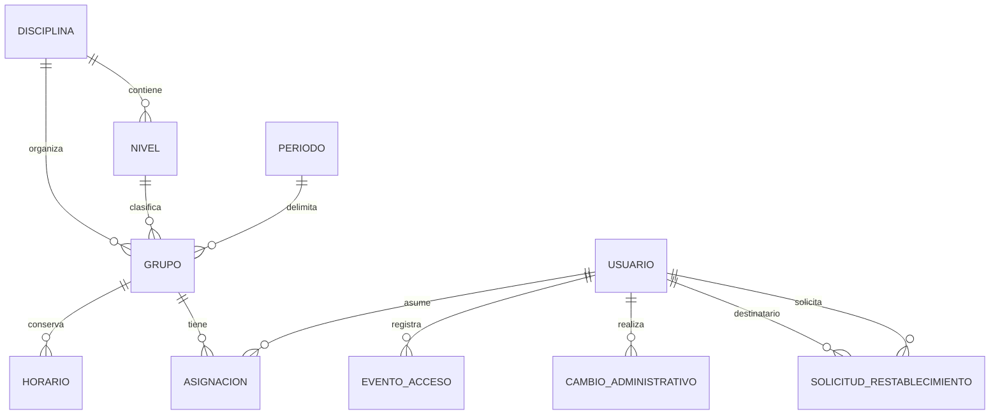

# Fase 2 — Organización deportiva y usuarios

Estado al 28 de octubre de 2026: **cuatro migraciones autorizadas aplicadas en zona_bloque**, respaldo previo y 88 comprobaciones de integración real aprobadas. Consulta [el informe](APLICACION_MIGRACIONES_FASE_2.md). Esta fase no incluye estudiantes, sesiones, asistencia, evaluaciones, semáforo ni promociones.

> Decisión definitiva posterior: un único coordinador activo gestionará la operación de todos los profesores, grupos, horarios y asignaciones, sin supervisiones individuales. Administración conservará usuarios, configuración, seguridad y reportes, con tablero general. Véanse la [matriz](MATRIZ_PERMISOS.md), [propuesta simplificada](AMPLIACION_COORDINACION.md) y [tableros](PLAN_TABLEROS.md). La ampliación autorizada ya está implementada, con una migración de unicidad pendiente en PostgreSQL. Véase [verificación de coordinación y tablero](VERIFICACION_COORDINACION_TABLERO.md). Las tablas y rutas siguientes conservan la referencia de la base anterior de Fase 2.

## Módulos y archivos principales

| Módulo | Archivos nuevos o modificados | Responsabilidad |
|---|---|---|
| Usuarios | cuentas/serializers_usuarios.py, servicios_usuarios.py, views_usuarios.py, urls_usuarios.py | Búsqueda, alta, edición, rol y estado por administrador |
| Recuperación | cuentas/recuperacion.py, SolicitudRestablecimiento en models.py | Reautenticación administrativa, token de un solo uso y cambio de clave |
| Auditoría | auditoria/models.py, servicios.py y migración | Actor, entidad, identificador, acción, campos e instante |
| Organización | organizacion/models.py, serializers.py, servicios.py, alcance.py, views.py, urls.py | Catálogos, grupos, horarios, asignaciones y calendario |
| Rutas/configuración | configuracion/settings.py, urls.py y comun/errores.py | Nuevas apps, endpoints y respuestas de validación |
| React | Usuarios, Catalogos, Grupos, Asignaciones, Profesores, Calendario, RestablecerAcceso | Pantallas reales de cada rol |
| Componentes | componentes/Gestion.jsx y api/gestion.js | Campos, errores, listados, paginación y escrituras CSRF |
| Navegación | Aplicacion.jsx, Estructura.jsx, Panel.jsx | Accesos por rol conservando login y diseño existentes |
| Legibilidad | estilos/_gestion.scss y principal.scss | Controles de al menos 44 px, texto legible y tablas adaptables |
| Entorno | scripts/django_local.py y package.json | Paquetes .venv-local; cargador Vite runner |
| Privacidad | .gitignore | Añade exclusión de .venv-local |
| Pruebas | cuentas/tests/test_usuarios.py, organizacion/tests/test_organizacion.py, Gestion.test.jsx, pruebas/navegador.cjs | Seguridad, integridad y pantallas |

Las rutas de backend de esta tabla son relativas a backend/; las páginas React están en frontend/src/paginas/. No se modificaron antigravity-app, los documentos originales ni .env.

## Modelo de entidades

- Disciplina: código único, nombre, estado.
- Nivel: disciplina, código único dentro de ella, nombre, orden, estado.
- Periodo: código único, nombre, inicio, fin, estado.
- Grupo: código único, nombre, disciplina, nivel, periodo, cupo positivo, estado.
- Horario: día (lunes 0 a domingo 6), inicio, fin, estado y duración calculada.
- Asignacion: grupo, usuario, tipo de responsabilidad e inicio/fin inclusivos.
- CambioAdministrativo: actor protegido, entidad/id, acción, nombres de campos y fecha. No guarda valores de contraseñas, tokens ni copias de contactos.
- SolicitudRestablecimiento: destinatario, administrador solicitante, hash del token, creación, vencimiento y uso.

## API y permisos implementados

Todos los endpoints, salvo la confirmación de recuperación, exigen sesión autenticada. Las escrituras exigen también CSRF.

| Ruta | Métodos | Permiso |
|---|---|---|
| /api/usuarios/ | GET, POST | Administrador; búsqueda con search y paginación |
| /api/usuarios/:id/ | GET, PATCH | Administrador; sin DELETE ni cambios de flags técnicos |
| /api/usuarios/:id/restablecer-acceso/ | POST | Administrador y contraseña actual válida |
| /api/recuperacion/confirmar/ | POST | Público, CSRF, token válido y límite de solicitudes |
| /api/organizacion/disciplinas/ | GET, POST | Lectura según ámbito; escritura administrativa |
| /api/organizacion/niveles/ | GET, POST | Lectura según ámbito; escritura administrativa |
| /api/organizacion/periodos/ | GET, POST | Lectura según ámbito; escritura administrativa |
| /api/organizacion/grupos/ | GET, POST | Lectura según asignaciones vigentes; escritura administrativa |
| /api/organizacion/{disciplinas,niveles,periodos,grupos}/:id/ | GET, PATCH | Mismos permisos; sin DELETE |
| /api/organizacion/asignaciones/ | GET, POST | Administrador ve historial y crea; otros solo ven lo autorizado vigente |
| /api/organizacion/asignaciones/:id/ | GET | Filtrado por ámbito |
| /api/organizacion/asignaciones/:id/finalizar/ | POST | Solo administrador; fecha final obligatoria |
| /api/organizacion/profesores/ | GET | Coordinador: profesores activos de sus grupos; profesor: su propia cuenta; administrador: profesores con asignación vigente |
| /api/organizacion/calendario/ | GET | Horarios recurrentes de grupos autorizados, con vigencia por fecha |

Filtros: search/page en listados de catálogos y usuarios; disciplina en niveles; grupo en asignaciones; desde/hasta en calendario (máximo 92 días de diferencia).

Los catálogos se restringen a los grupos del usuario salvo para el administrador. La consulta de un grupo ajeno devuelve 404; una escritura sin rol adecuado devuelve 403. No se aceptan privilegios desde parámetros del cliente.

## Validaciones implementadas y conservación de historia

1. No hay DELETE de usuarios, grupos, catálogos o asignaciones por API. Se desactiva o finaliza.
2. Un grupo activo exige disciplina, nivel y periodo activos, con nivel perteneciente a su disciplina.
3. No se desactiva un catálogo que conserva grupos activos.
4. Cupo mínimo uno; horarios válidos y sin cruces dentro del mismo grupo. Precisión de minutos, sin pasar medianoche.
5. Un profesor no puede tener asignaciones a grupos con entrenamientos simultáneos dentro de fechas comunes. Horarios contiguos sí son válidos. La coincidencia de día se comprueba dentro del intervalo común real.
6. Un coordinador puede responsabilizarse de varios grupos simultáneos.
7. La persona asignada debe estar activa y su rol debe coincidir con la responsabilidad. No se admiten vigencias solapadas de la misma persona/tipo/grupo.
8. Fecha final vacía significa hasta el fin del periodo; no concede acceso indefinido.
9. Una asignación finalizada no se reabre ni se amplía. Para una vigencia nueva se crea otro registro.
10. Las ediciones de horarios archivan las filas anteriores y crean nuevas. Si aparece un conflicto, se revierte toda la operación.
11. No se cambia disciplina/nivel/periodo de un grupo con historial de asignaciones. Las fechas de un periodo con historial también se conservan.
12. No se permite auto-desactivación ni cambio del propio rol. Debe quedar al menos un administrador activo.
13. Para cambiar el rol de una persona se deben cerrar primero sus asignaciones vigentes o futuras.
14. Al degradar una cuenta se retiran flags técnicos de administrador Django. La API no permite otorgar is_staff ni is_superuser.
15. Las escrituras están en transacciones. Usuarios, grupos, catálogos y asignaciones comparten un orden de bloqueo de usuarios con select_for_update; dentro de la transacción se revalida el rol administrativo.
16. La consola Django conserva consulta de usuarios, pero sus escrituras se centralizan en la API React para evitar omitir estas validaciones.

Las restricciones simples se incluyen en la base; la pertenencia nivel/disciplina y los solapamientos se validan en servicios transaccionales. La integración funcional real de PostgreSQL pasó 88 comprobaciones; no se midió concurrencia simultánea.

## Recuperación segura

- Requiere reautenticar al administrador, no basta una sesión abierta.
- Se genera un token aleatorio de 256 bits; la base conserva únicamente SHA-256.
- Caduca en 30 minutos. Emitir uno nuevo vence los anteriores.
- La ruta usa fragmento #token=, que no se envía en la petición HTTP inicial.
- La pantalla retira el fragmento del historial y conserva el token solo en memoria.
- El destinatario define su contraseña; se aplican los validadores Django.
- El consumo es transaccional y de un solo uso. Un usuario inactivo no puede consumirlo.
- Cambiar la contraseña invalida las sesiones anteriores mediante el hash de autenticación Django.
- El enlace solo se muestra al administrador solicitante y se oculta al cerrar la sección; las respuestas son no-store.
- No se envían correos ni mensajes reales automáticamente. El administrador debe compartirlo por un canal privado autorizado.
- No se registran contraseñas ni tokens en la auditoría.

## Pantallas disponibles con el esquema aplicado

Administrador: /administracion/usuarios, /catalogos, /grupos, /asignaciones, /calendario (todas con prefijo /administracion).

Profesor: /profesor/grupos, /asignaciones, /calendario.

Coordinador: /coordinacion/grupos, /profesores, /asignaciones, /calendario.

Público: /restablecer-acceso, mediante enlace válido.

El calendario representa recurrencias de horario, no sesiones de clase. Profesores y coordinadores no adquieren acceso a grupos que ya no están bajo su responsabilidad actual.

## Recorrido de prueba con migraciones aplicadas

1. Entrar con una cuenta administrativa existente.
2. Revisar escalada y los cinco niveles; crear un periodo.
3. Crear un grupo con nivel, cupo y horarios.
4. Crear cuentas ficticias de profesor y coordinador y asignarlas al grupo.
5. Ingresar con cada cuenta y comprobar que únicamente aparece su grupo.
6. Crear un grupo ajeno y verificar rechazo de consulta directa por ID.
7. Finalizar una asignación y comprobar pérdida de acceso al día siguiente de su fecha final inclusiva.
8. Solicitar recuperación, completar el enlace y verificar que no admite segundo uso.
9. Desactivar/reactivar una cuenta y comprobar el acceso.
