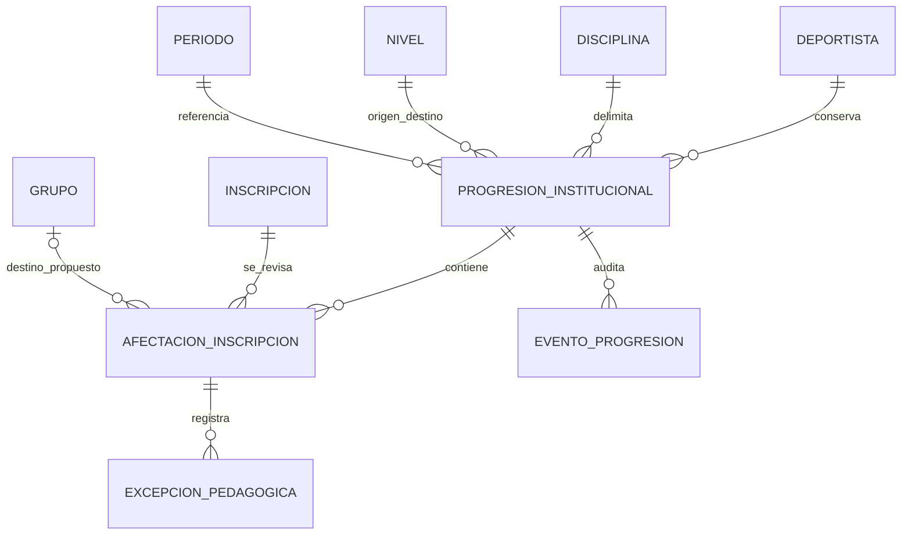

# Ascensos institucionales — Implementación del Incremento 2, etapa B1

Fecha: 29 de octubre de 2026. Estado: estructura B1 corregida tras auditoría y probada en PostgreSQL aislado; migración NO aplicada en `zona_bloque`. B2 y B3 no iniciadas. El inventario definitivo es el del apartado 7; sustituye al de la primera entrega.

## 1. Alcance y arquitectura implementada

Se utiliza la alternativa B de [diseño institucional](DISENO_ASCENSOS_INSTITUCIONALES_INCREMENTO_2.md): un agregado de progresión por deportista y disciplina, independiente de la propuesta individual antigua. Permanece dentro de la aplicación Django `inscripciones`, con modelos y servicios separados por responsabilidad. No se añade otra aplicación ni dependencia.

Se revisaron también [la organización real](REVISION_ORGANIZACION_REAL_ESCUELA.md), [el Incremento 1](AJUSTES_PROPUESTAS_TRASLADOS.md), modelos, servicios, permisos, vistas, serializers y pruebas actuales. La revisión organizativa describe estados históricos anteriores al Incremento 1; no se restablecen sus restricciones antiguas de destino docente.

B1 incorpora cuatro modelos y servicios internos con permisos, no endpoints REST ni pantallas nuevos. No llama a servicios de traslado, cierre, inscripción, reanudación o liberación de reservas. No hay tarea automática ni servicio que marque el plan como ejecutado. La aprobación pedagógica no cambia el nivel del grupo ni reconoce automáticamente un nuevo nivel institucional del deportista.

Esta separación evita alterar los contratos existentes de React y REST antes de diseñar B2. Los servicios internos son la futura entrada de aplicación; no se deben exponer los modelos mediante un CRUD genérico sin esos servicios y sus proyecciones por rol.

## 2. Modelos y relaciones

| Modelo | Responsabilidad y campos principales |
| --- | --- |
| `ProgresionInstitucional` | Deportista, disciplina, nivel origen y destino, periodo de referencia, inscripción de referencia, justificación, autor y marcas de tiempo/versiones heredadas de `Registro`; estado de decisión separado del estado de plan; responsable, fecha y resolución pedagógica |
| `AfectacionInscripcion` | Una fila por inscripción relevante; versión y situación observadas; disposición, motivo y destino opcional |
| `ExcepcionPedagogica` | Afectación, motivo original, responsable y fechas heredadas, inicio y fecha límite obligatorios, estado autorizada/revocada; actor, fecha y motivo de revocación separados; situación temporal derivada |
| `EventoProgresion` | Actor, fecha, tipo, versión y motivo; fotografía estructural del plan y excepciones, con IDs, estados y fechas; sin copiar documentos, nombres o contactos |

Todas las relaciones históricas utilizan `PROTECT`. Se reutilizan usuarios, deportistas, disciplinas, niveles, grupos, periodos e inscripciones; no se duplican. El periodo de cabecera es el de la inscripción de referencia, no un filtro que permita omitir otras inscripciones en periodos distintos.

Las afectaciones iniciales incluyen inscripciones abiertas de la disciplina con periodo aún no terminado: activas, suspendidas con reserva, suspendidas sin reserva y altas futuras. Las históricas finalizadas no se convierten en afectaciones; continúan en su historial anterior. El reconocimiento de un nivel institucional independiente se deja pendiente: no se añade un campo que sobreescriba el nivel derivado de los grupos.

## 3. Estados y transiciones efectivas

### Decisión pedagógica

- `pendiente` al crear.
- `pendiente → aprobada`: exclusivamente coordinador activo, con resolución, referencia docente vigente, conjunto actualizado y una disposición expresa por inscripción.
- `pendiente → rechazada`: exclusivamente coordinador activo, con resolución. Revoca las excepciones autorizadas del agregado y devuelve las continuidades a pendientes, sin tocar inscripciones.
- No existe transición desde aprobada o rechazada a pendiente, ni sustitución de una decisión ya registrada en B1. La decisión final no puede reescribirse mediante UPDATE SQL.

Se puede aprobar con disposiciones de reubicación `pendiente`, `reserva` o `futura`; no se exige inventar un destino con plaza. No se permite aprobar dejando filas sin revisar. Una mezcla de niveles en inscripciones relevantes se bloquea para revisión institucional, sin elegir automáticamente el mayor nivel.

### Plan administrativo

| Estado | Significado B1 |
| --- | --- |
| `pendiente` | Ninguna afectación tiene todavía una disposición distinta de revisar |
| `parcial` | Hay al menos una disposición expresa, pero no todas tienen destino propuesto de reubicación |
| `preparado` | Todas las afectaciones tienen un destino propuesto; no significa cupos confirmados, simulación superada ni ejecución |

`ejecutado` está excluido de las opciones del modelo y de `ascenso_plan_valido`. PostgreSQL rechaza INSERT/UPDATE con ese valor, incluso con decisión aprobada y sin usar servicios. B3 necesitará una modificación de esquema expresamente autorizada: no hay un mecanismo de habilitación en B1.

Revisar una disposición recalcula pendiente/parcial/preparado y aumenta la versión del agregado. Se permite seguir preparando el plan después de aprobar pedagógicamente. Una progresión rechazada está cerrada aunque conserve detalles del plan histórico; su estado de plan no habilita ejecución.

No hay una caducidad diaria para el nuevo expediente: fecha de creación y fecha de decisión son independientes. La prueba de revisión al día siguiente no ejecuta movimientos. El flujo individual antiguo conserva su contrato de fecha operativa y la restricción `inscripcion_fechas_validas`, sin modificaciones.

### Disposiciones

- `revisar`: estado inicial, impide aprobar.
- `reubicar`: exige destino distinto del origen, de la misma disciplina y del nivel propuesto.
- `pendiente`: falta reubicación o resolución operativa; no lleva destino ni concede plaza.
- `continuidad`: exige excepción temporal vigente.
- `reserva`: exige situación observada de reserva vigente; no transfiere ni cambia esa reserva.
- `futura`: exige inscripción futura observada; no anticipa el ingreso.

Solo `reubicar` admite destino. Los destinos seleccionados deben tener grupo, periodo, nivel y disciplina activos. B1 no verifica todavía capacidad y compatibilidad conjunta: un destino propuesto no garantiza que se pueda ejecutar.

### Excepción temporal

Estado persistente `autorizada` o `revocada`; situación de lectura `programada`, `vigente`, `vencida` o `revocada`, calculada por fechas. El último día autorizado está incluido. El vencimiento no necesita un proceso de escritura ni modifica la inscripción.

La excepción requiere motivo, fecha inicial no retroactiva, límite dentro del periodo de la inscripción y responsable coordinador. Solo cubre una inscripción activa en el nivel de origen; no reactiva una suspensión ni anticipa una inscripción futura. No crea una plaza. La continuidad no se acepta con excepción programada, vencida o revocada. La revocación conserva el registro y devuelve la disposición de continuidad a pendiente.

El trigger de excepción impide DELETE y reescritura de afectación, motivo original, fechas inicial/límite, autor y fecha original. La única actualización permitida es autorizada → revocada, aumentando versión y registrando `revocada_por`, `revocada_en`, `motivo_revocacion` y el actualizador coincidente. La fecha no puede ser anterior a la creación ni futura, el motivo no puede estar vacío y el actor debe ser el coordinador activo único. Una revocación ya registrada no se puede alterar ni deshacer.

Una restricción-trigger diferida exige, antes del commit, un evento inmutable coincidente de revocación o rechazo del ascenso, con la misma excepción, actor, fecha y motivo. Así no basta con completar columnas de revocación por ORM: sin evento se revierte la transacción. El servicio de rechazo mantiene este contrato cuando revoca excepciones del expediente. El evento conserva también el motivo y fechas originales. Los servicios usan el modo diferido inicial; no debe forzarse a inmediato antes de guardar la excepción y su evento dentro de la misma transacción.

Una excepción vencida continúa almacenada como autorizada y se muestra vencida: para sustituirla, se debe revocar expresamente antes de autorizar otra, conservando ambos registros. No se extiende ni se renueva automáticamente.

## 4. Servicios internos y permisos

Archivo: `backend/inscripciones/servicios_ascensos.py`.

| Servicio | Profesor | Coordinador activo | Administrador |
| --- | --- | --- | --- |
| `proponer_progresion` | Sí, referencia activa de asignación vigente | No suplanta al docente | No suplanta al docente |
| `leer_progresion` / `progresiones_visibles` | Solo propia y con referencia/ámbito vigente; sin afectaciones ni excepciones globales | Lectura operativa global | Lectura institucional global |
| `disponer_inscripcion` | No | Sí | No |
| `decidir_progresion` | No | Sí, aprobar/rechazar | No |
| `autorizar_excepcion` / `revocar_excepcion` | No | Sí | No |

No se incorporan rutas REST, serializers públicos nuevos ni pantallas en B1. `leer_progresion` es la proyección mínima destinada a futura integración; el QuerySet interno no constituye una API pública. Los detalles globales se excluyen de su respuesta docente, aunque el mismo deportista tenga otras inscripciones con otros profesores. Las relaciones anidadas de futuras APIs deberán conservar esta separación.

Se relee el usuario y se verifica la titularidad del coordinador desde PostgreSQL; no se confía en un objeto de sesión antiguo. El administrador conserva la consulta institucional y sus operaciones administrativas anteriores, sin convertirse en autoridad pedagógica. No se alteran roles ni credenciales.

## 5. Integridad, auditoría y concurrencia

- Validación Django `full_clean()` al guardar las entidades de dominio, más restricciones SQL de unicidad y estados.
- Una sola progresión abierta por deportista/disciplina: pendiente o aprobada. En B1 no se permite ejecución. Rechazar libera esa exclusividad, preservando su registro.
- Una afectación por progresión/inscripción; una excepción autorizada por afectación; fechas obligatorias y ordenadas.
- Funciones y triggers PostgreSQL validan referencias cruzadas de deportista, disciplina, niveles, periodo, afectación y destino incluso ante escrituras que omitan `save()`. Todas las tablas/funciones de ese SQL se referencian en `public`, y las funciones son `SECURITY INVOKER` con `SET search_path=pg_catalog`, sin SQL dinámico.
- La identidad del agregado y la asociación afectación/inscripción no se reescriben. Un nivel referenciado por una progresión no puede trasladarse a otra disciplina, aunque todavía no tenga grupos.
- Los eventos son inalterables mediante modelo y trigger SQL contra UPDATE/DELETE; las decisiones ya registradas tampoco pueden sobrescribirse. No se modifica el historial anterior de inscripciones.
- Cada servicio de escritura deja evento con actor, fecha, motivo y versión, fotografía de estados/disposiciones/excepciones y referencia a lo modificado; además usa `CambioAdministrativo`, que registra nombres de campos, no documentos personales.
- Transacciones atómicas y orden global de bloqueo de usuarios compatible con los servicios anteriores; bloqueo de agregado y deportista. La versión del agregado evita decisiones y modificaciones duplicadas o desactualizadas.
- Antes de revisar/decidir se compara el conjunto completo y versiones/situaciones de inscripciones. La aparición de una nueva inscripción o un cambio de reserva/estado provoca conflicto, no una aprobación basada en el conjunto anterior.

No se afirma aislamiento frente a SQL arbitrario ejecutado con privilegios de propietario ni inmutabilidad de todas las tablas de organización. Los triggers protegen las relaciones nuevas en sus escrituras y un cambio de disciplina del nivel referenciado; los servicios previos mantienen sus propias reglas de estructura/historial. Toda futura escritura de ejecución debe coordinar el bloqueo con altas, reservas, horarios y cupos.

## 6. Convivencia con propuestas e inscripciones existentes

El flujo antiguo de inscripción adicional y traslado al mismo nivel continúa funcionando. No se convierten ni cancelan propuestas antiguas por migración.

El nuevo servicio rechaza abrir una progresión si ya existe una propuesta tipo nivel pendiente en esa disciplina. El flujo individual antiguo comprueba, al consultar, crear y aprobar, si existe una progresión institucional abierta. Así se evita una decisión individual paralela. Esta comprobación es aditiva: si la tabla B1 aún no existe, no intenta consultarla. No amplía ningún ámbito docente ni cambia la autoridad coordinadora.

Las pruebas comparan íntegramente inscripciones, reservas, eventos anteriores, propuestas y grupos antes/después del recorrido B1, incluida aprobación y revocación. Los datos comparados son fixtures del PostgreSQL aislado; no se afirma una huella nueva de la base real, que no se consultó.

## 7. Migración generada y pendiente en la base real

Única migración nueva:

`inscripciones.0002_progresioninstitucional_eventoprogresion_and_more`

Dependencias: `inscripciones.0001_initial`, `deportistas.0003_comprobacion_facultades`, `organizacion.0002_catalogos_iniciales` y la dependencia intercambiable del modelo de usuario Django.

Inventario definitivo de **17 operaciones Django** (sustituye las 16 originales):

1. `RunSQL`: fijar localmente `public, pg_catalog, pg_temp` y exigir la tabla previa en `public`.
2. `CreateModel ProgresionInstitucional`.
3. `CreateModel EventoProgresion`.
4. `CreateModel AfectacionInscripcion`.
5. `CreateModel ExcepcionPedagogica`, con sus tres restricciones originales y sus columnas de revocación.
6. `AddIndex ascenso_persona_disciplina`.
7. `AddConstraint ascenso_niveles_distintos`.
8. `AddConstraint ascenso_decision_valida`.
9. `AddConstraint ascenso_plan_valido`, que excluye ejecutado.
10. `AddConstraint ascenso_decision_coherente`.
11. `AddConstraint ascenso_abierto_unico`.
12. `AddConstraint ascenso_afectacion_unica`.
13. `AddConstraint ascenso_situacion_valida`.
14. `AddConstraint ascenso_disposicion_valida`.
15. `AddConstraint ascenso_destino_coherente`.
16. `AddConstraint ascenso_revocacion_coherente`.
17. `RunSQL`: cuatro funciones y seis triggers de integridad/historial.

Cuatro tablas nuevas:

- `inscripciones_progresioninstitucional`
- `inscripciones_eventoprogresion`
- `inscripciones_afectacioninscripcion`
- `inscripciones_excepcionpedagogica`

Un índice explícito, trece restricciones de dominio nombradas (diez CHECK y tres unicidades; dos de ellas parciales), además de PK/FK e índices automáticos Django. Las restricciones incluidas en CreateModel ExcepcionPedagogica son `ascenso_excepcion_fechas`, `ascenso_excepcion_estado` y `ascenso_excepcion_unica`; se añade `ascenso_revocacion_coherente`. Se elimina de la versión no aplicada el CHECK anterior `ascenso_ejecucion_aprobada`: ya no basta una aprobación para permitir ejecutado, porque ese estado queda totalmente excluido de B1.

Funciones en `public`: `zdb_validar_ascenso_b1`, `zdb_historial_ascenso_inmutable`, `zdb_nivel_ascenso_estable`, `zdb_revocacion_ascenso_auditada`. Triggers: `zdb_progresion_coherente`, `zdb_afectacion_coherente`, `zdb_excepcion_coherente`, `zdb_evento_ascenso_inmutable`, `zdb_nivel_ascenso_estable`, `zdb_revocacion_ascenso_auditada`. El último es un constraint trigger diferido de UPDATE sobre la tabla nueva de excepciones.

El SQL de aplicación crea estructuras; no ejecuta backfill, cierres ni cambios de datos personales. Solo `zdb_nivel_ascenso_estable` se instala sobre una tabla preexistente (`public.organizacion_nivel`), como ya estaba documentado. No se añade otra operación de modificación de tablas anteriores.

La configuración existente no define un esquema alternativo ni multitenencia; las verificaciones institucionales previas documentaron `public`. No se consultó la base real para estas correcciones. La migración exige que exista `public.inscripciones_inscripcion` y fija `SET LOCAL search_path TO public, pg_catalog, pg_temp` dentro de su transacción atómica. También lo fija al comenzar la reversión, antes de que Django elimine tablas/índices. Esto evita que DDL no calificado generado por Django actúe sobre homónimos externos o temporales; al terminar la transacción se recupera el search_path de la sesión.

Las cuatro funciones usan `SECURITY INVOKER SET search_path=pg_catalog` y todas sus tablas y funciones de dominio están calificadas como `public.objeto`, también en el SQL inverso. PostgreSQL no permite calificar el nombre de un trigger como `public.trigger`; su esquema queda delimitado por `ON public.tabla`. No hay SQL dinámico ni `CREATE OR REPLACE`: una colisión en public falla y revierte la aplicación atómica, sin sobrescribir el objeto existente.

La reversión elimina primero los seis triggers y cuatro funciones, después las estructuras B1 mediante Django. No conserva datos de las cuatro tablas B1 si ya tienen registros. Los eventos inmutables no impiden DROP TABLE. El ciclo aislado con datos demostró que las columnas/conteos/huellas anteriores permanecen intactos, pero la información B1 se pierde; una reversión real requiere preservar/exportar esa historia y autorización específica. No debe ejecutarse automáticamente ni asumirse inocua.

**No se aplicó en `zona_bloque`.** Se aplicó únicamente al crear bases de pruebas dentro de clústeres efímeros. Antes de una aplicación real se requiere autorización expresa del inventario, respaldo nuevo con lectura completa/SHA-256/restauración aislada, plan de dependencias, conteos/huellas previas y verificaciones posteriores. No se generó un respaldo de producción en B1 porque no hubo intervención en esa base.

## 8. Pruebas realizadas

Ejecutor: `scripts/pruebas_postgresql_aisladas.py`, usando paquetes del entorno existente mediante `scripts/django_local.py`; no se instalaron dependencias globales.

El ejecutor inicia un PostgreSQL hijo oculto con puerto libre, verifica `data_directory` y PID del clúster creado y solo entonces configura la conexión explícita a ese clúster. Django usa un nombre de base de pruebas único. Se añadió generación opcional mediante `ZDB_GENERAR_ASCENSOS=1` después de verificar aislamiento; tras pruebas aprobadas se ejecuta comprobación de migraciones en seco en el mismo entorno. Nunca se usa `migrate` contra `zona_bloque`.

| Verificación final | Resultado real |
| --- | --- |
| Backend completo en PostgreSQL aislado, después de corregir auditoría | **319 pruebas aprobadas**, 312 anteriores y siete nuevas; 80,556 segundos |
| Comprobación Django | Sin incidencias |
| `makemigrations --check --dry-run` aislado | `No changes detected` |
| Frontend, resultado histórico de entrega B1 | **88 aprobadas**; no se repitió en esta corrección exclusivamente backend/SQL |
| PostgreSQL real | No consultado ni modificado en esta etapa |

Evidencia privada de la ejecución final corregida: `respaldos/pruebas_fase3_8etyl4va/`, puerto aislado 56429; clúster detenido. Prueba focalizada previa: 44 pruebas aprobadas en 21,385 segundos, `respaldos/pruebas_fase3_s4gn2cb0/`, puerto aislado 61818. Las carpetas son artefactos privados del ejecutor, no respaldos de producción.

La primera ejecución de estas correcciones falló por dos referencias a `inscripciones_inscripcion` aún sin esquema después de fijar el search_path de las funciones; se corrigieron. Los resultados finales anteriores corresponden a las referencias ya calificadas. Los resultados originales de 312 backend/88 frontend siguen siendo antecedentes, no sustituyen estas regresiones.

Cobertura nueva comprobada: creación; identidad y coherencia de niveles/disciplina; varias inscripciones; activas, reservas, suspendidas y futuras; exclusión de finalizadas; aprobación con destino pendiente sin ejecutar; preparación distinta de ejecución; disposición obligatoria; rechazo; duplicados; estados SQL; destinos ajenos; excepciones con fecha obligatoria y vencimiento; continuidad, revocación y rechazo; permisos docente/coordinador/administrador; privacidad y desasignación; coordinador desactivado; versiones y conjunto obsoletos; preservación de inscripciones/grupos/reservas/historial; convivencia con propuestas anteriores; decisión posterior al día de propuesta; integridad SQL de niveles y eventos.

Dos pruebas nuevas de concurrencia con conexiones independientes: propuestas simultáneas crean un solo agregado; decisiones simultáneas producen una sola aprobación y no crean ni cierran inscripciones. Las demás pruebas de concurrencia anteriores continúan en la suite completa.

Regresiones de la corrección: cinco pruebas adicionales en `test_ascensos_b1.py` verifican el rechazo de ejecutado por ORM y SQL con decisión ya aprobada; inmutabilidad y DELETE de excepciones; rechazo de revocación completa sin evento al forzar las restricciones diferidas; servicio válido con actor/fecha/motivo y originales intactos; revocación auditada durante rechazo. Los eventos continúan protegidos contra modificación y borrado.

Dos pruebas adicionales en `test_seguridad_migracion_b1.py` comprueban aplicación/reversión/reaplicación con datos ficticios previos y datos B1, y colisiones en public. Comparan columnas, conteos y huellas de las tablas anteriores excluyendo `django_migrations`, cuya modificación es esperada. Crean homónimos exclusivamente en el clúster de pruebas, en un esquema ajeno y pg_temp; prueban rutas `b1_ajeno, public`, `pg_temp, b1_ajeno, public` y `pg_catalog, public`, conservando los datos/funciones/trigger ajenos. Verifican el search_path recuperado y la configuración invoker de las cuatro funciones. Las colisiones de función y trigger públicos fallan atómicamente sin sobrescribirlos; se limpian solo los objetos ficticios del test y se reaplica el esquema final.

No se ejecutó una verificación visual B1 porque no hay pantallas nuevas, ni build/auditoría npm en este encargo: el frontend no se modificó y su suite de regresión sí se ejecutó. No se certifican reglas de ejecución, cupo por sesión o planificación que aún carecen de servicios implementados.

## 9. Archivos creados y modificados

Creados:

- `backend/inscripciones/modelos_ascensos.py`
- `backend/inscripciones/servicios_ascensos.py`
- `backend/inscripciones/test_ascensos_b1.py`
- `backend/inscripciones/test_seguridad_migracion_b1.py` (añadido tras auditoría).
- `backend/inscripciones/migrations/0002_progresioninstitucional_eventoprogresion_and_more.py`
- Este documento.

Modificados:

- `backend/inscripciones/models.py`: registro/importación de los nuevos modelos, sin cambiar campos de modelos existentes.
- `backend/inscripciones/compatibilidad_propuestas.py`: protección contra cambios individuales paralelos, tolerando esquema B1 pendiente.
- `scripts/pruebas_postgresql_aisladas.py`: generación y verificación de migraciones exclusivamente tras comprobar el clúster aislado.

No se modificaron frontend, rutas públicas, serializers existentes, autenticación, roles ni credenciales.

En la corrección posterior a auditoría se modificaron únicamente `modelos_ascensos.py`, `servicios_ascensos.py`, la migración B1 aún no aplicada, `test_ascensos_b1.py` y este documento; se creó `test_seguridad_migracion_b1.py`. No se volvió a modificar el ejecutor ni las migraciones antiguas.

## 10. Riesgos, límites y decisiones para revisar

1. `preparado` es estructural, no una simulación de cupos, horarios o calendario. B2 debe diseñar y probar esa simulación antes de ejecutar nada.
2. Un conjunto obsoleto bloquea revisión/aprobación; no existe todavía un servicio para reconstruir/versionar íntegramente sus afectaciones. Se puede rechazar motivadamente el expediente. La revisión integral posterior pertenece a B2, con historia explícita de entradas/salidas.
3. Las situaciones reserva/futura son disposiciones expresas, no soluciones administrativas: no cambian fechas ni trasladan reservas. Falta definir cómo se ejecutarán sus planes.
4. No hay política aprobada de saltos entre niveles ni criterios por orden del catálogo. B1 exige niveles distintos de la misma disciplina; no certifica que la propuesta sea un ascenso inmediatamente consecutivo. La decisión sigue siendo del coordinador.
5. La progresión aprobada significa decisión pedagógica, no nivel institucional ya adoptado. La trayectoria de nivel reconocido y el momento de su vigencia siguen por definir.
6. No hay servicio de ejecución, idempotencia de traslados múltiples ni marca temporal de ejecución. `ejecutado` queda prohibido por CHECK en B1; B3 necesitará una migración controlada y pruebas nuevas para admitirlo.
7. La vigencia del profesor se vuelve a exigir al aprobar. Una ratificación después de relevo requiere diseño institucional, sin sustituir autoría.
8. El vencimiento de una excepción se muestra sin escritura; no hay cierre automático de inscripción ni renovación. Una excepción no elimina restricciones de cupos/horarios.
9. La aprobación sin destinos puede mantener una progresión abierta sin plazo global de ejecución; la excepción individual siempre tiene límite. Una política de revisión/caducidad del expediente queda por acordar, sin inventar plazos.
10. La migración real sigue pendiente. Los servicios internos nuevos no deben invocarse antes de aplicarla con autorización; las APIs antiguas mantienen compatibilidad sin su tabla.
11. Las restricciones no son una defensa contra un propietario/superusuario que pueda eliminar triggers, truncar tablas o cambiar el esquema. Las escrituras ordinarias que intenten reescribir excepciones o marcar ejecución son rechazadas. Un actor SQL con permiso de inserción de eventos puede fabricar una transición formalmente auditada; la identidad humana sigue validándose en el servicio institucional, sin usar SECURITY DEFINER ni cambiar roles/credenciales.
12. Las pruebas de nombres cubren public, esquemas homónimos y objetos temporales en PostgreSQL; no se declara soporte para un esquema institucional distinto. El trigger diferido exige el evento dentro de la misma transacción y los errores pueden producirse al commit: las futuras APIs deben preservar la atomicidad del servicio.

## 11. Fuera de B1 y punto de parada

No se implementaron pantalla ni API pública de aprobación, traslados, cierres, altas, modificación de cupos/reservas, nivel automático del deportista, malla, evaluaciones, sesiones, asistencia, participación individual, cupos por sesión, procesos automáticos ni ClimbVision.

No se consultaron o modificaron datos persistentes de `zona_bloque`; no se hicieron commits ni push. El trabajo se detiene aquí para revisión de B1. No se inicia B2/B3 ni se aplica la migración real sin una autorización posterior.
