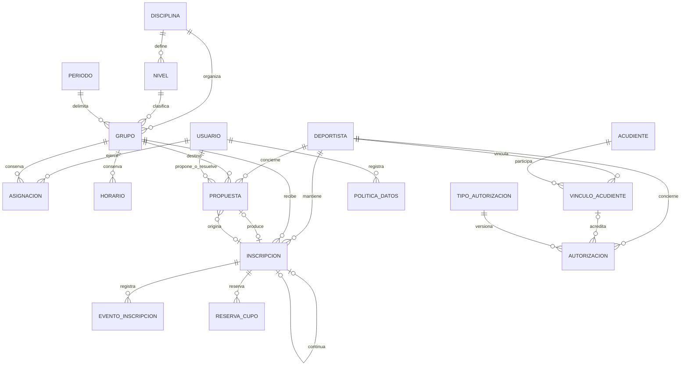

> Estado vigente — 28 de octubre de 2026: **deportistas.0001_initial e inscripciones.0001_initial aplicadas y verificadas en zona_bloque**, con respaldo integral. Cero migraciones pendientes, 69 comprobaciones reales revertidas y 172 pruebas PostgreSQL aprobadas. [Informe de aplicación](APLICACION_MIGRACIONES_FASE_3.md). Este documento conserva la entrega previa; sus referencias a autorización o esquema pendiente son históricas. La verificación visual conjunta aún está pendiente.

# Fase 3 — Implementación de deportistas e inscripciones

Fecha: 28 de octubre de 2026. **Incrementos 3A–3D implementados y probados en entornos aislados. Pendientes de aplicar en zona_bloque.**

No se aplicaron migraciones ni se crearon datos ficticios en la base real. No se modificaron credenciales, entornos virtuales, dependencias, documentos deportivos originales ni estilos generales. No hubo commits o push.

## 1. Funcionalidades y reglas definitivas

### 3A — Identidad y privacidad

- Deportista tiene UUID y código interno únicos, nombre, fecha de nacimiento, estado y versión. La misma ficha se reutiliza entre periodos y grupos; no tiene un nivel o grupo actual sobrescribible.
- Acudiente separa identidad/contacto de VinculoAcudiente. Parentesco no concede representación; una acción explícita registra quién verificó la facultad y cuándo.
- Autorizacion registra otorgante, tipo/finalidad versionada, decisión, declaración, vigencia, evidencia privada y revocación. Otorgamientos requieren referencia de evidencia; no se generan textos ni consentimientos.
- PoliticaDatos permite definir finalidad, criterio de conservación, procedimiento de supresión y referencia de aprobación. No tiene plazos legales predeterminados ni eliminación automática. Edad de autonomía es opcional, institucional y sin valor por defecto; sin una política única compatible se rechaza registrar una autorización personal del deportista. La edad se comprueba a la fecha de declaración.
- No hay cuentas nuevas de deportistas/acudientes, portal, fotos, vídeos, biometría o permisos para IA. Registrar una autorización no activa ninguna de esas capacidades.
- No se recopilan documentos oficiales, salud, EPS, dirección, colegio ni otros datos adicionales. Los motivos son breves y restringidos. No se fusionan homónimos automáticamente.

### 3B — Inscripciones y reservas

- Una Inscripcion es un tramo histórico de un deportista en un grupo existente. Periodo, disciplina y nivel se obtienen del grupo.
- Se permiten múltiples grupos cuando sus fechas y horarios son compatibles. Cambiar de nivel requiere el circuito pedagógico; el alta administrativa adicional no permite eludirlo.
- Ingreso inclusivo y salida exclusiva. El final operativo de un tramo abierto está limitado al final del periodo. Los horarios docentes existentes conservan su semántica inclusiva.
- Una suspensión requiere motivo y fecha de vencimiento expresa dentro del periodo. ReservaCupo conserva inicio, último día autorizado inclusive, responsable y liberación.
- La reserva ocupa cupo solo hasta su vencimiento. Desde el día siguiente, las consultas de capacidad excluyen esa plaza aunque aún no se haya registrado el procesamiento administrativo; el GET no escribe.
- Antes de operaciones de inscripción/traslado/estado se procesan reservas vencidas dentro de la transacción. Un comando y una acción POST permiten procesarlas de forma independiente. Se cierra el tramo con causa reserva_vencida y se crea un evento fechado al vencimiento efectivo, sin borrar historial.
- Si la operación posterior falla, su transacción también revierte ese procesamiento; el comando permite confirmarlo independientemente. No se simula una ejecución periódica que no esté configurada.
- Reanudar exige reserva e inscripción todavía vigentes y nueva validación de toda la vigencia restante, incluidos compromisos futuros incompatibles.
- Una reserva ya vencida no se prolonga silenciosamente: se cierra y, si procede, se hace un nuevo ingreso validado. Retiro y traslado requieren un tramo previo de al menos un día.
- Cupo calculado por máximo simultáneo sobre el intervalo, con salidas antes que entradas en una misma fecha. Se cuentan reservas e ingresos futuros efectivos; no se usa un contador mutable paralelo.
- Ediciones de cupo/horarios de los grupos existentes validan a sus inscritos y reservas y revierten si crean incompatibilidades. Estructura de grupo y fechas de periodo se protegen al existir historial de inscripciones, aunque no haya asignaciones docentes.
- Registro estado refleja el hecho administrativo; situacion_temporal distingue programada, periodo_finalizado y reserva_vencida sin escrituras de consulta.

### 3C — Propuestas y decisiones

Propuesta unifica las solicitudes administrativas y de cambio de nivel mediante tipo inscripcion/traslado/nivel; no duplica otro modelo SolicitudCambioNivel. Conserva autor, creación, deportista, origen, destino, fecha efectiva, justificación, versión de origen, estado, decisor, fecha, resolución y resultado.

- Profesor propone; no inscribe, traslada, suspende ni aprueba.
- Administrador y coordinador activo pueden aprobar/rechazar propuestas administrativas.
- Solo coordinador activo decide cambios de nivel; administrador no sustituye esa decisión.
- Aprobar valida y aplica en una sola transacción. Esta concreción sustituye la aprobación y aplicación separadas del plan original para reducir estados intermedios y carreras.
- Se rechazan doble aprobación, origen modificado, pérdida de permisos del decisor/autor, cambios de ámbito y conflictos de cupo/horario.
- Traslado cierra origen y crea destino enlazado, con eventos. No cambia el nivel del grupo anterior ni la identidad del deportista.
- Cancelación motivada de una propuesta pendiente por su autor autorizado o gestión operativa; no altera inscripciones.
- No hay ascensos por notas, antigüedad, color o IA. Cambios de nivel son decisiones humanas documentadas.

### Condiciones temporales del profesor

La consulta exige cuenta activa, asignación docente vigente hoy, grupo y periodo activos e inscripción vigente o reserva no vencida. No se amplía acceso introduciendo una fecha histórica en filtros.

Para proponer, el deportista ya debe estar dentro de ese ámbito; el destino también debe ser un grupo de su asignación actual y efectiva. Traslados y nivel requieren además origen propio vigente. No hay búsqueda de un padrón institucional externo al ámbito del docente. Las primeras altas corresponden a administración/coordinación.

Las propuestas se resuelven para la fecha operativa actual. Si vence esa fecha, deben cancelarse o rechazarse y presentarse nuevamente. No se habilitan retroactividad ni traslados programados. Historial y autoría permanecen aunque luego cambie el personal; la consulta docente sigue limitada a su ámbito actual.

### 3D — React

Rutas bajo /administracion, /coordinacion y /profesor:

- /deportistas: búsqueda, filtros, alta/edición según rol.
- /deportistas/:uuid: ficha individual y trayectoria autorizada.
- /inscripciones: alta, estados, reservas, traslado, cupos e historial.
- /propuestas: propuesta docente, decisiones y cancelación según rol.
- /autorizaciones: solo gestión; acudientes, vínculos, autorizaciones, tipos y políticas.

Reutiliza componentes, cliente CSRF, formularios, paginación, navegación y Sass existentes. Selectores consultan resultados paginados autorizados; no descargan todo el padrón. Se muestran errores de validación, versiones obsoletas, falta de cupo y esquema pendiente. No se renovó el diseño general.

## 2. Seguridad e integridad

- Sesiones Django, cookies HttpOnly y CSRF intactos. Todas las escrituras revalidan al actor en servidor.
- Servicios transaccionales comparten el bloqueo ordenado de usuarios de la organización existente, serializando cambios operativos, relevos y decisiones. Después bloquean las entidades afectadas.
- Un grupo sin inscritos también se bloquea para evitar dos altas sobre la última plaza. La misma serialización impide altas incompatibles para una persona en grupos diferentes.
- Propuestas se bloquean solo sobre su propia fila con select_for_update(of=("self",)); evita bloquear el lado nullable de un JOIN en PostgreSQL.
- FK/uniqueness/CHECK protegen coherencia local; capacidad y cruces entre tablas requieren el servicio. No afirmar que SQL manual que omite el servicio aplica esas reglas.
- Querysets de profesor filtrados antes de resolver objetos, serializador mínimo sin fecha de nacimiento ni acudientes, e historial sin motivos administrativos o responsables innecesarios.
- Formularios y acciones con lista cerrada de campos. Actores, estados de decisión y fechas de auditoría no vienen del cliente.
- Escrituras sensibles registradas en CambioAdministrativo con nombres de campos, sin valores personales o secretos. Eventos y reservas conservan los hechos específicos de negocio.
- Middleware existente mantiene Cache-Control: no-store, private para todas las APIs.
- No hay DELETE público, importación, carga de archivos ni endpoints de acceso familiar.

### Compatibilidad mientras falten migraciones reales

AccesoFase3 verifica las diez tablas requeridas. Las nuevas APIs responden **503 con mensaje controlado** mientras falten; no intentan consultar tablas inexistentes. Las guardas nuevas de los grupos no se activan hasta que el esquema esté disponible.

Comprobado sobre zona_bloque dentro de SET TRANSACTION READ ONLY: ninguna tabla de Fase 3 existe; resumen administrativo existente con administrador y periodo 4 devuelve 200; /api/deportistas/ devuelve 503. No se crearon sesiones ni registros para esta comprobación.

## 3. Archivos creados y modificados

### Creados

| Directorio | Archivos | Responsabilidad |
| --- | --- | --- |
| backend/deportistas/ | __init__.py, apps.py, models.py | Identidad, acudientes, vínculos, autorizaciones y política |
| backend/deportistas/ | permisos.py, serializers.py, servicios.py, views.py, urls.py | Ámbito, minimización, validación, auditoría y API |
| backend/deportistas/ | tests.py, migrations/__init__.py, migrations/0001_initial.py | Pruebas y esquema pendiente |
| backend/inscripciones/ | __init__.py, apps.py, models.py | Tramos, eventos, reservas y propuestas |
| backend/inscripciones/ | servicios.py, cancelacion.py, serializers.py, views.py, urls.py | Cupos, vencimiento, transiciones y decisiones |
| backend/inscripciones/ | tests.py, test_concurrencia.py, migrations/__init__.py, migrations/0001_initial.py | Historial, seguridad y carreras PostgreSQL |
| backend/inscripciones/management/ | __init__.py, commands/__init__.py, commands/liberar_reservas.py | Procesamiento explícito y auditado de vencimientos |
| backend/configuracion/ | settings_pruebas_postgresql.py | Base de prueba con nombre único |
| scripts/ | pruebas_postgresql_aisladas.py | Clúster temporal con binarios ya instalados; verifica puerto, data_directory y PID propios |
| frontend/src/componentes/ | FormularioRegistro.jsx | Formulario reutilizable y selectores paginados |
| frontend/src/paginas/ | Deportistas.jsx, Inscripciones.jsx, Propuestas.jsx, AcudientesAutorizaciones.jsx | Listados, ficha, historial y gestión por rol |
| frontend/src/pruebas/ | Fase3.test.jsx | 12 casos de UI y contratos |
| frontend/pruebas/ | navegador-fase3.cjs | 18 verificaciones responsivas con API ficticia |
| docs/ | IMPLEMENTACION_FASE_3.md | Entrega, pruebas e inventario para aprobación |

### Modificados

- backend/configuracion/settings.py: registra dos aplicaciones; no cambia credenciales o conexión.
- backend/configuracion/urls.py: incorpora nuevas rutas.
- backend/organizacion/servicios.py: protege estructura, cupos y horarios al existir inscripciones.
- backend/organizacion/serializers.py: protege fechas de periodo con historial de inscritos.
- frontend/src/Aplicacion.jsx: integra rutas por rol.
- frontend/src/componentes/Estructura.jsx: incorpora navegación.
- README.md, docs/PLAN_FASE_3_DEPORTISTAS.md y docs/MATRIZ_PERMISOS.md: estado, reglas definitivas, permisos y ejecución.

No se cambiaron Usuario, los modelos originales de organización, las migraciones aplicadas, login, estilos, paquetes o documentos originales de investigación/referencias.

## 4. Modelo y migraciones pendientes

### Inventario exacto

| Migración | Tablas nuevas |
| --- | --- |
| deportistas.0001_initial | deportistas_deportista, deportistas_acudiente, deportistas_vinculoacudiente, deportistas_tipoautorizacion, deportistas_autorizacion, deportistas_politicadatos |
| inscripciones.0001_initial | inscripciones_inscripcion, inscripciones_eventoinscripcion, inscripciones_reservacupo, inscripciones_propuesta |

Diez tablas, tres índices explícitos y 22 restricciones explícitas, además de PK, FK e índices de FK y unicidad generados por Django.

Índices explícitos: deportista_estado_nombre; inscripcion_grupo_fecha; inscripcion_persona_fecha.

| Tabla | Restricciones explícitas |
| --- | --- |
| deportistas_deportista | deportista_estado_valido |
| deportistas_tipoautorizacion | tipo_autorizacion_version_unica |
| deportistas_vinculoacudiente | vinculo_fechas_validas, vinculo_inicio_unico, vinculo_facultad_valida, vinculo_verificacion_completa |
| deportistas_autorizacion | autorizacion_otorgante_coherente, autorizacion_vigencia_valida, autorizacion_decision_valida |
| inscripciones_inscripcion | inscripcion_fechas_validas, inscripcion_estado_valido, inscripcion_cierre_coherente, inscripcion_inicio_unico, inscripcion_abierta_unica |
| inscripciones_propuesta | propuesta_tipo_valido, propuesta_estado_valido, propuesta_resolucion_coherente, propuesta_origen_coherente, propuesta_origen_pendiente_unica, propuesta_destino_pendiente_unico |
| inscripciones_reservacupo | reserva_fechas_validas, reserva_pendiente_unica |

UUID/código de deportista y UUID de acudiente son únicos. Las relaciones históricas usan PROTECT. No hay operaciones de borrado, renombrado, importación, carga inicial de personas ni alteración de tablas originales: solo CreateModel, AddIndex y AddConstraint en las aplicaciones nuevas.

Las migraciones se aplicaron correctamente en la base temporal PostgreSQL de pruebas. **En zona_bloque ambas están pendientes**, y el plan real comprobado contiene exactamente esas dos, sin reversión ni otras operaciones pendientes. No hay aprobación implícita para ejecutarlas.

### Relaciones



Los modelos incluyen marcas temporales, versión y responsables. PK/FK y el enlace de continuidad conservan la identidad y los niveles de los grupos históricos.

## 5. API implementada y permisos

Prefijo /api. Listados paginados; ningún endpoint permite DELETE.

| Rutas | Métodos y alcance |
| --- | --- |
| deportistas/ y deportistas/:uuid/ | GET por ámbito; POST/PATCH administrador/coordinador |
| deportistas/:uuid/trayectoria/ | GET de inscripciones filtradas |
| acudientes/, vinculos-acudientes/, autorizaciones/ | GET/POST/PATCH de gestión; autorizaciones no se editan, se revocan |
| vinculos-acudientes/:id/verificar/ | POST de gestión; registra facultad sin conceder acceso |
| autorizaciones/:id/revocar/ | POST de gestión, motivo y versión |
| tipos-autorizacion/, politicas-datos/ | GET de gestión; POST/PATCH solo administrador; textos utilizados requieren nueva versión |
| inscripciones/ y inscripciones/:id/ | GET por ámbito; POST de gestión |
| inscripciones/:id/suspender/, reanudar/, retirar/, trasladar/ | POST de gestión con motivo y versión |
| inscripciones/:id/historial/ | GET por ámbito, datos administrativos reducidos para profesor |
| inscripciones/cupos/?grupo=... | GET agregado del grupo permitido; desde/hasta opcionales dentro del periodo |
| inscripciones/liberar-reservas/ | POST sin campos, solo gestión operativa autorizada |
| propuestas/ y propuestas/:id/ | GET por ámbito; POST solo docente autorizado |
| propuestas/:id/aprobar/ o rechazar/ | POST A/C en administración; nivel solo C; resolución y versión |
| propuestas/:id/cancelar/ | POST autor autorizado o gestión; motivo en resolución y versión |

Las acciones rechazan campos fuera de su contrato. 403 deniega facultades, 404 oculta objetos fuera de ámbito, 400 valida datos y 409 señala versiones/conflictos. Filtros de inscripciones por deportista, grupo, periodo, nivel, disciplina y estado; búsquedas por código/nombre/grupo. Deportistas también admite filtros y búsqueda, propuestas estado y búsqueda.

Los tipos/versiones de autorización no incluyen un gestor de publicación o capacidades biométricas. No se habilitó un endpoint de supresión física ni se pretende que el texto de una política ejecute borrados.

## 6. Pruebas ejecutadas y resultados

| Verificación final | Resultado real |
| --- | --- |
| Suite completa PostgreSQL temporal | **170 pruebas aprobadas**, incluidas las 114 anteriores y 56 nuevas |
| Suite completa SQLite en memoria | 170 descubiertas; **166 aprobadas, 4 omitidas explícitamente** por depender de bloqueos PostgreSQL |
| Vitest React | **45 aprobadas**: 33 anteriores y 12 nuevas |
| Cliente HTTP Node | **6 aprobadas** |
| Navegador Edge headless con API ficticia | **18 vistas/formularios** a 390/768/1366 px; sin errores JS ni desbordamiento horizontal |
| npm run build | Aprobado, 64 módulos |
| Django check --database default | Sin incidencias |
| makemigrations --check --dry-run en settings de prueba | Sin cambios pendientes de generar |
| Revisión del plan de zona_bloque en solo lectura | Solo las dos migraciones nuevas; no aplicadas |
| Compatibilidad con base real sin tablas nuevas | Resumen anterior 200; módulo nuevo 503 controlado |
| npm audit | No completado: fallo al consultar registry.npmjs.org; sin conclusión sobre vulnerabilidades |

Las cuatro pruebas de concurrencia PostgreSQL verifican:
1. Última plaza: una alta confirmada y otra rechazada.
2. Una persona intenta dos grupos incompatibles: una confirmada.
3. Dos aprobaciones de la misma propuesta: un solo traslado, sin duplicar origen/destino.
4. Desactivación del coordinador durante aprobación: resultado serializado válido; si la desactivación gana, la propuesta no se aplica. Si la aprobación gana, se conserva la decisión autorizada previa y después se desactiva.

También se probaron unicidad/código permanente, grupos compatibles, fechas fuera de periodo, reservas inclusivas, vencimiento y liberación única, GET sin escrituras, reanudación con conflicto futuro, edición de capacidad y horarios, traslados con rollback, historial sin docentes, consulta mínima del profesor, propuestas ajenas, permisos revocados, relevo, origen obsoleto, rechazo/cancelación, conservación de historial, autorizaciones/revocación, políticas, CSRF y campos falsificados.

### Entorno y errores resueltos

- El rol PostgreSQL existente denegó crear una base de pruebas. No se cambiaron privilegios. Se utilizaron los binarios PostgreSQL 17 ya instalados para un clúster local separado, con puerto y directorio únicos, sin conexión de pruebas a zona_bloque.
- El script verifica data_directory y PID del proceso creado antes de ejecutar Django. La base de prueba tiene nombre test_zdb_fase3_... y se elimina al terminar; el clúster se detiene siempre. Archivos privados de evidencia en respaldos/pruebas_fase3_* quedan ignorados.
- pg_ctl start falló por el token restringido de Windows. Se sustituyó por un proceso hijo oculto postgres.exe, controlado por su handle, manteniendo parada explícita y verificaciones de identidad.
- PostgreSQL detectó inicialmente FOR UPDATE sobre un lado nullable de JOIN. Se corrigió restringiendo el bloqueo a la propuesta; la suite completa posterior pasó.
- Se ajustaron selectores de las pruebas React y el interceptor de las pruebas de navegador para que no interceptara módulos /src/api/. No fue necesario alterar el cliente HTTP de la aplicación.
- Las verificaciones de navegador usan datos ficticios e intercepción; no se presentan como una revisión visual con deportistas reales.
- No se instalaron dependencias. Se reutilizaron paquetes .venv-local con scripts/django_local.py y el Python auxiliar ya documentado.

## 7. Comandos de verificación y arranque

Desde la raíz, con el ejecutable del entorno existente si funciona; alternativa comprobada en este entorno:

```powershell
$pythonLocal = 'C:\Users\57310\.cache\codex-runtimes\codex-primary-runtime\dependencies\python\python.exe'
& $pythonLocal scripts/django_local.py test cuentas organizacion paneles deportistas inscripciones --settings=configuracion.settings_pruebas
& $pythonLocal scripts/pruebas_postgresql_aisladas.py
& $pythonLocal scripts/django_local.py check --database default
& $pythonLocal scripts/django_local.py migrate --plan
```

El último comando solo muestra el plan. **No ejecutar migrate sin --plan hasta la aprobación.** El script de pruebas usa únicamente su clúster temporal y no aplica migraciones en zona_bloque.

```powershell
Set-Location frontend
npm.cmd test
npm.cmd run build
npm.cmd run test:api
npm.cmd run dev
```

Backend habitual: scripts/django_local.py runserver 127.0.0.1:8000 con el Python del entorno existente o auxiliar. Mantener una sola instancia y recarga activa. No se detuvo ni se reinició manualmente la instancia habitual; su recarga automática depende del proceso existente.

Tras aprobar y aplicar migraciones, el acceso local será http://localhost:5173/administracion/deportistas, /coordinacion/deportistas y /profesor/deportistas, más las rutas del apartado 1. Mientras tanto muestran esquema pendiente; los paneles anteriores permanecen disponibles.

Para vencimientos, **solo después de aplicar migraciones y autorizar la operación real**:

```text
scripts/django_local.py liberar_reservas --responsable ID_DE_GESTOR_ACTIVO
```

No se configuró una tarea Windows que escriba en la base real. Antes de producción, acordar frecuencia y responsable de esa ejecución. La liberación lógica de capacidad por fecha no depende de una tarea; la materialización del evento se realiza por comando/POST o por una operación válida de gestión.

## 8. Plan de aplicación segura — pendiente de aprobación expresa

1. Reconfirmar PostgreSQL zona_bloque y el plan exacto de dos migraciones. Si aparecen otras, reversión, cambios de datos o archivos inesperados, detenerse.
2. Coordinar una pausa de escrituras y comprobar versión de código/instancia. Capturar conteos y huellas de las tablas de negocio existentes.
3. Generar nuevo pg_dump custom privado en respaldos/, sin imprimir credenciales. Verificar catálogo, lectura/descompresión completa y SHA-256. Conservar manifiesto y comprobar acceso al archivo.
4. Revisar SQL de las dos migraciones y sus FK/índices. No hay DROP, borrados ni transformación de datos actuales. Las tablas nuevas comienzan vacías.
5. Con aprobación escrita de esos nombres concretos, aplicar exclusivamente deportistas.0001_initial e inscripciones.0001_initial, en orden de dependencia y con atomicidad global. No ejecutar un migrate abierto a cambios adicionales.
6. Crear/sincronizar únicamente metadatos Django de las aplicaciones nuevas mediante el mecanismo estándar. No conceder roles, permisos de personal o cuentas a deportistas.
7. Verificar registro, diez tablas, índices y restricciones; confirmar que no quedan cambios autorizados pendientes. Comparar datos de negocio anteriores y comprobar nuevas tablas vacías.
8. Probar consultas autenticadas y restricciones sobre la base real sin insertar demostraciones. Las pruebas de escrituras y carreras se mantienen en clúster aislado.
9. Ante fallo durante la transacción, rollback y nueva comprobación. Tras confirmar e incorporar datos, no revertir automáticamente migraciones que eliminan tablas: detener nuevas operaciones y preparar corrección.
10. Recuperación de respaldo requiere un procedimiento específico: validar restauración en un destino aislado autorizado y autorizar expresamente cualquier reemplazo de la base real. No sobrescribir zona_bloque ni otra base como recuperación automática.

No se generó respaldo nuevo de la base real en este encargo porque no se va a aplicar el esquema hasta la siguiente aprobación.

## 9. Riesgos y decisiones institucionales pendientes

- Aportar tipos/finalidades, textos y evidencias institucionales aprobados antes de registrar autorizaciones reales. No hay catálogo legal prefabricado.
- Definir criterio de conservación/supresión y política de autonomía aplicable; el sistema permite registrarlos, no determina cumplimiento jurídico por sí solo ni inventa plazos universales.
- La supresión efectiva o anonimización requerirá un flujo específico aprobado y compatible con el historial; esta entrega permite definir la política y mantiene el borrado físico fuera de API.
- Acordar responsable/frecuencia de procesamiento administrativo de reservas. Hoy se dispone de comando, acción y procesamiento transaccional en operaciones.
- Confirmar si en el futuro se requiere retroactividad, propuestas para fechas futuras o destinos fuera de asignación docente; permanecen cerrados en esta entrega.
- No hay importación masiva, fusión automática de identidades ni documentos oficiales. Antes de altas reales, la institución debe controlar posibles registros repetidos de una misma persona.
- Bloqueo global de usuarios adecuado al volumen actual; optimizarlo requeriría revisar conjuntamente servicios y pruebas.
- Auditoría npm pendiente de conectividad. No se afirma ausencia de vulnerabilidades.
- No hubo datos reales nuevos de deportistas ni módulos futuros.

**Punto de parada:** código y documentación preparados; pruebas aisladas aprobadas. Se solicita autorización exclusivamente para las dos migraciones inventariadas, con respaldo y verificaciones previas. Hasta recibirla, zona_bloque no se migra.
