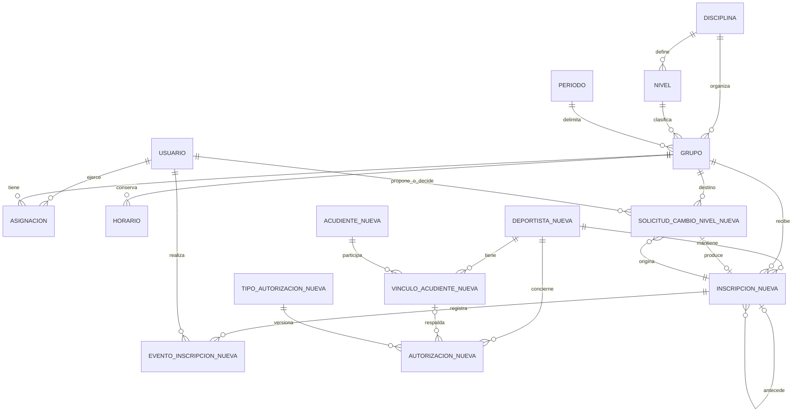

> Estado vigente — 28 de octubre de 2026: **deportistas.0001_initial e inscripciones.0001_initial aplicadas y verificadas en zona_bloque**, con respaldo integral. Cero migraciones pendientes, 69 comprobaciones reales revertidas y 172 pruebas PostgreSQL aprobadas. [Informe de aplicación](APLICACION_MIGRACIONES_FASE_3.md). Este documento conserva la entrega previa; sus referencias a autorización o esquema pendiente son históricas. La verificación visual conjunta aún está pendiente.

> Actualización de implementación autorizada — 28 de octubre de 2026. Las decisiones definitivas del propietario sustituyen las propuestas P1–P8 que contradigan esta nota. Incrementos 3A–3D implementados y probados en entorno aislado; **deportistas.0001_initial e inscripciones.0001_initial aplicadas y verificadas en zona_bloque**. [Entrega, pruebas y plan de aplicación segura](IMPLEMENTACION_FASE_3.md).
>
> Reserva de suspensión con último día autorizado explícito, motivo, actor y vencimiento; cuenta como ocupación y se libera con procesamiento transaccional auditable. Múltiples grupos compatibles por fechas/periodos/horarios; ediciones posteriores de grupo también se validan. Profesor propone, nunca aprueba ni ejecuta inscripciones/traslados. A/C resuelven administración; solo coordinador activo decide cambios de nivel. Propuesta conserva origen/destino, responsables, justificación y resolución. Aprobar y aplicar son una única transacción.
>
> Ámbito temporal docente implementado: deportista visible por inscripción/reserva y asignación vigentes; destino dentro de su asignación actual y efectiva. Propuestas para la fecha operativa actual; sin acceso al padrón externo, retroactividad o traslados programados. Profesor no recibe datos de acudientes ni fecha de nacimiento. Los cambios no modifican historia anterior.
>
> Identidad, contactos, facultad verificada y autorizaciones por finalidad están separados. No hay consentimientos precargados ni acceso de menores/familias, imágenes, biometría o IA habilitados. PoliticaDatos permite definir conservación, supresión y autonomía con referencia institucional, sin plazos legales o edad predeterminados. La supresión física requiere un flujo aprobado posterior.
>
> El resto del documento conserva el análisis original como antecedente; sus alternativas, nombres y fases se concretan o sustituyen por el informe de implementación enlazado.

# Fase 3 — Gestión de deportistas e inscripciones

Fecha: 28 de octubre de 2026. Estado: **análisis técnico y propuesta pendientes de aprobación**.

Este documento es el único archivo creado en este encargo. No autoriza programación ni aplicación de migraciones. Las reglas marcadas como propuestas requieren confirmación; las decisiones pendientes no se resolverán automáticamente al implementar.

## 1. Diagnóstico de la arquitectura actual

### 1.1 Alcance y fuentes

La instrucción actual delimita esta Fase 3 a deportistas, inscripciones y acudientes. Prevalece sobre la numeración y el alcance más amplio del prompt maestro original. Quedan fuera estudiantes con acceso autenticado, planificación deportiva, sesiones de entrenamiento, asistencia, evaluaciones, cargas, vídeos, ClimbVision-AI e importaciones de inventarios o datos personales.

Revisión directa del proyecto:

| Área | Archivos examinados | Aprovechamiento |
| --- | --- | --- |
| Identidad interna | backend/cuentas/models.py, servicios_usuarios.py y permisos.py | Usuario y sus tres roles de personal; sesiones Django y CSRF |
| Organización | backend/organizacion/models.py, servicios.py, alcance.py, permisos.py, views.py y urls.py | Disciplina, Nivel, Periodo, Grupo, Horario y Asignacion |
| Auditoría | backend/auditoria/models.py y servicios.py | CambioAdministrativo y registrar, sin duplicar otro registro genérico |
| API y paneles | backend/configuracion/urls.py, backend/paneles/urls.py y views_resumen.py | Rutas existentes y tableros organizativos |
| React | frontend/src/Aplicacion.jsx, componentes/Estructura.jsx, Gestion.jsx, Estado.jsx; api/cliente.js y gestion.js | Rutas por rol, navegación responsiva, formularios, paginación, errores y cliente CSRF |
| Requisitos institucionales | PROMPT_MAESTRO_CODEX_ZONA_DE_BLOQUE.md, MATRIZ_PERMISOS.md, FASE_2.md | Requisitos previos y diferencias que deben confirmarse |
| Verificación previa | APLICACION_COORDINADOR_UNICO.md, VERIFICACION_COORDINACION_TABLERO.md y DIAGNOSTICO_404_TABLERO.md | Línea base de pruebas, migraciones y operación local |

Se mantiene el monolito modular Django/DRF, PostgreSQL y React/JavaScript/Vite/Sass. No se justifican microservicios, otra base de datos, nuevas jerarquías de coordinación ni dependencias de IA.

### 1.2 Modelos y permisos que ya existen

- Usuario deriva de AbstractUser. Sus roles válidos son profesor, coordinador y administrador. La unicidad condicional impide dos coordinadores activos. El diseño de un administrador principal es una decisión organizativa; el modelo no limita a una sola cuenta administradora.
- Grupo ya contiene disciplina, nivel, periodo, cupo máximo y estado. No se crearán nuevos catálogos equivalentes ni una segunda relación independiente grupo-periodo.
- Asignacion representa profesores/coordinadores asignados a grupos y tiene fechas históricas. **No representa inscripciones de deportistas** ni debe reutilizarse con otro significado.
- Horario conserva filas anteriores mediante activo; sus días van de 0 a 6 y no admite franjas nocturnas partidas.
- es_coordinador_activo comprueba identidad vigente. No basta comprobar el texto del rol.
- grupos_permitidos y asignaciones_permitidas delimitan al profesor por asignaciones vigentes y fechas del periodo. No conceden alcance histórico global por haber enseñado alguna vez.
- Coordinación puede gestionar grupos, horarios y asignaciones docentes de toda la escuela. Usuarios, roles, seguridad y escritura de catálogos siguen siendo administrativos.
- Los servicios críticos usan transaction.atomic y bloqueos; actualmente bloquear_usuarios adquiere bloqueos de usuarios ordenados. La Fase 3 debe respetar este protocolo antes de añadir otros bloqueos.
- CambioAdministrativo guarda actor, entidad, identificador, acción, nombres de campos y fecha. No conserva valores personales previos/posteriores. Los historiales de negocio deben almacenar explícitamente sus hechos, sin convertir este registro genérico en una copia de fichas personales.

### 1.3 Brechas e impactos reales

No existen Deportista, Acudiente o Inscripcion, ni reglas de ocupación por deportistas. No se puede sumar una nueva API sin adaptar también, cuando se autorice:

1. guardar_grupo: impedir bajar cupos por debajo de reservas y horarios que generen cruces para inscritos.
2. Guardas de estructura de Grupo y fechas de Periodo: hoy consideran principalmente historial docente; deberán reconocer también historial de inscripciones aunque el grupo no tenga docentes.
3. Archivado de grupos/deportistas y desactivación de catálogos: no deben dejar inscripciones abiertas incoherentes.
4. Consultas de alcance: un profesor no puede utilizar el nuevo listado para descubrir el padrón institucional o deportistas de otros grupos.
5. Correcciones de identidad y privacidad: el historial operativo no autoriza divulgar contactos ni conservar datos personales indefinidamente sin una política.
6. Los cambios de nivel deben representarse en el cambio de inscripción, sin editar retrospectivamente el nivel del grupo de origen.

### 1.4 Migraciones y pruebas: evidencia y límites

Se realizó exclusivamente una consulta PostgreSQL dentro de una transacción con SET TRANSACTION READ ONLY. Destino efectivo confirmado: **zona_bloque**. Historial consistente; **cero migraciones pendientes**. Índice un_coordinador_activo presente, único y válido.

| Aplicación | Migraciones aplicadas verificadas |
| --- | --- |
| auditoria | 0001_initial |
| cuentas | 0001_initial, 0002_eventoacceso, 0003_solicitudrestablecimiento, 0004_usuario_un_coordinador_activo |
| organizacion | 0001_initial, 0002_catalogos_iniciales |

No se generaron ni aplicaron migraciones, ni se hicieron escrituras o fixtures en PostgreSQL. Se deshabilitó la escritura de bytecode para esta inspección Django.

Se revisó la distribución de pruebas en cuentas/tests, organizacion/tests y paneles/tests y las tres suites React. La última ejecución comprobada del encargo anterior aprobó 114 pruebas backend. Los informes de cierre registran 33 frontend y 6 del cliente HTTP; la auditoría npm quedó sin resultado por fallo del registro. **No se ejecutaron nuevamente las suites en este análisis** ni se presentan pruebas de Fase 3 como existentes.

La incidencia previa de rutas se resolvió deteniendo el Django antiguo con --noreload. En futuras verificaciones se comprobará que haya una sola instancia actual en 8000; no se modificaron servidores en este encargo.

### 1.5 Referencias metodológicas y su grado de aprobación

Referencias locales dentro de [ZONA_DE_BLOQUE_PAQUETE_MAESTRO_V01](investigacion_deportiva/ZONA_DE_BLOQUE_PAQUETE_MAESTRO_V01/):

| Documento | Lo que aporta al diseño | Lo que NO autoriza |
| --- | --- | --- |
| 00_LEER_PRIMERO/LEEME_PAQUETE_MAESTRO.md | Distinguir candidatos, borradores y contenidos institucionales aprobados | Importar los 224 registros combinados o tratarlos como ejercicios únicos verificados |
| 04_TRAZABILIDAD_Y_SEGURIDAD/ZB_AUDITORIA_COMPENDIO_Y_PLAN_INVESTIGACION.md | Procedencia, revisión, autores y fechas verificables | Convertir legibilidad OCR en validación pedagógica o de seguridad |
| 04_TRAZABILIDAD_Y_SEGURIDAD/REVISION_PILOTO_16_JUEGOS_Y_SEGURIDAD_ZONA_DE_BLOQUE.md | Revisión docente/coordinadora explícita y separación de hechos y propuestas | Usar sus niveles o precauciones como prescripciones aprobadas |
| 03_MANUAL_Y_FORMATOS/MANUAL_TECNICO_PILOTO_JUEGOS_ZONA_DE_BLOQUE.md | Mantener autoría, versión y estado de revisión | Implantar sus actividades, etiquetas, edades, colores o métricas |
| 03_MANUAL_Y_FORMATOS/F03_ESPECIFICACION_SESION_ZONA_DE_BLOQUE.md | Futuras referencias estables a grupo y deportista | Crear sesiones en esta fase |
| 03_MANUAL_Y_FORMATOS/F04_BIBLIOTECA_EJERCICIOS_ZONA_DE_BLOQUE.md | Separar propuesta y aprobación | Crear bibliotecas ni reglas automáticas de ascenso |
| 03_MANUAL_Y_FORMATOS/F05_CONTROL_CARGAS_ZONA_DE_BLOQUE.md | Historial y distinción entre identificación e inscripción | Registrar cargas, RPE o datos clínicos |

El LEEME declara F03/F04/F05 borradores no aprobados y otros formatos incompletos. Los inventarios CSV se identificaron por nombre y contexto, sin importarlos ni convertirlos en requisitos. No se consultaron ni modificaron Excel personales, ni se siguieron enlaces externos del material como si fueran requisitos.

**Requisitos aprobados para diseñar:** ficha permanente, fecha de nacimiento, inscripciones históricas, acudientes y autorizaciones diferenciadas, control de cupos, roles acotados, doble intervención profesor/coordinador en ascensos, auditoría y preparación conceptual de acceso futuro. **No aprobados aún:** políticas concretas de suspensión, concurrencia de grupos, datos identificativos adicionales, formularios de autorización y reglas pedagógicas de ascenso.

## 2. Modelo de datos recomendado

### 2.1 Separación por responsabilidad

Proponer dos aplicaciones pequeñas: **deportistas** para identidad, contactos y autorizaciones; **inscripciones** para vínculos deportivos, eventos y solicitudes de cambio de nivel. Ambas dependen de cuentas, organizacion y auditoria. No introducir una aplicación de jerarquías.

Cada tabla nueva tendrá una PK interna BigAutoField. Las referencias históricas usarán PROTECT; no habrá DELETE público. UUID de consulta no sustituye permisos. Fechas operativas en America/Bogota; marcas de auditoría con zona horaria. Los nombres son propuestas de dominio, no archivos ni migraciones ya creados.

### 2.2 Entidades y campos

| Entidad propuesta | Campos y relaciones principales | Restricciones e índices recomendados |
| --- | --- | --- |
| Deportista | identificador_publico UUID inmutable; codigo_interno único e inmutable; nombres, apellidos; fecha_nacimiento; estado activo/inactivo/archivado; fecha_alta; motivo_estado como código; creado_por y actualizado_por a Usuario; creado_en, actualizado_en; version entera | UUID y código únicos; CHECK de estado y versión positiva; índice estado/apellidos/nombres. Fecha de nacimiento no futura validada por servicio; no edad fija almacenada |
| Acudiente | identificador_publico UUID; nombres, apellidos; telefono y correo opcionales; activo; creado_por, actualizado_por y marcas temporales | UUID único; al menos un canal de contacto al habilitar un vínculo operativo; no unicidad de nombres, teléfono o correo |
| VinculoAcudiente | deportista, acudiente; parentesco declarado opcional; fecha_inicio y fecha_fin exclusiva; es_contacto_principal; facultad_para_autorizar pendiente/verificada/no_acreditada; verificada_por y verificada_en opcionales | FKs PROTECT; fechas ordenadas; unicidad deportista/acudiente/fecha_inicio; índice deportista/fecha_fin. Exclusión de solapamiento de la misma pareja y un único contacto principal vigente mediante servicio transaccional |
| TipoAutorizacion | codigo, version, finalidad descrita institucionalmente; referencia_texto_aprobado; activo; aprobado_por administrador y aprobado_en | Único codigo/version; una versión utilizada es inmutable. Sin finalidades ni textos precargados inventados |
| Autorizacion | deportista; tipo y versión mediante FK; otorgante deportista/acudiente; vinculo_acudiente opcional; decision otorgada/denegada; otorgada_en o declarada_en; vigente_desde, vigente_hasta opcional; revocada_en; sustituye opcional a otra Autorizacion; registrada_por y registrada_en; referencia_evidencia privada opcional | CHECK de otorgante y presencia de vínculo coherentes; fechas ordenadas; autorrelación sin ciclos por servicio; índices deportista/tipo/vigencia. No almacenar imágenes de firmas o documentos por defecto |
| Inscripcion | deportista; grupo; fecha_ingreso inclusiva; fecha_salida exclusiva opcional; estado activa/suspendida/finalizada; causa_salida retiro/traslado/fin_periodo/correccion cuando corresponda; inscripcion_anterior opcional; creado_por, creado_en, version | FKs PROTECT; CHECK salida mayor que ingreso; coherencia estado/causa/fecha_salida; único deportista/grupo/fecha_ingreso; único deportista/grupo cuando fecha_salida nula; índices grupo/fechas y deportista/fechas |
| EventoInscripcion | inscripcion; tipo ingreso/suspension/reanudacion/retiro/traslado_origen/traslado_destino/correccion; estado_anterior, estado_resultante; fecha_efectiva; registrado_en; actor; motivo_codigo; referencia a inscripción relacionada opcional | Solo inserción desde servicio; índice inscripcion/fecha_efectiva/id; no editar ni borrar eventos. Mantener estado y eventos en una transacción |
| SolicitudCambioNivel | inscripcion_origen; grupo_destino; profesor_proponente; coordinador_decisor opcional; propuesta_en; decidida_en; estado pendiente/aprobada/rechazada/cancelada/aplicada; fecha_efectiva_propuesta; motivo pedagógico breve y restringido; version_inscripcion_origen; inscripcion_resultante opcional; aplicada_por y aplicada_en opcionales | FKs PROTECT; CHECK de campos obligatorios por estado; una solicitud pendiente o aprobada por inscripción de origen mediante unicidad condicional; resultado único; índices estado/propuesta_en e inscripcion_origen |

**Identidad permanente:** Deportista no tiene nivel_actual, grupo_actual ni periodo_actual. Se obtienen de inscripciones y grupos según la fecha consultada. Puede tener varias etapas y, si se aprueba, varias inscripciones compatibles. Nunca crear un segundo deportista al cambiar de periodo o grupo.

**Periodo, disciplina y nivel:** se derivan de Inscripcion.grupo. No duplicarlos como FKs editables en Inscripcion ni en SolicitudCambioNivel. El grupo de origen/destino queda protegido estructuralmente cuando tiene historial. Si se requiere conservar también nombres históricos de catálogos, definir versionado de etiquetas en otra decisión; una FK estable conserva identidad, no un nombre que luego se renombre.

**Estado de la persona y de su inscripción:** inactivar la ficha no equivale a retirar una inscripción. La operación deberá rechazar o resolver explícitamente inscripciones abiertas; no realizar retiros silenciosos en cascada.

**Identificación mínima:** no proponer documento nacional, EPS, dirección residencial, colegio, sexo, diagnósticos, fotografías ni biometría como campos obligatorios. Posible documento oficial solo tras justificar necesidad, alcance, validación y acceso. Nombres iguales y fecha de nacimiento coincidente generan una advertencia administrativa, nunca fusión automática. Acudientes con un mismo contacto tampoco se fusionan automáticamente.

**Capacidades de las autorizaciones:** un vínculo familiar no demuestra representación ni facultad de consentir. El personal registra una decisión respaldada; no la concede en nombre de la familia. Un rechazo, revocación o ausencia de registro no se interpreta como autorización. Contacto, representación, retiro del menor, tratamiento de datos e imagen/vídeo no son equivalentes; las finalidades que realmente se registren deben definirse y aprobarse individualmente. Imagen/vídeo y acceso digital permanecen deshabilitados aunque se llegase a aportar una autorización externa.

### 2.3 Diagrama de relaciones

Las entidades marcadas NUEVA son propuestas; el resto existe. Las cuentas futuras no forman parte del esquema a crear en esta fase.

Las FKs a Usuario de creación, edición y auditoría, omitidas parcialmente para legibilidad, siempre conservarán autoría. La condición de profesor/coordinador se verifica al actuar; un cambio posterior de rol no borra decisiones históricas.

## 3. Reglas de negocio propuestas

### 3.1 Inscripción y trayectoria

1. Crear ficha no inscribe ni crea una cuenta. Alta y primera inscripción pueden ser pasos separados.
2. Toda inscripción referencia un grupo real con disciplina, nivel y periodo coherentes y habilitados. Ingreso dentro del periodo. La salida exclusiva puede ser el día posterior a fecha_fin del periodo; nunca posterior.
3. Usar intervalos semiabiertos: ingreso incluido y salida excluida. Las fechas existentes de Asignacion siguen siendo inclusivas; no modificar su semántica, sino convertirlas al comprobar cruces.
4. La vigencia de una inscripción abierta termina operativamente al acabar su periodo aunque fecha_salida sea nula. La interfaz calcula programada, vigente o terminada por fecha; no depende de una tarea nocturna para aplicar restricciones o liberar cupos.
5. No actualizar grupo o fecha_ingreso mediante PATCH una vez confirmada la inscripción. Trasladar cierra el tramo original y crea otro vinculado, con eventos y auditoría en una transacción.
6. Retiro conserva la inscripción. Reingreso posterior crea una nueva; reanudar una suspensión conserva la misma con un evento.
7. En traslado con fecha D, origen deja de ocupar desde D y destino ocupa desde D. Debe haber duración positiva en ambos tramos; traslado del mismo día de ingreso requiere un flujo de corrección explícito, no un historial ficticio.
8. No permitir corrección de hechos históricos mediante un PATCH genérico. Las rectificaciones administrativas deben dejar motivo, actor y evento compensatorio; nunca inventar un profesor proponente para cubrir una importación o corrección.
9. El primer incremento propondrá transiciones efectivas en la fecha operativa actual. Retroactividad, retiros futuros y traslados programados requieren una política específica antes de habilitarlos. Las altas con ingreso futuro dentro del periodo pueden mostrarse como programadas y deben reservar cupo desde su fecha.
10. La trayectoria se consulta por deportista y fecha, con enlaces a periodos, grupos y decisiones, respetando el ámbito del solicitante. No incluye valoraciones ni resultados deportivos.

### 3.2 Cupos, duplicados e incompatibilidades

- Cupo derivado de Grupo.cupo_maximo; no almacenar un contador paralelo como fuente de verdad.
- Propuesta P1: la suspensión **reserva cupo** hasta reanudación o salida. Permite una política simple y evita perder una plaza de forma implícita. Si se decide liberarlo, habrá que modelar intervalos de ocupación y revalidar capacidad al reanudar antes de programar esa alternativa.
- La ocupación incluye las reservas efectivas de cada día, también inscripciones programadas. Excluye periodos fuera de vigencia y tramos ya finalizados.
- Para un ingreso futuro se compara el máximo de ocupación durante todo su intervalo, no únicamente el total de hoy ni la suma de todas las inscripciones que alguna vez se solapan. Evaluar los puntos de entrada/salida, procesando salidas antes de entradas del mismo día.
- Rechazar dos inscripciones solapadas del mismo deportista en el mismo grupo, incluidas suspendidas. Las restricciones únicas no cubren todos los solapamientos finitos: estos se validan bajo bloqueo del deportista y grupos.
- Propuesta P2: permitir varios grupos únicamente con horarios compatibles; dentro de una disciplina, mantener el mismo nivel simultáneo. Puede sustituirse por una política de un solo grupo por disciplina, si la institución lo prefiere. No inferir la política desde el orden numérico de niveles.
- Cruces: mismos días de entrenamiento y horas solapadas en fechas realmente comunes; franjas contiguas permitidas. Comparar también disciplinas diferentes. Para seguridad operativa, una suspensión que reserva plaza conserva la validación de compatibilidad; cualquier excepción debe aprobarse.
- Sin horarios definidos no se puede confirmar compatibilidad: rechazar confirmación y solicitar completar el grupo. No asumir que un calendario vacío significa disponibilidad.
- Las ediciones de horarios/cupos existentes deben pasar por estas mismas validaciones, incluso si las ejecuta un administrador. No hay un bypass institucional de integridad.

**Concurrencia:** usar transaction.atomic, revalidar el actor vigente y adquirir bloqueos en un orden único. Mantener primero los bloqueos actuales de Usuario; después Deportista por PK, Grupo por PK, Inscripcion por PK y SolicitudCambioNivel cuando aplique. Las operaciones sobre varias personas bloquean todos los deportistas afectados de forma ordenada antes de grupos. No descubrir y bloquear deportistas después de tomar grupos: para cambios globales de horario se determinarán y revalidarán los afectados tras el bloqueo inicial compartido de usuarios.

Bloquear el grupo incluso cuando no tenga inscripciones: evita la carrera por la última plaza. Bloquear deportista evita dos inscripciones incompatibles simultáneas en grupos distintos. El protocolo inicial de usuarios ya serializa escrituras operativas; conservarlo es apropiado para el tamaño de la empresa. Optimizarlo posteriormente exigiría revisar conjuntamente todos los servicios y pruebas de interbloqueos.

La capacidad y los cruces entre tablas son invariantes de servicio, no CHECK simples. Las restricciones de PostgreSQL cubren unicidad, FKs y coherencia local. No proponer ahora extensiones, triggers ni constraints de exclusión que cambien los requisitos de instalación. No afirmar garantía absoluta ante SQL manual que eluda el servicio; limitar escrituras operativas a la API autorizada y tratar los scripts administrativos con las mismas validaciones.

### 3.3 Cambios de nivel y responsabilidad pedagógica

- No fijar edades por nivel, puntajes, saltos permitidos, permanencias mínimas o criterios automáticos a partir del material preliminar. Nivel.orden sirve para presentación, no demuestra habilitación para ascender.
- Propuesta: profesor asignado y vigente propone desde una inscripción propia hacia un grupo destino explícito de la misma disciplina y nivel distinto. No cambia el nivel de la ficha ni del grupo.
- El coordinador activo revisa y aprueba o rechaza. Profesor y coordinador intervienen como personas distintas. Guardar ambos actores, las fechas de propuesta/decisión y, al ejecutarse, fecha efectiva y actor ejecutor.
- Administrador consulta y ejecuta una transferencia aprobada, pero no sustituye la decisión pedagógica mediante un cambio directo de grupo. Un traslado a otro nivel exige siempre SolicitudCambioNivel válida.
- Una aprobación no reserva por sí sola cupo ni modifica la inscripción. Al aplicar, volver a validar capacidad, calendario, vigencia de la inscripción, destino y versión de origen; cerrar y abrir inscripciones, enlazar resultado, marcar aplicada y auditar atómicamente.
- Si la inscripción cambió, devolver conflicto; no aplicar una aprobación sobre un origen distinto. Una solicitud no puede ejecutarse dos veces ni editar su destino tras aprobación; un cambio exige cancelación y nueva propuesta.
- Un relevo de coordinador no borra decisiones previas. Antes de decidir se verifica al titular actual; una decisión registrada conserva al decisor original. La política de caducidad de aprobaciones queda pendiente.
- Para un deportista nuevo se permite asignar un nivel inicial sin fingir ascenso histórico. Se necesita acordar quién decide esa ubicación inicial; proponer coordinación. No requiere implementar pruebas o evaluaciones.
- Traslado de igual nivel es operación organizativa de coordinación/administración. Cambios correctivos de nivel y descensos no tendrán bypass genérico: requieren acordar el procedimiento o usar el mismo circuito de doble intervención.

### 3.4 Acudientes y autorizaciones

- La condición de menor se deriva de fecha_nacimiento y de la política institucional aprobada. No programar un umbral de mayoría de edad como si ya estuviera validado en este encargo.
- Propuesta P4: permitir ficha preliminar sin contacto completo, pero impedir confirmar inscripción de un menor sin vínculo y contacto principal verificados según la política institucional. No etiquetar una autorización como legalmente suficiente desde el software.
- Permitir hermanos vinculados a un mismo acudiente y varios acudientes por deportista, con vigencias. Cambiar contacto principal conserva vínculos anteriores; no sobrescribe relaciones históricas.
- Los permisos de representación/autorización deben verificarse por vínculo y finalidad, no por coincidencia de apellidos o parentesco declarado.
- Registrar un otorgamiento requiere identificar su otorgante, finalidad y versión, fecha y evidencia institucional verificable. No deducirlo de una casilla marcada por un empleado.
- Revocar no borra la autorización; las consultas de vigencia consideran fechas, revocación y sustitución. Evitar versiones contradictorias simultáneas para la misma finalidad/otorgante mediante bloqueo y reglas de sustitución.
- Alcanzar la edad institucional de autonomía no transfiere automáticamente credenciales ni permisos de acudiente; genera una revisión futura de representación y autorizaciones.

## 4. Matriz de permisos propuesta y privacidad

Esta matriz no altera permisos actuales. **P3 pendiente:** el prompt maestro permite al profesor inscribir desde un padrón existente; la petición actual exige acceso limitado a sus grupos, sin ratificar cómo puede buscar candidatos ajenos. Se propone inicialmente gestión de inscripciones por coordinación/administración y lectura/propuesta pedagógica por profesor. Confirmar expresamente si se mantiene la inscripción docente y cómo se autoriza consultar candidatos antes de habilitarla.

| Operación Fase 3 | Administrador | Coordinador activo | Profesor |
| --- | --- | --- | --- |
| Crear/editar identidad y activar/desactivar ficha | Institucional, auditado | Operativa, auditado | No; comunicar corrección |
| Listar/buscar deportistas | Global, campos mínimos | Global operativo | Solo vinculados actualmente a grupos asignados vigentes |
| Consultar trayectoria | Institucional autorizada | Global operativa | Solo tramo y datos pertinentes a sus grupos; no trayectoria ajena |
| Inscribir, trasladar al mismo nivel, suspender, reanudar, retirar | Sí, con validación | Sí, con validación | Pendiente P3; propuesta inicial: no escritura directa |
| Consultar cupos | Global | Global | Sus grupos |
| Modificar cupos y horarios | Sí | Sí, operativo | No |
| Proponer cambio de nivel | No en sustitución del docente | Revisa, sin sustituir autoría | Sí, de inscritos de sus grupos |
| Aprobar/rechazar cambio de nivel | No en sustitución de coordinación | Sí, titular vigente | No |
| Aplicar cambio de nivel aprobado | Sí | Sí | No |
| Gestionar acudientes y registrar evidencia de autorizaciones | Sí, por necesidad | Sí, operativo | No |
| Consultar contactos de acudientes | Autorizados institucionalmente | Necesidad operativa | Solo contacto principal vigente indispensable de sus inscritos, si se aprueba P5 |
| Consultar representación/evidencias/textos restringidos | Autorizado | Necesidad operativa | No |
| Definir tipos/versiones de autorización o políticas | Sí, con aprobación institucional | Consulta | No |
| Consultar auditoría | Institucional autorizada | Eventos operativos de este módulo | Sin auditoría global |
| Crear cuentas, cambiar roles, seguridad | Permisos actuales | No | No |
| Eliminar físicamente historial | No por esta fase | No | No |
| Acceso como deportista o acudiente | No habilitado | No habilitado | No habilitado |

**Aplicación en backend:**

- IsAuthenticated y cuenta activa en todos los endpoints; denegar por defecto acciones no declaradas.
- Querysets filtrados antes de buscar un objeto. Para objeto ajeno, 404; para acción prohibida dentro del ámbito, 403. Los filtros y IDs enviados nunca amplían el queryset.
- Un profesor que pierde asignación pierde el acceso operativo a las fichas; el historial de autoría permanece. No basta compartir deportista con otro grupo para ver sus otros tramos.
- Los IDs de grupos destino en solicitudes se resolverán mediante un selector mínimo de opciones autorizadas por coordinación, sin abrir al profesor listados de grupos ajenos, nóminas o detalles. Validar disciplina y disponibilidad desde servidor.
- Serializadores distintos para listados institucionales, ficha operativa y vista del profesor. Evitar serializadores anidados que filtren primero la ficha pero expongan después todos sus contactos e inscripciones.
- Prohibir mass assignment de actores, rol, fechas de auditoría, estado de aprobación y relaciones fuera de ámbito. Actores se toman de request.user, no del formulario.
- Sesiones Django, cookies HttpOnly y CSRF se conservan; GET no modifica estados ni crea evidencias. Sin JWT ni credenciales en almacenamiento local.
- Auditoría transaccional para altas, correcciones, traslados, suspensiones, retiros, decisiones, cambios de vínculos y autorizaciones. Registrar nombres de campos, no teléfonos, fechas de nacimiento, secretos o documentos. Motivos preferentemente codificados; texto breve restringido solo cuando sea imprescindible.
- No guardar fichas personales en logs, URLs de búsqueda sensibles, fixtures reales, capturas públicas, repositorios o cachés compartidas. Listados paginados; sin descargas masivas en esta fase.
- Cache-Control privado/no-store para respuestas con datos personales; revisar la cobertura actual del backend al implementar. UI no debe persistir fichas o contactos en localStorage.
- Delimitar acceso a respaldos y referencias privadas. Definir retención, rectificación y anonimización antes de datos reales; conservar historial de negocio no significa retener indefinidamente cada dato personal.
- No incluir datos clínicos ni un campo libre de observaciones general que se convierta en repositorio sensible. El motivo pedagógico no almacena evaluaciones, diagnósticos o instrumentos de valoración.

### Acceso futuro: preparación conceptual, sin habilitación

Deportista y Acudiente son identidades administrativas, no Usuario. Mantener identificadores estables y vínculos con vigencia permite añadir posteriormente relaciones explícitas CuentaDeportista y CuentaAcudiente, solo tras aprobar identidad, titularidad y representación.

No añadir ahora FKs a cuentas, roles nuevos, invitaciones, contraseñas, endpoints de registro ni botones de acceso. Crear una cuenta con el rol por defecto profesor sería una escalada de permisos y queda expresamente prohibido. El diseño futuro deberá separar personal interno de capacidades externas y revisar la restricción usuario_rol_valido mediante su propio plan aprobado.

Acceso futuro de acudiente se decidirá por vínculo acreditado, vigencia y alcance, no por correo compartido. La revocación deberá invalidar acceso en cada solicitud. Tratamiento de menores, verificación de identidad, representación, recuperación, auditoría y política institucional son dependencias pendientes. Vídeos requerirán una autorización y un proyecto separados: ningún permiso de Fase 3 habilita carga o visualización.

## 5. Endpoints REST propuestos

Todos son **propuestas no registradas**. Prefijo /api; JSON paginado en listados, filtros validados y límites de consulta. Sin DELETE. Se conservan intactos /api/usuarios/, /api/autenticacion/, /api/organizacion/ y los resúmenes existentes.

Abreviaturas: A administrador, C coordinador activo, P profesor según matriz.

| Endpoint | Método | Finalidad y permiso |
| --- | --- | --- |
| /api/deportistas/ | GET, POST | Listado filtrado A/C/P; alta solo A/C |
| /api/deportistas/{uuid}/ | GET, PATCH | Ficha según ámbito; PATCH de identidad A/C, sin estados o vínculos anidados |
| /api/deportistas/{uuid}/cambiar-estado/ | POST | A/C; validar inscripciones abiertas, motivo y versión |
| /api/deportistas/{uuid}/trayectoria/ | GET | Inscripciones y decisiones filtradas por ámbito, no resultados deportivos |
| /api/acudientes/ y /api/acudientes/{uuid}/ | GET, POST; GET, PATCH | Gestión A/C; no búsqueda global para P |
| /api/deportistas/{uuid}/contacto-operativo/ | GET | Contacto mínimo A/C y P solo si se aprueba P5; sin evidencias ni vínculos ajenos |
| /api/deportistas/{uuid}/vinculos-acudientes/ | GET, POST | A/C; crear vínculo sin conceder autorización |
| /api/vinculos-acudientes/{id}/finalizar/ | POST | A/C; fechar fin y verificar contacto alternativo cuando sea necesario |
| /api/vinculos-acudientes/{id}/verificar/ | POST | A/C; registrar verificación concreta sin alterar roles |
| /api/tipos-autorizacion/ | GET, POST | A/C leen; A crea versiones de textos institucionales ya aprobados |
| /api/tipos-autorizacion/{id}/desactivar/ | POST | A; conserva versiones usadas |
| /api/deportistas/{uuid}/autorizaciones/ | GET, POST | A/C; evidencia factual por finalidad, no consentimiento implícito |
| /api/autorizaciones/{id}/revocar/ | POST | A/C registran revocación acreditada; no eliminan registro |
| /api/inscripciones/ | GET, POST | Lista según ámbito; creación A/C por propuesta P3 |
| /api/inscripciones/{id}/ | GET | Consulta de tramo, sin editar FKs ni estado directamente |
| /api/inscripciones/{id}/suspender/ o reanudar/ o retirar/ | POST | A/C; transiciones válidas, versión y motivo |
| /api/inscripciones/{id}/trasladar/ | POST | A/C; mismo nivel, origen y destino atómicos |
| /api/inscripciones/{id}/eventos/ | GET | Historial de inscripción, filtrado y minimizado |
| /api/organizacion/grupos/{id}/cupos/ | GET | Capacidad y ocupación agregadas por intervalo, según ámbito; no devuelve padrón ajeno |
| /api/organizacion/grupos/{id}/deportistas/ | GET | Lista del grupo para A/C y docente vigente, con campos por rol |
| /api/inscripciones/{id}/opciones-cambio-nivel/ | GET | Selector mínimo A/C/P autorizado; no expone detalles de grupos ajenos |
| /api/cambios-nivel/ | GET, POST | Consulta por ámbito; propuesta POST solo P de origen |
| /api/cambios-nivel/{id}/ | GET | Detalle filtrado; actores históricos solo donde sean necesarios |
| /api/cambios-nivel/{id}/aprobar/ o rechazar/ | POST | Solo C vigente; controla versión, motivo y autoría docente |
| /api/cambios-nivel/{id}/cancelar/ | POST | P autor antes de decidir; C cancela aprobación no aplicada con motivo |
| /api/cambios-nivel/{id}/aplicar/ | POST | A/C; transfiere una sola vez, revalida aprobación y cupo |

Filtros: grupo, periodo, disciplina, nivel, estado y fecha/intervalo en listados pertinentes. Periodo se resuelve mediante grupo; no aceptar pares inconsistentes. P no puede usar una fecha histórica arbitraria o un profesor ajeno para ampliar acceso. Para buscar por nombre/código, minimizar lo enviado en URLs y no consultar documentos personales.

Contratos: 200 consulta/cambio, 201 creación, 400 validación de campos, 403 falta de permiso/CSRF y 404 objeto fuera de ámbito. Proponer 409 para versión obsoleta, cupo tomado concurrentemente o aplicación repetida; incluir un código estable y mensaje sin datos ajenos. La comprobación frontend de cupo es informativa; el POST es la autoridad final. PATCH usa lista cerrada de campos.

No crear endpoint de descargas, importación, medios, acceso de familias o evaluación en esta fase.

## 6. Pantallas React propuestas

Reutilizar Aplicacion.jsx, Estructura, Marca, Estado, Campo, ErrorGestion, useListado, BarraListado, PieListado y BotonesFormulario; API cliente existente con prepararCsrf. Mantener tokens y diseño actual. Incorporar únicamente las rutas autorizadas cuando se apruebe el desarrollo.

| Rol/ruta propuesta | Pantalla y operaciones |
| --- | --- |
| /administracion/deportistas | Búsqueda paginada, estado, alta, filtros de grupo/periodo/disciplina/nivel |
| /coordinacion/deportistas | Gestión operativa global con los campos mínimos necesarios |
| /administracion/deportistas/:uuid y equivalente coordinacion | Identidad, inscripciones/trayectoria, contactos y autorizaciones en secciones con permisos |
| /administracion/inscripciones y equivalente coordinacion | Alta, suspensión, reanudación, retiro y traslado; cupo antes de confirmar |
| /administracion/cambios-nivel | Consulta y ejecución administrativa de decisiones aprobadas |
| /coordinacion/cambios-nivel | Revisión de propuestas, aprobación/rechazo y aplicación |
| /profesor/grupos/:id/deportistas | Padrón mínimo del grupo propio; ficha acotada y propuesta de cambio |
| /profesor/cambios-nivel | Propuestas propias y decisiones autorizadas; sin edición de aprobación |
| Detalle existente de grupo | Acceso a inscritos y ocupación agregada, filtrado según rol |
| Configuración administrativa de autorizaciones | Tipos/versiones institucionalmente aprobados; sin editor de consentimientos improvisado |

Componentes propuestos: selector de grupo con disponibilidad; confirmación de traslado con origen/destino; historial cronológico; ficha de vínculo; resumen de autorización por finalidad. Son componentes de interfaz, no nuevos modelos.

Formularios con errores por campo, estados de envío/carga, teclado, etiquetas y confirmaciones. No precargar todos los deportistas/acudientes con todas(): usar búsqueda paginada autorizada. Manejar 409 recargando disponibilidad sin borrar el historial ni repetir automáticamente una escritura.

Profesor ve la información mínima autorizada, no una ficha global con pestañas meramente ocultas. Edad calculada con fecha local y política aprobada; fecha de nacimiento completa limitada a roles que la necesiten.

No añadir todavía contadores a los tableros existentes: primero estabilizar definiciones y permisos del módulo. Un futuro contador de inscritos será agregado real del modelo, nunca una cifra de demostración ni un indicador de asistencia.

## 7. Estrategia de migraciones sin pérdida de información

No se generó ni aplicó ningún archivo. Los nombres siguientes son orientativos y se concretarán después de aprobar modelos y reglas.

1. Crear esquema aditivo de deportistas: identidad, acudientes, vínculos, tipos versionados y registro de autorizaciones. Dependencias en cuentas/auditoria sin modificar sus migraciones anteriores.
2. Crear esquema aditivo de inscripciones: inscripción, eventos y solicitudes; dependencias en deportistas y organizacion. No reinterpretar Asignacion ni copiar personas desde Usuario.
3. Incorporar índices/constraints locales previstos desde la creación de tablas vacías; no introducir extensiones PostgreSQL ni tareas de importación encubiertas.
4. No sembrar deportistas, acudientes, consentimientos o reglas deportivas. Las finalidades de autorización solo se cargarán desde contenido institucional expresamente aprobado.
5. Las nuevas tablas pueden comenzar vacías; los usuarios, grupos, horarios y asignaciones existentes no necesitan transformación ni borrado. Las guardas de servicios se amplían mediante código posterior, sin reescribir el pasado.
6. Antes de cualquier aplicación real: verificar zona_bloque, estado consistente, plan y SQL exactos; inventariar tablas afectadas; respaldo nuevo con hash y lectura integral; solicitar aprobación explícita de esas migraciones.
7. Después: aplicar exclusivamente lo aprobado, comprobar índices/registro y comparar filas y huellas de tablas existentes. Probar inicialmente en base PostgreSQL de prueba aislada autorizada con datos ficticios; no utilizar zona_bloque como base de pruebas automáticas.
8. Reversión operativa: ante fallo transaccional se revierte lo no confirmado. Tras incorporar datos, preferir desactivar nuevas rutas o corregir hacia adelante. Revertir una migración que elimina tablas con historial sería destructivo y exigiría un plan y autorización separados.

No cambiar el historial de migraciones actual, los roles, ni el esquema de autenticación en esta fase. La futura vinculación de cuentas de deportistas/acudientes tendrá su propio diseño y migraciones aprobadas.

## 8. Estrategia de pruebas

### 8.1 Unitarias y de dominio

- Identidad estable entre periodos, advertencias de posibles homónimos sin fusión automática, nacimiento futuro inválido y edad en cambio de año/cumpleaños.
- Estados de ficha e inscripción independientes; transiciones ilegales rechazadas.
- Intervalos semiabiertos, límites del periodo y compatibilidad con fechas inclusivas de asignaciones docentes.
- Duplicados con fin abierto y fin cerrado; reingreso válido tras retiro; traslado preserva ambos tramos y actor.
- Ocupación actual/futura, extremos contiguos, máximo de concurrencia y reservas por suspensión según política aprobada.
- Minoría de edad y verificación de vínculo según política aprobada; varios hermanos/acudientes, un contacto principal vigente, fin de vínculo sin borrado.
- Autorizaciones por finalidad/version, ausencia/negación/revocación, otorgante incorrecto y representación no acreditada.
- Propuesta docente, aprobación exclusiva coordinadora, rechazo, cancelación, cambio de inscripción obsoleto y aplicación exactamente una vez.
- Sin reglas implícitas de promoción por edad, color, antigüedad, orden de nivel o puntajes.

### 8.2 Integración y concurrencia PostgreSQL

Usar entorno aislado autorizado; SQLite puede cubrir lógica rápida pero no demuestra bloqueos ni carreras PostgreSQL. No crear ninguna base o fixture real en este encargo.

- Dos solicitudes concurrentes a la última plaza: exactamente una confirmada.
- Dos inscripciones concurrentes incompatibles del mismo deportista en grupos distintos: máximo una confirmada.
- Retiro/traslado simultáneo frente a inscripción y reducción de cupo.
- Cambio de horario frente a inscripción que introduciría un cruce.
- Dos aplicaciones de una aprobación; relevo del coordinador durante aprobación; revocación de rol/asignación mientras se guarda.
- Dos vínculos principales o autorizaciones sustitutivas concurrentes.
- Rollback completo de origen/destino/eventos/auditoría ante un fallo.
- Orden global de bloqueos, tiempos límite e interbloqueos; ninguna operación parcialmente confirmada.
- Restricciones SQL verificadas por escrituras directas de prueba y validaciones de servicio verificadas por API, diferenciando ambas garantías.
- Migración desde copia ficticia del esquema de Fase 2; ninguna pérdida ni reinterpretación de sus tablas.

### 8.3 Seguridad y privacidad

Probar matriz completa A/C/P/inactivo/anónimo y coordinador sustituido; accesos por URL directa, filtros manipulados, IDs ajenos y relaciones anidadas. Un docente sin asignación vigente no obtiene padrón ni trayectoria institucional.

CSRF obligatorio en escrituras por sesión, GET sin mutación, no exposición de contactos/documentos en errores y logs, rechazo de campos administrativos, actores falsificados y decisiones pedagógicas por administrador. El endpoint de cupos no revela identidades. Contacto operativo no expone a otros hermanos del acudiente.

Probar que una autorización registrada no activa autenticación, descarga ni medios. No exponer endpoints de login de menores ni cargas por configuración accidental.

### 8.4 Frontend y regresión

Vitest/Testing Library: listados por rol, validación, errores y conflictos de cupo, historial, formularios de vínculo, aprobación y rechazo sin botones indebidos. Navegador: flujos a 390/768/1366 píxeles, teclado, contraste y navegación de vuelta; fixtures simulados identificados como tales.

Mantener las 114 pruebas backend, 33 frontend y 6 del cliente HTTP como línea base previa, ampliándolas según comportamiento aprobado. Ejecutar build, check, comprobación de cambios de modelos/migraciones y npm audit si el registro responde. Registrar resultados reales y limitaciones; no confundir un mock de API con integración PostgreSQL.

## 9. Plan por incrementos, sujeto a autorización

| Incremento | Entrega futura | Comprobación para cerrar |
| --- | --- | --- |
| I0 — Aprobación de reglas | Resolver P1–P8, campos, privacidad y facultad docente; congelar contratos | Aprobación escrita del alcance, sin migración automática |
| I1 — Identidad | App deportistas, ficha mínima, búsquedas y acceso backend por ámbito | Datos ficticios aislados, serializadores mínimos, regresión |
| I2 — Acudientes y autorizaciones | Vínculos con vigencia, verificación y evidencia por finalidad/version | Política institucional aprobada; sin otorgamientos ficticios en datos reales |
| I3 — Inscripciones y cupos | Alta/retiro/suspensión/reanudación, ocupación temporal y guardas de grupo/periodo/horarios | Pruebas de capacidad, solapamientos, concurrencia y rollback PostgreSQL |
| I4 — Traslados y trayectoria | Tramos encadenados y eventos; cambios de igual nivel | Historial intacto y filtros por profesor |
| I5 — Decisión de cambio de nivel | Propuesta docente, aprobación coordinadora y aplicación trazable | Sin valoración ni promoción automática; doble intervención y control concurrente |
| I6 — Integración React | Pantallas progresivas de A/C/P, reutilización de navegación y componentes | UI por rol, accesibilidad, errores, regresión y build |
| I7 — Aplicación local controlada | Plan de migraciones concretas, respaldo y despliegue solo de lo autorizado | Aprobación previa de migraciones y verificación de datos existentes |

I6 se desarrolla en entregas pequeñas junto a cada módulo de backend; no acumular una única entrega final sin revisar. Cada incremento debe explicar archivos, reglas implementadas, resultados y límites. Las nuevas rutas no se publican sobre una base sin el esquema aprobado; se coordinan backend/frontend/migraciones para evitar errores de tabla ausente.

Los prototipos y las pruebas serán ficticios en entorno aislado. No preparar importadores Excel como parte de estos incrementos. No incorporar sesiones, asistencia, evaluaciones o IA aunque sus referencias ya aparezcan en investigación.

## 10. Riesgos, decisiones pendientes y aceptación

### 10.1 Decisiones que requieren confirmación

| ID | Decisión pendiente | Propuesta para aprobar |
| --- | --- | --- |
| P1 | Cupo durante suspensión | Reservarlo; liberar solo mediante salida explícita |
| P2 | Inscripciones simultáneas | Varios grupos compatibles; mismo nivel dentro de cada disciplina. Alternativa: un grupo por disciplina |
| P3 | Facultad docente de inscribir presente en prompt maestro | Primera entrega con A/C como gestores y P como lector/proponente; confirmar si se conserva inscripción docente y acceso mínimo al padrón candidato |
| P4 | Política institucional de menores y verificación de acudientes | Definir umbral aplicable, quién acredita representación, datos/contacto mínimos y requisitos para confirmar inscripción. Sin umbral legal inventado |
| P5 | Contactos visibles al profesor | Solo contacto principal vigente de sus inscritos cuando sea necesario; confirmar campos y casos |
| P6 | Textos de autorización y retención | Aprobar finalidades, versiones, evidencias y plazos; no crear textos o consentimientos supuestos |
| P7 | Progresión e inscripción inicial | Docente propone y coordinador decide; A ejecuta sin sustituirlos. Confirmar ubicación inicial, descensos, correcciones y caducidad de aprobaciones |
| P8 | Fechas operativas e historia | Primer flujo con transiciones actuales; altas futuras reservan cupo; definir retroactividad y traslados programados antes de habilitarlos |

Las propuestas de P1/P2/P3/P5/P8 no son decisiones institucionales ya aprobadas. La autorización para programar debe indicar si se aceptan estas opciones o se sustituyen. P4/P6 necesitan contenido institucional verificable antes de tratar datos reales; pueden mantener el módulo bloqueado para confirmación mientras se prueban flujos ficticios.

### 10.2 Riesgos y mitigación

| Riesgo | Mitigación propuesta |
| --- | --- |
| Exposición del padrón o hermanos por relaciones anidadas | Querysets y serializadores por ámbito; pruebas de cada relación |
| Sobreventa de cupos o cruces por peticiones simultáneas | Bloqueo de grupo/deportista, revalidación y pruebas PostgreSQL |
| Modificación de horarios/cupos eludiendo inscripción | Guardas compartidas en servicios existentes y nuevos |
| Alterar el pasado cambiando nivel/periodo del grupo | Inmutabilidad estructural al existir cualquier inscripción, no solo asignación docente |
| Consentimiento inferido de parentesco o contacto | Vínculo, facultad acreditada, finalidad y evidencia separados |
| Roles futuros externos tratados como profesores | No crear cuentas en Fase 3; diseño separado antes de abrir autenticación |
| Falta de coordinador o docente para un ascenso | Mantener pendiente, sin aprobar automáticamente ni ampliar autoridad de A |
| Duplicados por nombres semejantes | Identificador permanente, advertencia y revisión; sin fusión automática |
| Historia incompleta por actualización directa | Acciones específicas, eventos append-only y transacciones |
| Datos sensibles en motivos/capturas | Códigos, límites de texto, acceso restringido y pruebas ficticias |
| Material preliminar convertido en currículo aprobado | Trazabilidad explícita; sin importación ni reglas de evaluación |
| Conservar datos personales sin plazo definido | Aprobar retención/rectificación/anonimización antes de datos reales |
| Bloqueos globales con crecimiento | Mantener diseño simple inicial; medir y optimizar sin romper el protocolo |
| Código local o esquema desactualizados | Verificar única instancia, rutas, plan de migraciones y HTTP de extremo a extremo |

### 10.3 Criterios de aceptación del futuro desarrollo

1. Una persona mantiene un único código e identidad a través de periodos, niveles y grupos; ninguna operación normal elimina historial.
2. Administrador y coordinador gestionan lo autorizado; ningún profesor obtiene datos fuera de sus grupos vigentes, tampoco por API.
3. Capacidad y horarios se validan bajo concurrencia en altas, reanudaciones aplicables, traslados y edición de grupos.
4. Cada cambio de nivel aplicado identifica propuesta docente, decisión coordinadora, fechas, ejecutor, origen y resultado; sin cálculo automático de ascenso.
5. Acudientes, representación y autorizaciones están separados; no existe autorización por defecto ni acceso familiar implícito.
6. Usuarios, catálogos, grupos, horarios, asignaciones, autenticación, navegación y tableros anteriores conservan funcionamiento y datos.
7. Nuevas migraciones se revisan y autorizan separadamente; hay respaldo verificado y evidencia de preservación de información.
8. Regresión y nuevos casos pasan con resultados registrados; integración PostgreSQL y UI se distinguen de pruebas en memoria o simuladas.
9. No hay autenticación de deportistas/acudientes, medios, sesiones, asistencia, evaluaciones, cargas ni ClimbVision-AI habilitados.
10. El módulo no recibe datos reales hasta resolver los requisitos de privacidad y las decisiones institucionales aplicables.

**Cierre del presente encargo:** análisis entregado para revisión. Única escritura autorizada: este documento. No se modifica el código ni se generan/aplican migraciones. La implementación queda detenida hasta recibir autorización expresa y resolver las decisiones que afecten al incremento correspondiente.
