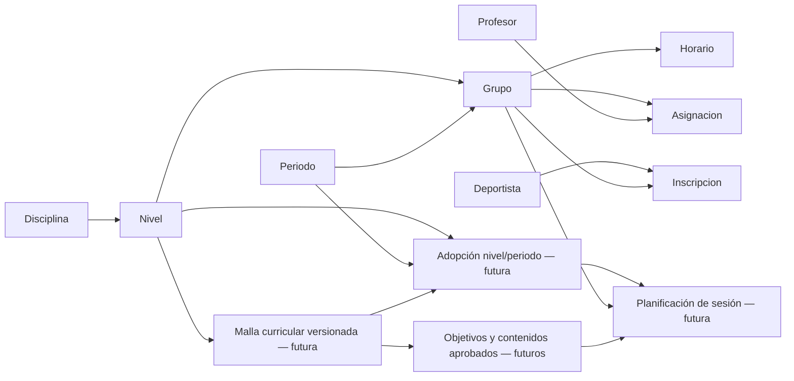

# Revisión de la organización real de Zona de Bloque

**Fecha:** 29 de octubre de 2026. **Estado:** diagnóstico y propuesta para revisión; no autoriza implementación.

Único archivo creado en este encargo: este documento. Se inspeccionaron código, pruebas existentes y documentación; no se ejecutaron operaciones de negocio, consultas a PostgreSQL, pruebas con fixtures, migraciones ni cambios de código. No se crearon grupos, profesores o inscripciones. No hubo commits ni push.

## 1. Conclusión y organización confirmada

La arquitectura actual **soporta la base de esta organización sin duplicar niveles ni deportistas**: cada grupo tiene nivel, periodo, horarios y cupo propios; las asignaciones docentes son múltiples y fechadas; las inscripciones enlazan una identidad permanente con grupos diferentes.

No es necesario crear «Nivel 1 entre semana» y «Nivel 1 domingo» como niveles distintos. Deben ser grupos independientes que referencien el mismo Nivel 1 institucional de Escalada. La trayectoria del deportista sigue reuniendo sus distintas inscripciones.

| Nivel institucional | Entre semana | Sábado | Domingo |
| --- | --- | --- | --- |
| Lúdico | Oferta confirmada | Oferta confirmada | Oferta confirmada |
| Nivel 1 | Oferta confirmada | No indicada | Oferta confirmada |
| Nivel 2 | Oferta confirmada | No indicada | Oferta confirmada |
| Escuela de especialización semicompetitiva | Oferta confirmada | No indicada | No indicada |
| Alto rendimiento | Oferta confirmada | No indicada | No indicada |

Son nueve combinaciones de oferta confirmadas, **no un inventario de nueve grupos existentes ni un límite a su número**. Puede haber varios grupos de una misma combinación, con códigos, franjas y cupos diferentes. «No indicada» no debe convertirse sin aprobación en una prohibición irreversible para abrir oferta futura.

La malla común de un nivel tampoco implica mismo ritmo de ejecución: un grupo de domingo y uno de varios días entre semana pueden trabajar los mismos objetivos con distinta distribución de clases. Esa adaptación pertenece a planificación futura, no a copias de la malla.

## 2. Evidencia técnica y alcance de la verificación

Fuentes principales inspeccionadas:

- `backend/organizacion/models.py`, `servicios.py`, `alcance.py`, `serializers.py`, `views.py` y `consultas.py`.
- `backend/inscripciones/models.py`, `servicios.py`, `serializers.py`, `views.py` y pruebas de inscripciones/cupos.
- `backend/deportistas/models.py`, `permisos.py` y pruebas base de Fase 3.
- `frontend/src/paginas/Propuestas.jsx` y `frontend/src/componentes/FormularioRegistro.jsx`.
- [Plan de Fase 3](PLAN_FASE_3_DEPORTISTAS.md) y documentación de implementación. Sus cifras y propuestas históricas no sustituyen al código actual ni a esta decisión institucional.
- [LEEME del paquete metodológico](investigacion_deportiva/ZONA_DE_BLOQUE_PAQUETE_MAESTRO_V01/00_LEER_PRIMERO/LEEME_PAQUETE_MAESTRO.md) y [borrador F03](investigacion_deportiva/ZONA_DE_BLOQUE_PAQUETE_MAESTRO_V01/03_MANUAL_Y_FORMATOS/F03_ESPECIFICACION_SESION_ZONA_DE_BLOQUE.md), usados solo para identificar dependencias y material no aprobado.

Las conclusiones de comportamiento se basan en trazado del código y lectura de pruebas. **No se afirma una nueva ejecución de la suite ni una auditoría de los registros existentes de la escuela.** Los ejemplos de jornadas que aparecen aquí son escenarios de análisis, no datos creados.

## 3. Diagnóstico por modelo

| Entidad actual | Qué permite actualmente | Límite o ajuste identificado |
| --- | --- | --- |
| Disciplina / Nivel | Nivel único por disciplina y código; varios grupos pueden apuntar al mismo nivel | No contiene malla curricular ni sus versiones. `orden` no define por sí mismo reglas de promoción |
| Grupo | Código global único, disciplina, nivel, periodo, estado y cupo independiente | No existe campo jornada ni oferta por jornada. No contiene un plan de días por alumno |
| Periodo | Ciclo con fechas y estado, compartible entre todos los grupos que correspondan | No es una jornada; no hace falta duplicarlo por sábado/domingo. Fechas con historial no deben reescribirse |
| Horario | Varias franjas por grupo, día semanal, horas, estado y duración derivada | Sin vigencia fechada por franja ni calendario de excepciones. La inscripción se considera vinculada a todas las franjas activas |
| Asignacion | Relación profesor–grupo repetible para grupos/niveles distintos, con inicio y fin | No especifica qué franja imparte cada profesor; la asignación cubre el grupo completo |
| Deportista / Inscripcion | Identidad permanente y múltiples vínculos históricos con grupos; una inscripción conserva su origen cuando hay traslado | No existe «un único grupo» ni un nivel global automático del deportista. El cambio de nivel actual opera sobre una inscripción |

La migración de catálogos `organizacion.0002_catalogos_iniciales` define los cinco niveles institucionales de Escalada. El nombre «Escuela de especialización semicompetitiva» y la denominación abreviada utilizada por la escuela describen el mismo nivel; no deben originar dos registros por una diferencia de presentación.

### 3.1 Independencia de grupos y periodos

Dos grupos del mismo nivel pueden compartir periodo y tener días, profesores y cupos propios. Cuando un grupo tiene asignaciones o inscripciones históricas, `guardar_grupo` impide cambiar su disciplina, nivel o periodo: debe crearse otro grupo cuando cambie esa estructura. Esto protege la interpretación del historial.

El código único de Grupo tampoco se reutiliza automáticamente en cada periodo. Se necesita una convención de identificación de cohortes/grupos, no convertir el nivel en identidad del grupo. No se propone renombrar códigos existentes en este encargo.

### 3.2 Profesores con varios grupos y niveles

**Soportado actualmente.** No hay una unicidad que limite a un profesor a un solo grupo, nivel o jornada. `validar_asignacion` verifica cuenta activa, rol, vigencia dentro del periodo, duplicados de la misma asignación y cruces con otros grupos del mismo profesor.

El cruce exige coincidencia de fechas, día semanal y horas. Por tanto, dirigir Nivel 1 entre semana y Nivel 2 domingo es compatible si las franjas no se superponen. Franjas contiguas se admiten por las comparaciones estrictas de horas; no hay margen de desplazamiento entre sedes ni disponibilidad personal adicional modelados.

Las fechas de asignación incluyen su día final. Al guardar horarios de un grupo se revalidan asignaciones afectadas y se revierte la transacción si aparece un conflicto. Administrador/coordinador gestionan la operación; el profesor no se asigna ni modifica privilegios.

**Límite que debe confirmarse:** si varios profesores se reparten días del mismo grupo, el modelo actual no representa ese reparto; cada asignación se contrasta con todas las franjas del grupo. Esto puede bloquear una combinación que sería viable por días o atribuir responsabilidad demasiado amplia. No se debe resolver duplicando niveles. Si cada grupo tiene profesores responsables de todas sus franjas, no se requiere esa ampliación; si hay reparto por franja, habrá que diseñarlo expresamente.

### 3.3 Inscripciones simultáneas del mismo nivel

**Soportadas actualmente.** `Inscripcion` no impone exclusividad por deportista/periodo/nivel; las restricciones de duplicado se refieren a la misma pareja deportista–grupo y sus fechas. `validar_nueva` admite otro grupo del mismo nivel cuando hay cupo, vigencia y compatibilidad horaria.

`cruzan` compara días semanales y horas solo en la intersección de fechas. Un Nivel 1 entre semana y un Nivel 1 domingo, con días distintos, no produce un cruce. Se cuentan las reservas vigentes de suspensión; una ausencia informal no elimina el conflicto ni libera una plaza.

La inscripción adicional **no es un traslado**: agrega otra inscripción sin cerrar la primera. Un traslado cierra la inscripción origen y abre una continuación en otro grupo; el deportista no cambia de identidad. La prueba existente `test_grupos_contiguos_compatibles_misma_identidad` y la de propuesta de inscripción adicional cubren la base de esta capacidad. El caso exacto entre semana/domingo necesita una regresión explícita futura; no se ejecutó en este análisis.

## 4. Diferenciar jornadas sin duplicar niveles

### Solución mínima recomendada

Mantener Nivel institucional y crear/administrar grupos independientes por oferta real. Usar código y nombre comprensibles, por ejemplo «Escalada · Nivel 1 · Entre semana · [ciclo]» y «Escalada · Nivel 1 · Domingo · [ciclo]». Son convenciones ilustrativas, no nombres o registros aprobados para cargar.

La jornada puede presentarse inicialmente como clasificación derivada de los **horarios activos**:

- Solo lunes a viernes: entre semana.
- Solo sábado: sábado.
- Solo domingo: domingo.
- Combinación de categorías o ausencia de franjas: mixta/sin definir, para revisión; no asignar una clasificación falsa.

En el modelo actual los días son 0–6, de lunes a domingo. Esta derivación no necesita modificar datos ni migrar, aunque implementarla en respuesta/filtros requeriría autorización posterior de código. No usar la cadena del código del grupo como fuente definitiva de validación.

### Cuándo justificar un campo explícito

Si se necesita filtrar/reportar por jornada de forma estable, incluso antes de configurar horarios, proponer un campo de jornada en Grupo, validado contra sus franjas. Su incorporación exigiría migración y revisión de grupos anteriores, sin reclasificarlos automáticamente de forma ambigua. No crear relaciones de jerarquía o supervisión nuevas por ello.

La oferta nivel/jornada/ciclo podría documentarse primero como configuración institucional. Solo si se necesita impedir automáticamente combinaciones fuera de oferta conviene una configuración explícita y modificable. No codificar la matriz confirmada como una limitación permanente de los niveles ni inventar horarios, cantidades de grupos o cupos a partir de ella.

## 5. Asistencia parcial dentro de un grupo

### Lo que ocurre hoy

Una inscripción implica el calendario completo del grupo. No hay una relación «esta persona solo asiste los martes» ni un plan individual de días. Si el grupo entrena martes y jueves, el control de incompatibilidad considera ambos días, aunque exista un acuerdo verbal de asistir solo uno.

El caso de un alumno con **dos grupos completos compatibles** ya está resuelto por dos inscripciones. El caso de un alumno que usa **solo parte del horario de un mismo grupo** es distinto y requiere una decisión institucional antes de basar en él cupos, cruces o futuras ausencias.

### Propuesta y separación de conceptos

Si la asistencia parcial es una modalidad real recurrente, proponer un **plan de participación previsto por inscripción**, no un registro de asistencia ni una ficha duplicada del deportista. Debe indicar franjas autorizadas, fechas de vigencia, responsable y versiones históricas. Las franjas deben pertenecer al grupo y conservar trazabilidad si cambia su horario. Toda modificación revalidaría conflictos del alumno y compatibilidad de la organización.

La futura asistencia contrastará presencia real con las sesiones esperadas según ese plan y el calendario efectivo. No se debe marcar falta a quien no estaba programado ese día ni inferir asistencia porque tenía plaza. Las sesiones canceladas y excepciones de calendario también deberán tenerse en cuenta; hoy no están implementadas.

**Recomendación conservadora inicial:** mientras no se apruebe una política diferente, cada inscripción parcial ocuparía una plaza completa de su grupo. No reducir la ocupación actual por una promesa de no asistir ni inventar plazas fraccionarias. Si la escuela desea compartir capacidad entre alumnos de días distintos, se necesitará cupo por franja/fecha y control concurrente para cada franja; el algoritmo actual de ocupación por fechas no basta.

Decisiones pendientes: si se admite esta modalidad; qué días puede elegir el alumno; si exige autorización de gestión; vigencias/cambios; si consume plaza completa o por franja; y cómo afecta al seguimiento. No crear estos planes ni asistencia en la presente revisión.

## 6. Malla curricular institucional compartida: diseño futuro

La malla no debe depender de Profesor ni duplicarse por Grupo o jornada. El ancla debe ser **Nivel**, que ya pertenece a una Disciplina. Los contenidos aprobados se versionan institucionalmente y se referencian.

Propuesta conceptual, sin fijar todavía migraciones:

| Entidad futura | Responsabilidad |
| --- | --- |
| MallaCurricular | Versión institucional de la malla de un nivel; unicidad nivel/número de versión, estado, responsables, aprobación y referencia documental |
| ComponenteCurricular | Objetivos, unidades, temas o contenidos efectivamente aprobados, pertenecientes a esa versión; estructura a validar con las mallas fuente |
| AdopcionCurricularNivelPeriodo | Versión institucional adoptada para nivel y periodo; los grupos con esa pareja la comparten sin copiar contenido |
| Planificación de sesión futura | Grupo/fecha/profesor autorizado y referencias a los objetivos de la versión adoptada; adaptaciones pedagógicas sin reescribir la malla |

La recomendación para esta empresa es una versión común por nivel/ciclo, no una elección libre diferente por cada profesor. Definir una transición institucional si debe cambiar durante el ciclo; preservar las referencias históricas de las sesiones. Si la escuela requiere una misma versión simultánea incluso entre periodos distintos que se solapan, aprobar una regla de vigencia institucional por nivel antes de implementar la adopción. No suponer esa política a partir de un campo `activo`.

Relación conceptual:

El profesor podrá distribuir objetivos, elegir actividades y adaptar sesiones a alumnos y frecuencia de su grupo dentro del marco aprobado. Las adaptaciones conservarán autor, fecha, referencia al objetivo y justificación cuando corresponda; no crearán una nueva malla canónica por clase o por alumno. Compartir objetivos tampoco exige repetir la misma clase en la misma semana calendario en todas las jornadas.

**Material preliminar:** el paquete de investigación declara que F03/F04/F05 y los inventarios son borradores, no contenidos aprobados ni datos para importar. F03 identifica pendientes en las mallas de Nivel 1 y Especialización y ausencia de malla propia aportada para Alto rendimiento. No rellenar esos vacíos por deducción ni trasladar sus ejemplos/tiempos a reglas institucionales. No se leyeron o importaron los Excel privados en este encargo.

La definición de malla, planificación, sesiones, asistencia y evaluación requiere fases y aprobaciones posteriores. No se implementa ninguno de esos módulos por documentar su relación.

## 7. Propuestas docentes: diagnóstico preciso del destino

### 7.1 Interfaz actual

`Propuestas.jsx` consulta deportistas de su ámbito, inscripciones activas y grupos autorizados, pero los selectores son independientes. El origen no se filtra por el deportista seleccionado; el destino no se filtra por el origen/tipo. El selector compartido muestra grupos disponibles de la API sin excluir el mismo grupo ni relaciones de nivel incompatibles. Cambiar el tipo remonta el formulario, pero cambiar un deportista dentro del formulario no limpia de forma coordinada origen/destino.

Por ello puede mostrarse el origen como destino. Los nombres genéricos y la tabla «Grupo [id]» dificultan comprender las diferencias de jornada, nivel y periodo. Conviene reutilizar la experiencia de selectores buscables incorporada en [la mejora de cupos](MEJORA_SELECTORES_CUPOS.md), pero un selector legible por sí solo no determina destinos válidos.

### 7.2 Qué impide realmente el backend

| Caso | Al crear propuesta: `proponer` | Al aprobar/aplicar |
| --- | --- | --- |
| Traslado al mismo grupo | **No hay comparación explícita de PK origen/destino**; si no existe otro conflicto de pendientes puede guardarse | `trasladar_bajo_bloqueo` rechaza destino idéntico antes de cerrar origen |
| Cambio de nivel al mismo grupo o mismo nivel | Rechazado: el tipo nivel exige niveles diferentes | Se revalidan operación y permisos; no debe llegar como destino válido |
| Traslado a distinto nivel | Rechazado por incompatibilidad entre tipo y niveles | Solo el flujo pedagógico de cambio de nivel permite esa transición |
| Origen de otra persona/no autorizado | Se comprueba pertenencia al deportista, estado y asignación del docente | Se comprueban versión y ámbito nuevamente |
| Destino fuera de asignación del profesor | Rechazado por queryset/validación y asignación efectiva | Se revalida el ámbito del autor antes de ejecutar |
| Cupo agotado, horarios incompatibles, estructura inactiva o destino ya inscrito | No hay una prevalidación completa de viabilidad en `proponer` | La creación efectiva revalida cupo, duplicado, estructura, fechas y horarios bajo transacción |

Este es un hallazgo por inspección del flujo; no se enviaron POST para reproducirlo en la base. Mostrar la opción no significa que todos esos destinos puedan ejecutarse. El traslado al mismo grupo es, principalmente, una propuesta inválida aceptada demasiado pronto, no una inscripción duplicada aplicada automáticamente.

Las restricciones de una propuesta pendiente por origen y por deportista/destino pueden hacer que una propuesta imposible bloquee otra útil hasta cancelarla. Además, solo se admiten propuestas para la fecha operativa actual: si quedan para otro día, aprobarlas produce conflicto y no se convierten automáticamente en nuevas propuestas. Debe explicarse y permitir resolución/cancelación auditada de las obsoletas, sin eliminarlas.

### 7.3 Filtrado mínimo recomendado, sin ampliar permisos

Diseñar un formulario controlado específico de propuestas, reutilizando controles existentes, que conozca tipo, deportista y origen. No introducir comportamiento pedagógico global en el formulario genérico.

1. Elegir deportista autorizado. En traslado/nivel, ofrecer solo sus inscripciones efectivamente activas y autorizadas como origen; no mezclar las de otros alumnos.
2. Cambiar deportista limpia origen y destino. Cambiar origen o tipo invalida el destino anterior y obliga a reevaluar candidatos.
3. Inscripción adicional: no hay origen que cerrar. Destinos sin inscripción/reserva incompatible o duplicada, compatibles por fechas y horarios. Admitir otro grupo del mismo nivel; no confundirlo con traslado.
4. Traslado: excluir siempre el grupo de origen; misma disciplina y mismo nivel.
5. Cambio de nivel: excluir origen y grupos del mismo nivel; misma disciplina y transición pedagógica permitida por una regla aprobada. Un valor de `Nivel.orden` no autoriza automáticamente ascensos, descensos o saltos.
6. En todos los casos, filtrar estructura activa y vigencia, horarios definidos y viabilidad conocida de cupo/compatibilidad. Mostrar código, nombre, nivel, jornada y periodo. Una indisponibilidad no justifica revelar datos de otros deportistas.
7. Incorporar validación anticipada equivalente en Django, particularmente destino distinto del origen, sin retirar la validación final de aprobación. Las consultas de candidatos no deben liberar reservas ni escribir estados.
8. Resolver candidatos en backend con paginación/búsqueda, o mediante consultas ya autorizadas que garanticen todos los datos necesarios. No limitar la validación a excluir elementos de la primera página descargada ni a lógica de React. Una consulta de viabilidad no reserva una plaza.

Una ruta de candidatos específica podría recibir deportista, tipo, origen y fecha, validando primero el ámbito del actor y devolviendo únicamente metadatos de destinos pertinentes. No se crea ni se aprueba esa ruta ahora. Crear y aprobar deben revalidar por separado: cupos, asignaciones o inscripciones pueden cambiar entre ambas acciones. No cerrar realmente la inscripción origen para simular un candidato; proyectar ese cierre solo dentro del cálculo sin escrituras.

### 7.4 Decisión institucional sobre destinos de otro profesor

Actualmente el docente debe estar asignado **al origen y al destino**, tanto en el ámbito vigente como para la fecha efectiva. Un profesor que solo trabaja entre semana no puede proponer por esta vía un destino de domingo impartido exclusivamente por otra persona. Un profesor de un nivel tampoco puede proponer hacia otro que no dirige. Es una restricción de seguridad implementada, no un error del selector.

Opciones para decidir:

- **Conservar ámbito actual:** el selector solo muestra sus destinos propios; gestión/coordinación ejecuta los traslados administrativos del mismo nivel que correspondan. No presentar esa vía como una solución completa para promociones: el cambio de nivel sigue exigiendo propuesta docente y decisión coordinadora, por lo que el caso entre profesores puede quedar bloqueado.
- **Ampliación acotada de propuesta, recomendada para evaluar:** permitir al docente del origen proponer destinos institucionales compatibles mediante una consulta de metadatos mínimos, sin darle acceso a alumnos, acudientes o datos privados del destino. El coordinador revisa y decide el cambio de nivel; administrador/coordinador mantienen sus facultades administrativas actuales. Esto requiere aprobar explícitamente la política y ajustar el backend, no saltarse `grupos_permitidos` desde React.

Antes de programar debe elegirse la regla. No se recomienda conceder una asignación docente ficticia al destino para sortear el permiso ni permitir al profesor ejecutar su propuesta directamente.

## 8. Impactos y riesgos que requieren decisión

### Cupos, horarios e historial

Los cupos son por grupo: una persona con dos inscripciones compatibles ocupa una plaza en cada grupo y cuenta una sola vez como identidad institucional. No sumar inscripciones como si fueran deportistas distintos en el tablero. Reservas vigentes también ocupan plaza y pueden bloquear reincorporaciones incompatibles. Mantener las comprobaciones de concurrencia del último cupo.

Al cambiar horarios o reducir capacidad, el backend actual revalida alumnos/reservas y asignaciones docentes; esas protecciones deben seguir activas. El historial de Horario conserva filas desactivadas cuando se reemplazan, pero carece de vigencias fechadas completas. No afirmar que eso permite reconstruir qué horario rigió exactamente en cualquier fecha pasada. La planificación/asistencia futura necesita una estrategia temporal que no reinterprete el pasado con los horarios activos actuales.

El cupo de cada grupo tampoco comprueba por sí solo el aforo conjunto del espacio cuando coinciden grupos distintos. Si se requiere control de uso compartido del muro o recursos, definirlo posteriormente con datos y criterios aprobados, sin inventar capacidades físicas.

### Cambio de nivel con varias inscripciones

Este es el principal punto pedagógico pendiente. `Deportista` no tiene un único nivel actual: los niveles se conocen a través de sus inscripciones. El cambio de nivel actual sustituye **una** inscripción y conserva la otra historia, no traslada automáticamente todas las inscripciones del alumno.

En altas normales se rechaza concurrencia de niveles diferentes de la misma disciplina sin decisión pedagógica. Sin embargo, el flujo aprobado de cambio de nivel utiliza `permitir_nivel=True`, que omite ese control frente a otras inscripciones de la persona. Así, alguien en Nivel 1 entre semana y domingo podría cambiar solo su inscripción entre semana a Nivel 2 y mantener la de domingo en Nivel 1 si no hay cruces. El código actual no obliga a resolver las dos ubicaciones como un ascenso global.

Debe decidirse si se admite esa coexistencia pedagógica, o si un ascenso afecta a todas las inscripciones vigentes de esa disciplina. Si se exige transición conjunta, diseñar una operación transaccional que planifique todos los cierres/destinos y valide todos los cupos antes de confirmar; nunca cerrar todo automáticamente por aplicar una propuesta individual. No fabricar cambios retroactivos ni sobrescribir los niveles de los grupos anteriores.

### Seguimiento y permisos

El profesor consulta el ámbito de sus grupos y alumnos vigentes; compartir malla no concede acceso a todos los deportistas del nivel. La coordinación activa conserva supervisión operativa global y la decisión de cambios de nivel. El administrador conserva gestión institucional; no sustituye automáticamente la aprobación pedagógica reservada al coordinador.

El futuro seguimiento debe identificar objetivo y versión curricular, deportista y contexto de grupo/sesión. Trabajar un objetivo en dos jornadas no duplica el objetivo institucional ni debe contar dos veces una supuesta promoción automática. Las adaptaciones, observaciones y evidencias futuras no equivalen por sí solas a evaluaciones aprobadas o ascensos.

## 9. Qué funciona, qué ajustar y qué posponer

| Categoría | Elementos |
| --- | --- |
| Funciona con los modelos actuales | Grupos independientes por jornada; nivel/periodo compartidos; varios profesores y niveles por persona con validación de cruces; varios grupos compatibles del mismo nivel por deportista; cupos/reservas por grupo; identidad e historial permanentes |
| Ajuste mínimo de código a proponer | Presentación de jornada derivada y etiquetas; formulario dependiente de propuestas; excluir origen; rechazar anticipadamente propuestas inviables; explicar alcance/fecha y limpiar selecciones; pruebas específicas entre semana/domingo |
| Decisión funcional previa | Destinos de otro profesor; efecto del cambio de nivel sobre varias inscripciones; participación parcial y su cupo; profesores repartidos por franjas; tratamiento de propuestas que vencen de un día a otro |
| Posibles cambios de esquema, solo si se aprueban | Jornada explícita; vigencias completas de horarios; participación por franjas; atribución docente por franja; coordinación transaccional de cambios múltiples si exige nuevas entidades |
| Fases posteriores | Malla institucional versionada y adopción por nivel/ciclo; planificación grupal/adaptaciones; sesiones, asistencia, seguimiento y evaluación con reglas propias |

No se necesita alterar las claves actuales ni duplicar niveles, mallas o identidades para distinguir jornadas. Tampoco se necesita una jerarquía de múltiples coordinadores o una cuenta diferente por cada grupo de un profesor.

## 10. Orden de implementación recomendado y pruebas de aceptación

1. **Cerrar decisiones institucionales**: ámbito de destinos, ascenso con varias inscripciones, participación parcial y reparto docente por días. Documentar la oferta confirmada sin convertirla en datos inventados.
2. **Corregir primero propuestas** con alcance aprobado: backend y formulario coordinados, metadatos legibles, origen/destino coherentes y validación anticipada. No cambiar permisos implícitamente. Mantener aprobación transaccional y auditoría.
3. **Distinguir jornadas de forma mínima**, primero por nombre/horarios y clasificación derivada; solo introducir campo o configuración si el uso real lo exige. Confirmar horarios y cupos reales mediante una actuación independiente, sin siembras automáticas.
4. **Resolver temporalidad/participación parcial antes de asistencia o planificación que dependan de ella**. Si no se admite asistencia parcial, comunicar que se inscribe al grupo completo y mantener el cómputo conservador. Si se admite, diseñar vigencias y validación antes de permitir excepciones.
5. **Aprobar y versionar la malla institucional por nivel**, completar los vacíos fuente y definir adopción por ciclo. No importar los inventarios preliminares ni inventar Alto rendimiento.
6. **Planificación y seguimiento posteriores**, referenciando esa malla y las asignaciones/participación vigentes. Sesiones, asistencia y evaluaciones permanecen en sus fases autorizadas correspondientes.

Pruebas a añadir tras autorización, únicamente en entornos aislados:

- Un profesor con niveles diferentes entre semana y domingo; rechazo de cruces reales, aceptación de franjas contiguas y conservación de asignaciones históricas.
- Un deportista en dos grupos del mismo nivel, entre semana y domingo, con una identidad, dos plazas y sin conflicto; rechazo de duplicado en el mismo grupo y de reserva incompatible.
- Matriz de jornadas: varias franjas entre semana, solo sábado, solo domingo y datos mixtos/incompletos sin clasificación engañosa.
- Propuesta de traslado al mismo grupo rechazada al crear; cambio de nivel al mismo nivel rechazado; origen de otro alumno no ofrecido ni aceptado; selecciones limpiadas al cambiar contexto.
- Destino completo, inactivo, fuera de vigencia o ya ocupado por el alumno; búsquedas/páginas que no omitan candidatos válidos; reevaluación de cupo/horario al aprobar, incluido acceso directo a API.
- Transferencia entre profesores según la política finalmente aprobada, sin ampliar consulta de alumnos ajenos; relevo/desactivación y cambio de asignación entre propuesta y decisión.
- Ascenso con dos grupos del mismo nivel: comportamiento definido explícitamente, conservación de historia, sin cierre o promoción global no autorizados.
- Si se aprueba participación parcial: días esperados, cupos según regla escogida, cambios de horario/plan y coherencia del futuro denominador de asistencia.
- Una sola malla/version para los grupos del mismo nivel/ciclo, adaptaciones sin modificar el canon y preservación de versiones anteriores. Contenido no aprobado no puede publicarse como currículo vigente.
- Regresión de autenticación, ámbito docente, cupos, reservas, historial y concurrencia.

**Punto de parada:** diagnóstico terminado. Revisar esta propuesta y resolver las decisiones señaladas antes de autorizar programación. No se modificó el sistema ni se aplicó ninguna migración por este documento.
